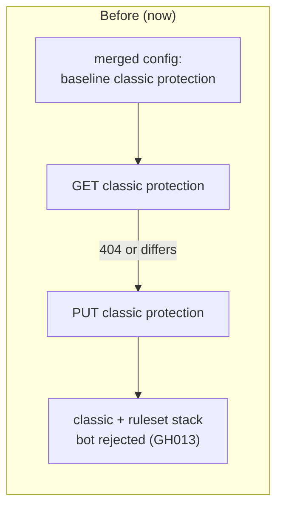
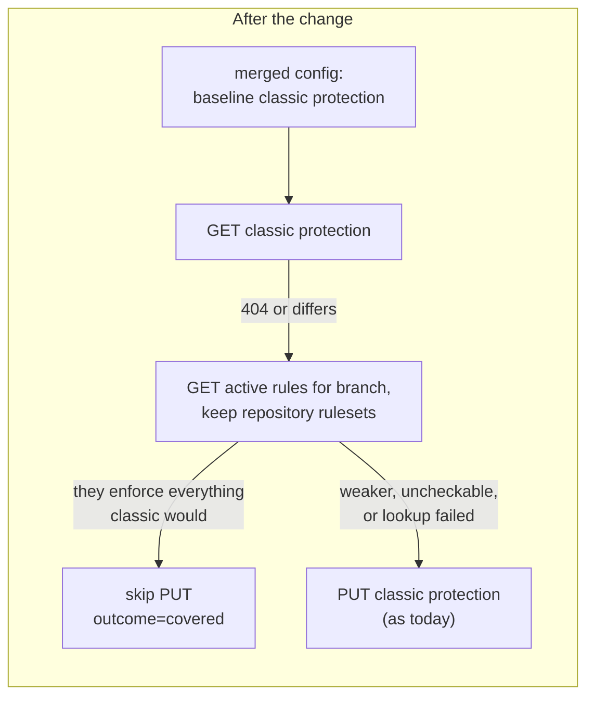
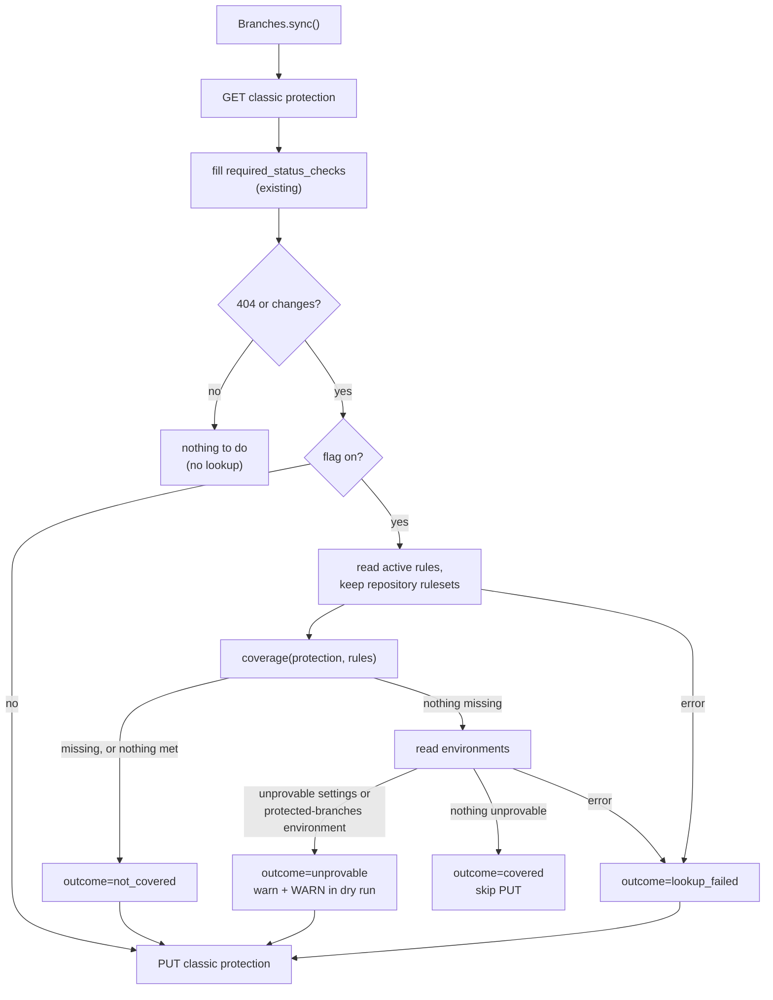

# Change Design: Skip classic branch protection on branches that a repository ruleset already covers

**Date:** 2026-11-23
**Artifact:** change-design
**Status:** Draft
**Template version:** default/0.3.2
**References:** [IDXART-899](https://tomtom.atlassian.net/browse/IDXART-899) · [#sig-github thread (navapp-automotive, 28 Oct 2026)](https://tomtomslack.slack.com/archives/C019Z1686CB/p1793277602784629) · [draft PR #28](https://github.com/tomtom-forks/safe-settings/pull/28)

**Plugin version:** 0.7.11
**Agent Sessions:** claude-code: a173e73d-6559-498e-a9e8-c496830d80d7, claude-code: 2b652d20-1c13-4864-b4e7-5435aa271747
**Revised:** 2026-11-23, after the four review comments on PR #28 and a re-check of the first draft's claims against live data (see Key facts).

---

<!-- hint: Keep the `**Artifact:** change-design` line — /plan and /implement use it to recognize this as a change-design artifact (requirements + design in one file) and skip the prd.md requirement. -->

> *Section audience —* 🔍 reviewer (understand the change without implementing it) · 🛠 author (implement the change). Sections without an icon serve both.

## Summary 🔍

When a repository moves its default branch to a ruleset, safe-settings keeps writing the organization baseline's classic branch protection onto that branch (`.github/settings.yml` → `branches: - name: default`). It rewrites it when the repo drops its own `branches:` override, and it puts it back within seconds when someone deletes it. Classic protection and rulesets stack, and ruleset bypass actors do not bypass classic protection, so bots that the ruleset lets through are rejected with GH013. This hit `tomtom-internal/navapp-automotive` on 28 Oct 2026 (`navapp-release-bot`).

After this change, just before the branches plugin would write classic protection, it reads the branch's active rules and keeps the ones that come from **repository rulesets**. If those rules enforce everything the classic protection about to be written enforces, the write is skipped. Existing classic protection is never deleted. In every other case (weaker rules, a setting that can't be checked, a failed lookup) classic protection is applied exactly as today. When only uncheckable settings stand in the way, the logs and the PR check name them.

Two supporting changes keep a covered branch from being left without protection. The branches plugin waits for the rulesets plugin within a sync. And, as a rollout step, both GitHub Apps subscribe to `repository_ruleset` events, so a human edit of a covering ruleset re-syncs that repo. An env flag turns the behavior off.

## Background & problem 🔍

safe-settings merges the org baseline, suborg and repo configs. The branches plugin (`lib/plugins/branches.js`) then reads the branch's classic protection and sends `PUT /repos/{owner}/{repo}/branches/{branch}/protection` when it is missing (404) or differs from the config. It knows nothing about rulesets.

**What happened to navapp.** Its repo file had a `branches:` override whose classic protection let its bots through (`bypass_pull_request_allowances` listed `navapp-release-bot` and three other apps). `admin#8592` removed the override in favor of repository ruleset 80723, which was created outside safe-settings. safe-settings then wrote the baseline: `allow_deletions: false`, `allow_force_pushes: false`, `required_conversation_resolution: true`, `required_pull_request_reviews` with 1 approval and code owners, and no allowances. The bots were blocked. Deleting the classic rule by hand does not help today: GitHub sends a `branch_protection_rule` event and safe-settings puts the rule back. Navapp's workaround is a repo override with `required_pull_request_reviews: null` (`admin#8630`).

Navapp's live rules on `master` show that ruleset 80723 already enforces everything the baseline does: `deletion`, `non_fast_forward`, and `pull_request` with `required_approving_review_count: 1`, `require_code_owner_review: true` and `required_review_thread_resolution: true`. GitHub is also steering repos this way with its tool that migrates branch protection rules to rulesets, so more repos will hit this.

**Why only repository rulesets count.** After a skip, a branch can have no classic protection, so the ruleset is the only thing protecting it. When that ruleset stops covering the branch, safe-settings has to look at the repo again to put classic protection back. In prod it only looks at a repo when an event about that repo arrives: the cron is off for good, because one full pass costs about 100–200k API calls against a 15k/hour budget. A change to a repository ruleset produces an event about that one repo, and a single-repo sync repairs it. A change to an organization ruleset can affect thousands of repos, and there is no affordable way to re-check them. So organization and enterprise rules do not count toward coverage (CD-D-18).

**How a repo moves to rulesets after this change:**
1. Make a repository ruleset active that enforces what the baseline does (in the repo's config file, with GitHub's migration tool, or in the UI).
2. Remove the repo's `branches:` override, if it has one.
3. Delete the classic protection rule once, by hand. safe-settings no longer puts it back while the ruleset covers the baseline.

If the ruleset is later removed or weakened, classic protection returns at the next sync of that repo.





## Goals and non-goals

### Goals

**G1: Classic protection is not written on a branch that repository rulesets fully cover**
- [ ] G1-AC1 — Navapp replay: with the org baseline config, no classic protection on `master` (GET returns 404) and navapp's live rules on `master`, a sync sends no `PUT …/branches/master/protection` and logs `BRANCH_RULES repo=<owner>/<repo> branch=master outcome=covered` · `verify: nock test; the PUT interceptor counts its calls and the count is 0`
- [ ] G1-AC2 — When classic protection already exists and differs from the config, and repository rules cover the config, no PUT and no DELETE is sent; the existing classic protection is left as it is · `verify: nock test`
- [ ] G1-AC3 — Rules from organization and enterprise rulesets are ignored. Next to a covering repository ruleset they change nothing (still no PUT). A branch whose requirements are met only with the help of an organization rule gets the PUT · `verify: nock tests with fixtures that mix rule sources`
- [ ] G1-AC4 — In a dry run (PR check), the branches plugin returns no result for a covered branch; for a repo whose only configured branch is covered, the PR check shows no ✋ in the branches column · `verify: nock test in nop mode on a single-branch config`
- [ ] G1-AC5 — For `name: default`, the rules lookup uses the repo's actual default branch name, not `default` · `verify: nock interceptor on rules/branches/master only`

**G2: Classic protection is still applied whenever repository rules don't prove full coverage**
- [ ] G2-AC1 — No repository ruleset on the branch (the response holds only enterprise or organization rules) → PUT is sent with the same body as today · `verify: nock test asserts the PUT body`
- [ ] G2-AC2 — A repository ruleset in `evaluate` mode → PUT is sent. GitHub leaves evaluate-mode rules out of the response (checked live on dev, CD-D-15) · `verify: nock test with the response GitHub gives for such a branch`
- [ ] G2-AC3 — A repository ruleset that targets another branch (e.g. `develop`) → PUT is sent for `master` · `verify: nock test; the master lookup returns no repository rules`
- [ ] G2-AC4 — Rules weaker than the classic config → PUT is sent. Cases: no `pull_request` rule; `required_approving_review_count` lower than configured; `require_code_owner_review: false` when the config requires code owners; a configured status-check context missing from the rules · `verify: nock tests, one per case`
- [ ] G2-AC5 — `allow_deletions` and `allow_force_pushes` left out of the config count as `false` (GitHub's default, so classic blocks deletion and force push) and require `deletion` and `non_fast_forward` rules · `verify: nock test with both keys omitted and no such rules → PUT`
- [ ] G2-AC6 — A setting that can't be checked against rules → PUT is sent. Cases: `enforce_admins: true`; non-null `restrictions`; non-empty `dismissal_restrictions`; any key or sub-key the mapping does not know with a non-null value; an environment in the repo with `deployment_branch_policy.protected_branches: true` · `verify: nock test per case`
- [ ] G2-AC7 — A lookup fails (rules or environments; 403, 404, 5xx, network error) → PUT is sent as today and the log line has `outcome=lookup_failed status=<http status>` at warn · `verify: nock tests with 403 and 500 replies on each lookup`
- [ ] G2-AC8 — Removing protection (`protection: null`, `{}`, `[]`, `false`) works as today: DELETE is sent and no lookup is made · `verify: existing unit tests stay green; nock test asserts no lookup request`
- [ ] G2-AC9 — A protection config that requires nothing checkable (for example `allow_deletions: true` and `allow_force_pushes: true` with nothing else) is never `covered`: the PUT is sent · `verify: nock test`

**G3: The outcome of every check is visible to operators and, when it matters, to the PR author**
- [ ] G3-AC1 — Every check logs exactly one line, in syncs and dry runs: `BRANCH_RULES repo=<owner>/<repo> branch=<b> outcome=<covered|unprovable|not_covered|lookup_failed>`, followed by `missing=<settings>` and `unprovable=<settings>` when those lists are not empty. `covered` and `not_covered` log at info, `unprovable` and `lookup_failed` at warn · `verify: nock tests assert the line for each outcome`
- [ ] G3-AC2 — In a dry run with outcome `unprovable`, the PR check summary has a "Breakdown of warnings" section that names the repo, the branch and the unprovable settings, one line per branch even when several branches of one repo are affected; the check conclusion stays `success` · `verify: Settings test renders the summary for a repo with two such branches; E2E PR check`
- [ ] G3-AC3 — Outcomes `covered` and `not_covered` add nothing to the PR check warnings · `verify: nock tests assert no WARN result`

**G4: A ruleset changed in the same sync is seen by the branches plugin**
- [ ] G4-AC1 — For each repo, the branches plugin's sync starts only after the rulesets plugin's sync has settled, whether it succeeded or failed; other plugins start as today; a rulesets failure is reported as today · `verify: Settings unit test with fake plugins that record start and finish, including a rejecting rulesets plugin, for both repo-sync paths`
- [ ] G4-AC2 — On dev, removing the covering ruleset from a repo's config file brings classic protection back in that same sync · `verify: E2E`

**G5: The behavior can be switched off without redeploying an older image**
- [ ] G5-AC1 — With `BRANCHES_SKIP_IF_RULESET_COVERS=false`, no lookup request is made and classic protection is applied as today; unset or any other value means on · `verify: nock test asserts no lookup request and one PUT`

**G6: Branches already in sync cost no extra API call**
- [ ] G6-AC1 — The rules lookup is made only when a PUT is about to be sent (classic missing, or differs from the config). The environments lookup is made only when the rules leave nothing missing · `verify: nock tests assert the exact lookup requests per case`

**G7: A covered branch gets classic protection back when its ruleset stops covering it**
- [ ] G7-AC1 — A `repository_ruleset` event for a repository ruleset, sent by a human, syncs that repo; if the branch is no longer covered, classic protection is written · `verify: E2E on dev: disable the covering ruleset in the UI, classic protection is back within minutes and before the next cron tick`
- [ ] G7-AC2 — A `repository_ruleset` event for an organization ruleset starts no sync · `verify: unit test drives the registered handler through a fake robot; Settings.syncAll is not called`

### Non-goals

- Deleting existing classic protection when rules cover it (CD-D-2).
- Skipping on organization or enterprise rulesets (CD-D-18). A branch covered only by those keeps classic protection, as today.
- Healing after a ruleset change made by a Bot other than safe-settings' own sync. Events from Bot senders are dropped, as they are for classic protection today.
- Comparing who may bypass a ruleset with who was exempt from classic protection (CD-D-1).
- `protection: null` overrides and the admin schema in `tomtom-internal/admin`.
- Moving the classic baseline to org rulesets (PERFC_029_01).
- Making the dry run aware of rulesets that the same PR adds: the PR check may show a classic PUT that the real sync then skips.
- Repairing the broken `test/integration/` harness (CD-D-7).

## Architecture

The change is one check in the branches plugin's write path, one ordering rule in `Settings`, one guard in an event handler, and a warnings section in the PR check.

**Where the check sits.** `Branches.sync()` keeps its flow: resolve the branch name (`default` → the repo's default branch), GET classic protection, fill `required_status_checks` from the current value when the config omits it (`useCurrentRequiredStatusChecksIfNotOverridden`), compare. On the two paths that end in `updateBranchProtection` (GET returned 404, or `compareDeep` found changes) it first calls one new method. On the "changes" path the call comes before the dry-run `NopCommand` that carries the compared additions, modifications and deletions, so a covered branch adds no branches change to the PR check. The method does nothing when the flag is off. It compares the config's protection after the status-check fill, so status checks that would be re-sent also have to be covered.

**The lookups.** The method reads the branch's active rules with `github.paginate(github.repos.getBranchRules, { owner, repo, branch })` and keeps those whose `ruleset_source_type` is `Repository`. Only when the comparison leaves nothing missing does it read the repo's environments (`GET /repos/{owner}/{repo}/environments`, paginated). Any error in either lookup gives outcome `lookup_failed`, and classic protection is applied.

**The comparison.** A pure function in a new module, `lib/plugins/branchRulesCoverage.js`: `coverage(protection, rules)` returns `{ met, missing, unprovable }`, three lists of classic setting names (sub-settings dotted, e.g. `required_pull_request_reviews.require_code_owner_reviews`). It walks the keys of the protection config and the sub-keys of `required_pull_request_reviews` and `required_status_checks`, and looks each one up in a mapping table. The requirements come from the config, not from a fixed list. A requirement is met when any of the rules satisfies it, because GitHub enforces every active rule.

| Classic setting (config) | Requires a rule when | Met by a repository rule |
|---|---|---|
| `allow_deletions` | `false` or omitted | `deletion` |
| `allow_force_pushes` | `false` or omitted | `non_fast_forward` |
| `required_linear_history` | `true` | `required_linear_history` |
| `required_signatures` | `true` | `required_signatures` |
| `block_creations` | `true` | `creation` |
| `lock_branch` | `true` | `update` |
| `required_conversation_resolution` | `true` | `pull_request` with `required_review_thread_resolution: true` |
| `required_pull_request_reviews` | non-null | a `pull_request` rule exists, and per sub-key: `required_approving_review_count` N → rule count ≥ N (omitted counts as 1); `require_code_owner_reviews: true` → `require_code_owner_review: true`; `dismiss_stale_reviews: true` → `dismiss_stale_reviews_on_push: true`; `require_last_push_approval: true` → `require_last_push_approval: true`; `bypass_pull_request_allowances` → nothing (it exempts, does not enforce); `dismissal_restrictions` non-empty → unprovable |
| `required_status_checks` | non-null | every configured context (`contexts[]` or `checks[].context`) appears in a `required_status_checks` rule; a `checks[]` entry with a positive `app_id` needs the same `integration_id`; `strict: true` needs `strict_required_status_checks_policy: true` |
| `enforce_admins` | `true` | unprovable (the response has no bypass lists) |
| `restrictions` | non-null | unprovable (no rule is a push allowlist) |
| `allow_fork_syncing` | never | — (it only relaxes `lock_branch`) |
| any other key or sub-key | non-null value | unprovable |
| an environment with `protected_branches: true` | it exists in the repo | unprovable, listed as `environment:<name>` |

The last row is not a classic setting. GitHub's documentation defines "Protected branches only" environments in terms of branch protection rules, and user reports say rulesets do not count. Removing the last classic rule could then let every branch deploy to such an environment. The check keeps classic protection in those repos whatever GitHub's behavior is.

**The outcome.** One rule, in this order:

1. Something is missing, or no requirement is met → `not_covered`. Classic protection is applied as today.
2. Otherwise, something is unprovable → `unprovable`. Classic protection is applied as today, the log line is a warning, and a dry run also returns a `NopCommand` of type `WARN`.
3. Otherwise → `covered`. No PUT and no `NopCommand`.

**Plugin order.** A new helper in `Settings`, used by both places that start a repo's plugins (lib/settings.js:418 and :449), starts every plugin as today except branches, which starts once the rulesets plugin has settled. The reason is a race in the unsafe direction. If a config change removes or weakens a ruleset on a branch that has no classic protection, a parallel branches plugin can still read "covered" and skip. The follow-up event comes from safe-settings itself, a Bot, so it is dropped, and the branch stays unprotected until the repo's next sync. Waiting closes that. It also makes classic protection a safety net when the rulesets plugin deletes a ruleset and fails to re-create it.

**Events.** The `repository_ruleset` handler (index.js:324) already syncs the repo when a human changes a repository ruleset. It is dormant because neither App subscribes to the event. Subscribing is a rollout step. One line of the handler has to change first: for an organization ruleset it calls `syncAllSettings`, a full org sync. With the guard, an event for a ruleset that is not a repository ruleset returns without syncing.

**PR check warnings.** `handleResults` dedups results by (type, repo, plugin), which would keep only one warning per repo, so `WARN` results are exempt from that dedup. It collects them into `stats.warnings[repo]`, which does not set `error`. `lib/commentmessage.js` renders a "Breakdown of warnings" section after the errors section, so the check stays green.



## Components

- **`lib/plugins/branchRulesCoverage.js`** (new) — pure `coverage(protection, rules)` with the mapping table; no API calls.
- **`lib/plugins/branches.js`** — one method called before both `updateBranchProtection` paths: flag check, the two lookups, the outcome rule, the log line, the `WARN` result.
- **`lib/settings.js`** — one helper that starts a repo's plugins with branches waiting for rulesets, replacing the two duplicated blocks; `WARN` results exempt from the dedup and collected into `stats.warnings`.
- **`lib/commentmessage.js`** — "Breakdown of warnings" section.
- **`lib/env.js`** — `BRANCHES_SKIP_IF_RULESET_COVERS` (default `'true'`).
- **`index.js`** — the `repository_ruleset` handler returns without syncing for rulesets that are not repository rulesets.
- **`test/unit/lib/plugins/branchRulesCoverage.test.js`** (new) — table-driven tests of the mapping.
- **`test/unit/lib/plugins/branches-rules.nock.test.js`** (new) — nock on `api.github.com` plus a real `ProbotOctokit`, driving `Branches.sync()`, with a navapp fixture taken from the live response.
- **`test/unit/lib/plugins/branches.test.js`** — the jest-mocked `github` gains `paginate` and `log.warn`, so existing PUT expectations still hold.
- **`test/unit/lib/settings.test.js`** — plugin-order test (G4-AC1) and summary rendering test (G3-AC2).
- **`test/unit/index-ruleset-event.test.js`** (new) — the handler guard (G7-AC2). The existing `test/unit/index.test.js` is skipped as a whole (`describe.skip`), so this test registers the handlers on a fake robot.
- **`TOMTOM.md`** — §3 patch row, §4 flag, §5 the `BRANCH_RULES` marker, and the three-step migration flow from Background.

## Testing & verification

**Unit and nock tests.** The per-goal `verify:` hints cover them. One rule for every nock test: `Branches.sync()` catches a failed PUT and returns normally, so an unmatched request does not fail a test by itself. Each test therefore registers the PUT as an optional interceptor that counts its calls, asserts that count (0 or 1) and the PUT body, and asserts the plugin collected no errors.

**Rollout order (dev, then prod).** Deploy the new build first, then subscribe that environment's App to `repository_ruleset`, in the same change window. The old build's handler would start a full org sync on a human edit of an organization ruleset. The Apps are `repo-safe-settings-dev` and `repo-safe-settings`; both already have the Administration permission the event needs, and subscribing is done in the App's settings by an App manager.

**End-to-end, on safe-settings-dev** (org `tomtomsptesting`, config repo `tomtomsptesting/admin`). It touches tomtomsptesting only, never tomtom-internal. A sync is triggered by the event of the step itself, or by merging a PR that touches the repo's file; dev's hourly cron is the fallback. Each check reads `GET /repos/tomtomsptesting/<repo>/branches/main/protection` and the safe-settings-dev logs.

Setup:
1. Create four repos with `gh repo create tomtomsptesting/<name> --private --add-readme`: `ss899-covered`, `ss899-plain`, `ss899-near-miss`, `ss899-env`. The names avoid the `restrictedRepos.exclude` globs in `apps/safe-settings-dev/values.yaml`. Wait until each `main` has the baseline classic protection (GET returns 200).
2. One PR in `tomtomsptesting/admin` adds repo files for `ss899-covered`, `ss899-near-miss` and `ss899-env`, each with this ruleset and no `branches:` section. All five `pull_request` parameters are required by the API:

```yaml
rulesets:
  - name: ss899-cover
    target: branch
    enforcement: active
    conditions:
      ref_name:
        include: ["~DEFAULT_BRANCH"]
        exclude: []
    rules:
      - type: deletion
      - type: non_fast_forward
      - type: pull_request
        parameters:
          required_approving_review_count: 1
          dismiss_stale_reviews_on_push: false
          require_code_owner_review: true
          require_last_push_approval: false
          required_review_thread_resolution: true
```

3. On `ss899-env`, create an environment `prod` with `deployment_branch_policy: { protected_branches: true, custom_branch_policies: false }`.
4. Before reading any result, confirm the setup: `GET /repos/tomtomsptesting/<repo>/rulesets` lists `ss899-cover` as `active` on the three repos, and `GET …/rules/branches/main` lists `deletion`, `non_fast_forward` and `pull_request` with `ruleset_source_type: Repository`. A ruleset rejected with a 422 shows up here, not in a check run.

**Red, on rc.9 (now).** On `ss899-covered`, delete the classic protection by hand (`DELETE …/branches/main/protection`). It is back within minutes although the ruleset is active. This records the bug.

**Green, on rc.10,** after the deploy and the dev App subscription (CD-D-8):
1. `ss899-covered`: delete classic protection by hand. GET stays 404 after the event's sync and after the next cron tick; the log shows `outcome=covered`.
2. `ss899-plain`: delete classic protection by hand. It is back; the log shows `outcome=not_covered`.
3. `ss899-env`: delete classic protection by hand. It is back; the log shows `outcome=unprovable unprovable=environment:prod`.
4. `ss899-near-miss`: open a PR that adds a `branches: default` override with `enforce_admins: true`. The check summary shows the warning and stays green. After the merge, classic protection is present and the log shows `outcome=unprovable unprovable=enforce_admins`.
5. Heal on a human edit (G7-AC1): on `ss899-covered`, disable the ruleset in the UI. Classic protection is back within minutes, before the next cron tick. Re-enable the ruleset and delete classic protection again: it stays deleted.
6. Heal on a config change (G4-AC2): a PR removes `rulesets:` from `ss899-covered.yml`. After that sync, classic protection is back, written under the same delivery `id` as the ruleset deletion.

Only after green does rc.10 go to prod. Afterwards the four repos and their files are deleted.

## Decisions 🔍

| ID | Title | Context | Options | Choice | Rationale | Source | Goal impact | Consequences |
|----|-------|---------|---------|--------|-----------|--------|-------------|--------------|
| CD-D-1 | What "covered" means | The skip must never lower what the config asks for | Fixed checklist of rule types; compare against live rules, derived from the protection config | Covered only if the branch's active rules (from repository rulesets, see CD-D-18) enforce everything the classic protection about to be applied enforces; requirements derived from the config | No hardcoded policy; follows whatever the merged config says | `user` | G1, G2 | Coverage is computed from live state at each write. Who may bypass is not compared: the response has no bypass lists, and repo admins control a repository ruleset's bypass list. That is the purpose (bots), and an accepted risk |
| CD-D-2 | Covered branch with existing classic protection | Rules may cover a branch that still has classic protection | Skip only; skip and delete; delete behind a flag | Skip only: no PUT, no DELETE | The ticket is "stop putting it back". Automatic deletion is a destructive write across the org | `user` | G1-AC2 | Classic protection is removed once by hand (step 3 of the migration flow). Drift in leftover classic protection on a covered branch is no longer corrected. In navapp's case the old override's rule, with its bot allowances, would simply have stayed |
| CD-D-3 | A lookup fails | 403/5xx/network leaves coverage unknown | Apply classic; skip PUT; skip the branch with an error | Apply classic as today, `outcome=lookup_failed` at warn | A failure must never leave a branch less protected than today | `user` | G2-AC7 | A stacked-protection case until the next successful sync. Octokit reports a network error as status 500, so `status=` is always a number |
| CD-D-4 | Settings that can't be checked | `enforce_admins: true`, `restrictions`, `dismissal_restrictions` and unknown keys have no checkable rule. In `admin/.github`, 565 repo and suborg files set `enforce_admins: true`, 192 `restrictions`, 163 `dismissal_restrictions` | Not covered; ignore them; ignore only `enforce_admins` | Not covered: classic is applied, and it is made visible (CD-D-5) | Matches CD-D-1; those repos keep exactly today's behavior; a new GitHub key can't silently weaken protection | `user` | G2-AC6, G3 | Repos with these settings get no skip until their config drops them |
| CD-D-5 | How the `unprovable` outcome is shown | User requirement: very visible in the logs and obvious to the PR author. `CREATE_PR_COMMENT` is `"false"` in prod and dev, so the check summary is the only channel | Warnings section, green check; extra table column; fail the check | "Breakdown of warnings" section, check stays green, plus a warn log line. Shown only for outcome `unprovable` | Names repo, branch and settings where the author looks, without blocking unrelated edits. A broader trigger ("some rule matches") would fire on every repo once an org ruleset such as code signing is active | `user` (section, green); `auto` (trigger) | G3 | A ruleset that is simply weaker produces no PR warning; its `missing=` list is in the log line |
| CD-D-6 | A ruleset changed in the same sync | The rulesets and branches plugins run in parallel (`Promise.all`, lib/settings.js:418 and :449); 173 files define `rulesets:` | Branches waits for rulesets; also read configured rulesets in the dry run; accept and document | Branches starts after rulesets has settled, success or failure | Closes the unsafe race (a ruleset removed by config while classic is absent, see Architecture) and the harmless one (a ruleset added and seen too late). Waiting on a settled promise keeps branches running when rulesets fails | `user` (order); `auto` (settled, and the unsafe race found in review) | G4 | The dry run of a PR that adds a ruleset still shows a classic PUT that the real sync skips |
| CD-D-7 | Where the nock tests live | `test/integration/` fails before any test (`createProbot` → `appId option is required` under probot 13) and CI runs only `test:unit:ci` | New nock test under `test/unit`; repair the harness; both | `test/unit/lib/plugins/branches-rules.nock.test.js`, nock 14 + real `ProbotOctokit` | Real HTTP, runs in CI. Confirmed with a probe that nock 14 intercepts `ProbotOctokit` | `user` | all `verify:` hints | Tests must count PUT calls explicitly (see Testing): the plugin swallows PUT errors |
| CD-D-8 | Build for the green E2E | TOMTOM.md §6: image X only from git tag X; `main` squash-merges | Tag main after merge; pre-release tag on branch; local throwaway image | Red on rc.9 now; merge, tag `2.1.18-tomtom-rc.10` on main, deploy to dev, subscribe the dev App, green, then prod | Same path as rc.8 and rc.9 | `user` | E2E | A failed green means fix forward with rc.11, never prod |
| CD-D-9 | E2E scope | The first draft had six repos, including an evaluate-mode repo and an active org ruleset scoped to one repo | Keep six; four repos | Four repos: covered, plain, near-miss, environment | The two dropped cases were checked live on dev on 2026-11-23 (CD-D-15), and org rules no longer count (CD-D-18). A "new repo never gets classic" case depended on creation order, so the ordering proof is now "remove the ruleset by config" | `auto` (user asked for the simplest plan; reverses the earlier pick of a scoped org ruleset) | E2E | No change to dev's org rulesets or `settings.yml` |
| CD-D-10 | Kill switch | Only other rollback is redeploying rc.9 | Env flag, default on; no flag | `BRANCHES_SKIP_IF_RULESET_COVERS`, on unless `false` | Same convention as `COLLABORATORS_MEMBERS_ONLY` | `user` | G5 | Turning it off needs a values.yaml edit and a pod restart |
| CD-D-11 | When the lookups run | Each lookup is an API call | Before every compare; only before a PUT | Rules: only on the two paths that would PUT. Environments: only when the rules leave nothing missing | Branches in sync pay nothing | `auto (API budget, 15k/hour)` | G6 | A covered branch pays GET protection, GET rules and GET environments on every sync of its repo, because classic stays absent or different |
| CD-D-12 | Mapping semantics | Classic defaults differ per key; GitHub may add keys | Map only present keys; apply GitHub's defaults | Omitted `allow_deletions`/`allow_force_pushes` count as `false`; an omitted `required_approving_review_count` counts as 1; `bypass_pull_request_allowances` and `allow_fork_syncing` require nothing; unknown non-null keys and sub-keys are unprovable; a config that requires nothing checkable is never covered | Mirrors what the PUT would enforce, and fails toward classic. `block_creations` and `lock_branch` are mapped because navapp's own ruleset translates `block_creations` to `creation`, and each key needs a row for its polarity anyway | `auto (GitHub update-branch-protection defaults; navapp ruleset 80723)` | G2-AC5, G2-AC6, G2-AC9 | The mapping table is the one place to extend when GitHub adds a setting |
| CD-D-13 | Several rules of one type | Two rulesets can each have a `pull_request` rule | The strictest single rule must meet all; any rule per requirement | A requirement is met if any repository rule meets it | GitHub enforces every active rule, so their effects add up | `auto (rules endpoint semantics)` | G1 | Coverage can come from several repository rulesets together |
| CD-D-14 | Status-check matching | Classic has `contexts[]` or `checks[{context, app_id}]`; rules have `{context, integration_id}` | Context only; context + app | Context must be present; a positive `app_id` must equal `integration_id`; `strict: true` needs `strict_required_status_checks_policy: true` | Matches what classic enforces without over-constraining checks that accept any source | `auto (navapp rules fixture; classic API shape)` | G2-AC4 | UI-set classic checks that the existing fill re-sends must also be in a rule, or classic stays |
| CD-D-15 | Evaluate-mode rulesets | The rules response has no enforcement field | Fetch each ruleset to check; trust the endpoint | Trust the endpoint | GitHub documents that evaluate and disabled rules are not returned. Checked live on 2026-11-23: dev repo `gregor` is targeted by two evaluate org rulesets and the response contains none of their rules | `auto (GitHub REST docs; live check)` | G2-AC2 | No extra calls |
| CD-D-16 | Pagination | Both lookups are paged | Single call; `github.paginate` | `github.paginate` for both | The convention in this codebase (labels, teams, rulesets). A truncated environments list could hide a protected-branches environment | `auto` | G2-AC6 | The jest-mocked `github` in existing tests needs a `paginate` stub |
| CD-D-17 | Log format | Operators and support need to see why classic was or wasn't written | Three markers; one marker with an outcome | One marker, `BRANCH_RULES … outcome=…`, in syncs and dry runs | One row in TOMTOM.md §5 and one Loki query. `missing=` answers "why did classic come back?" | `auto (CD-D-5)` | G3-AC1 | Dry runs add lines to Loki; correlate by delivery `id` as with `RECONCILE_DONE` |
| CD-D-18 | Which rulesets count | A skipped branch depends on its ruleset staying in place. Prod has no usable full sync (cron off: about 100–200k calls per pass against 15k/hour), so a change to an org ruleset cannot be re-checked across its repos | Repository rulesets only; repository and organization | Repository rulesets only | Every skip then rests on state a single-repo sync can re-check. Leaving branches unprotected with no way to repair it is not acceptable in prod | `user` (narrows the original "repo + org" decision) | G1-AC3, G7 | A branch covered only by org or enterprise rules keeps classic protection, as today, so a bot that is a bypass actor only on an org ruleset is still blocked; that is for PERFC to solve by removing the classic baseline. When the PERFC rulesets go active, nothing changes for safe-settings. No `custom_property_values` subscription is needed |
| CD-D-19 | How a covered branch heals | Neither App subscribes to `repository_ruleset` (checked 2026-11-23). The handler exists, but for an org ruleset it starts a full org sync | Subscribe and guard the handler; also accept Bot senders; accept the gap | Subscribe both Apps as a rollout step, after the build with the guard is deployed; the handler ignores rulesets that are not repository rulesets; Bot senders stay dropped | A human edit of a covering ruleset then re-syncs that repo in seconds, the same healing classic protection has today. Bot changes are not healed for classic today either | `user` (subscribe, from the PR review); `auto` (guard, after confirming there is no usable full sync) | G7 | Subscribing also wakes existing behavior: a human edit of a ruleset that safe-settings manages is reverted at once instead of at the repo's next sync. A human edit of an org ruleset triggers nothing |
| CD-D-20 | Environments limited to protected branches | GitHub's docs define that policy by branch protection rules; a community report says rulesets don't count (not verified live; the branches API does report `protected: true` for a ruleset-only branch). 6 repo configs set `protected_branches: true`, and UI-made environments are not in config | Check environments; ignore | An environment with `protected_branches: true` makes the outcome `unprovable` | Safe whichever way GitHub behaves, for one GET on the skip path only | `user` (PR review) | G2-AC6 | Those repos keep classic protection until GitHub's behavior is confirmed |

## Key facts & assumptions

- **Invariant: classic protection is skipped only when active repository rules enforce every requirement it sets.** Every unknown, failure or uncheckable setting falls back to today's PUT.
- **Accepted gaps, both named in the Decisions table.** Who may bypass a repository ruleset is not compared (CD-D-1). A ruleset change made by a Bot other than safe-settings' own sync is not healed until the repo's next sync (CD-D-19).
- **Checked live on 2026-11-23.** The rules endpoint returns repository, organization and enterprise rules in one list with the same shape, and leaves out evaluate-mode rulesets. Neither App subscribes to `repository_ruleset` or `custom_property_values`. nock 14 intercepts a real `ProbotOctokit`. The unit-test baseline is 158 passing.
- **Not verified:** whether GitHub counts rulesets for "Protected branches only" environments (CD-D-20). The design does not depend on the answer.
- Every TomTom branch carries enterprise rules (`repository_visibility`, `repository_transfer`). They are ignored like all non-repository rules.
- Navapp's existing override (`required_pull_request_reviews: null`) keeps working unchanged. Once this ships, its `branches:` override can be dropped; the classic protection that remains is left alone, and can be deleted by hand.
