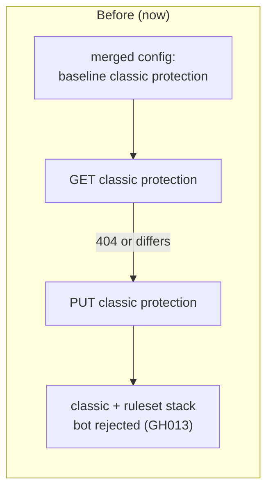
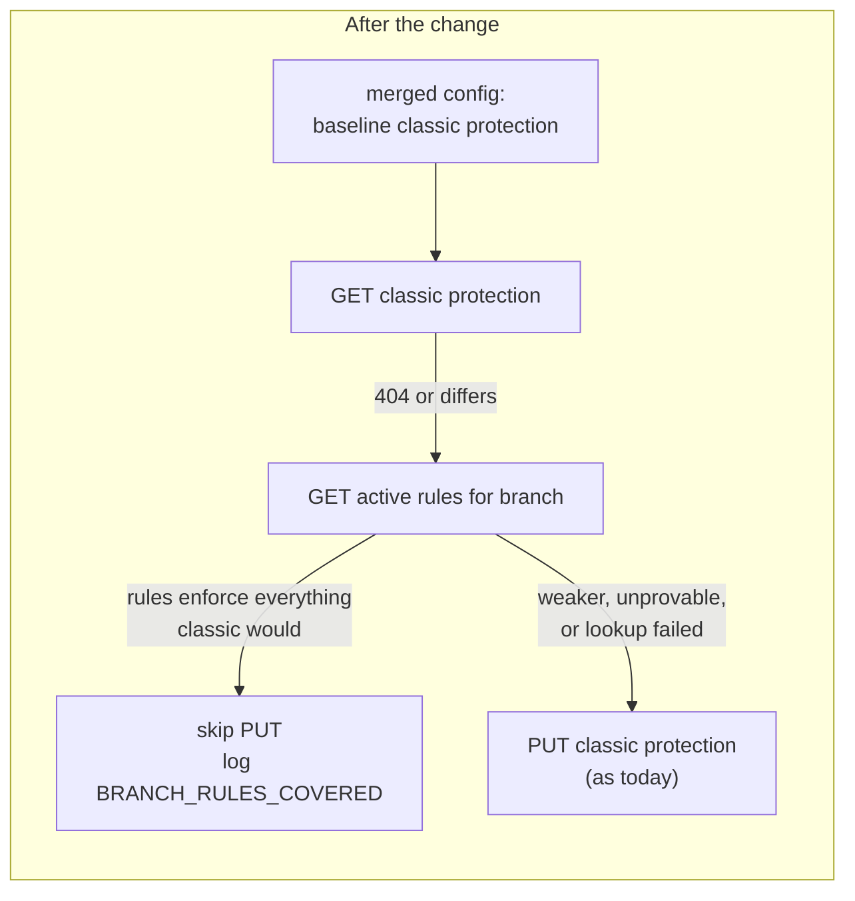
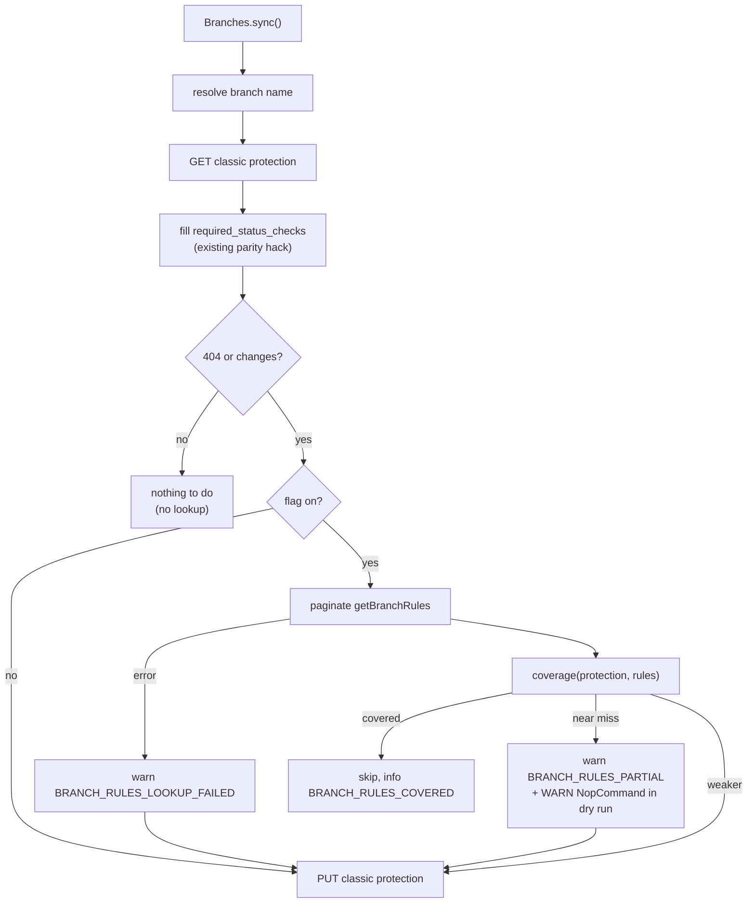

# Change Design: Skip classic branch protection on branches that active rulesets already cover

**Date:** 2026-11-23
**Artifact:** change-design
**Status:** Draft
**Template version:** default/0.3.2
**References:** [IDXART-899](https://tomtom.atlassian.net/browse/IDXART-899) · [#sig-github thread (navapp-automotive, 28 Oct 2026)](https://tomtomslack.slack.com/archives/C019Z1686CB/p1793277602784629)

**Plugin version:** 0.7.11
**Agent Sessions:** claude-code: a173e73d-6559-498e-a9e8-c496830d80d7, claude-code: 2b652d20-1c13-4864-b4e7-5435aa271747
**Self-review:** CAP_REACHED — round-2 findings fixed, not re-reviewed. Round-2 findings (verbatim, condensed to their first sentence): (1) "Invariant overstated: Key facts says 'this change never makes a branch less protected than its config asks.'" (2) "Contradiction on who manages org rulesets." (3) "G4-AC1's ordering anchor is wrong. … `Branches.sync()` first issues `GET /repos/{owner}/{repo}` (`repos.get`), not GET protection." (4) "G1-AC4's observable is per-repo, behavior per-branch." (5) "Omitted `required_approving_review_count` is undefined." (6) "Which object is compared is ambiguous." (7) "G5-AC2 is not externally testable." (8) "Minor: near-miss warning can fire with no rules present."

---

<!-- hint: Keep the `**Artifact:** change-design` line — /plan and /implement use it to recognize this as a change-design artifact (requirements + design in one file) and skip the prd.md requirement. -->

> *Section audience —* 🔍 reviewer (understand the change without implementing it) · 🛠 author (implement the change). Sections without an icon serve both.

## Summary 🔍

When a repository protects its default branch with a ruleset and drops its own `branches:` override, safe-settings re-applies the organization baseline (`.github/settings.yml` → `branches: - name: default`) and recreates classic branch protection. Classic protection and rulesets stack, and ruleset bypass actors do not bypass classic protection, so bots that the ruleset lets through are rejected with GH013. This happened to `tomtom-internal/navapp-automotive` on 28 Oct 2026 (`navapp-release-bot`).

After this change, the branches plugin asks GitHub which rules are active on the branch (`GET /repos/{owner}/{repo}/rules/branches/{branch}`, repository and organization rulesets) just before it would write classic protection. If those rules enforce everything the classic protection about to be written enforces, the write is skipped. It never deletes classic protection that already exists. If the rules are weaker, can't be proven equal, or the lookup fails, classic protection is applied exactly as today. Near misses (rules cover everything except a setting the rules response can't prove, such as `enforce_admins: true`) are logged as a warning and shown in the PR check. The `rulesets` plugin now runs before `branches` for each repo, so a ruleset created in the same sync is seen. An env flag turns the whole behavior off.

## Background & problem 🔍

safe-settings merges the org baseline, suborg and repo configs, then the branches plugin (`lib/plugins/branches.js`) reads the branch's classic protection and sends `PUT /repos/{owner}/{repo}/branches/{branch}/protection` when it is missing (404) or differs from the config. It knows nothing about rulesets.

Repositories are moving their default-branch protection to rulesets, both repo rulesets (navapp's ruleset 80723, created outside safe-settings; 173 repo and suborg files in `admin/.github` define `rulesets:`) and, later, the PERFC_029_01 org rulesets (declared in `admin/.github/settings.yml`, in `evaluate` today, to flip to `active`; created by github-as-code, not by safe-settings). Which tool creates an org ruleset does not matter here: the rules endpoint returns its active rules either way. The safe-settings `rulesets` plugin is enabled in this fork (registered in `Settings.PLUGINS`; the "Disabled in TomTom deployment" comment at lib/settings.js:1116 is stale) and syncs the repo-level `rulesets:` sections. Once a repo drops its `branches:` override, the baseline's classic protection comes back: `allow_deletions: false`, `allow_force_pushes: false`, `required_conversation_resolution: true`, `required_pull_request_reviews` (1 approval, code owners). Its PR requirement blocks direct pushes from bots that the ruleset lets bypass. Navapp's current workaround is a repo override with `required_pull_request_reviews: null` (`admin#8630`).

Navapp's live rules on `master` show the ruleset already enforces everything the baseline does: `deletion`, `non_fast_forward`, and `pull_request` with `required_approving_review_count: 1`, `require_code_owner_review: true` and `required_review_thread_resolution: true`, plus enterprise rules (`repository_visibility`, `repository_transfer`) that every TomTom branch carries.

## Goals and non-goals

### Goals

**G1: Classic protection is not written on a branch that active rules fully cover**
- [ ] G1-AC1 — Navapp replay: with the org baseline config, no classic protection on `master` (GET returns 404) and navapp's live rules on `master`, a sync sends no `PUT …/branches/master/protection` and logs `BRANCH_RULES_COVERED repo=<owner>/<repo> branch=master` · `verify: nock test; nock fails on any unmatched request and the scope must be done`
- [ ] G1-AC2 — When classic protection already exists and differs from the config, and the rules cover the config, no PUT and no DELETE is sent; the existing classic protection is left as it is · `verify: nock test`
- [ ] G1-AC3 — Rules that come only from an organization ruleset (`ruleset_source_type: Organization`) count the same as repository rules · `verify: nock test with an org-sourced fixture; E2E scoped org ruleset`
- [ ] G1-AC4 — In a dry run (PR check), the branches plugin returns no result for a covered branch; for a repo whose only configured branch is covered, the PR check shows no ✋ in the branches column · `verify: nock test in nop mode on a single-branch config`
- [ ] G1-AC5 — For `name: default`, the rules lookup uses the repo's actual default branch name, not `default` · `verify: nock interceptor on rules/branches/master only`

**G2: Classic protection is still applied whenever the rules don't prove full coverage**
- [ ] G2-AC1 — No ruleset on the repo (rules response holds only enterprise rules such as `repository_visibility`) → PUT is sent with the same body as today · `verify: nock test asserts the PUT body`
- [ ] G2-AC2 — A ruleset in `evaluate` mode → PUT is sent (GitHub omits evaluate-mode rules from the rules response) · `verify: E2E on ss899-evaluate is the proof (the rules response is GitHub's, so a nock reply can only restate the assumption; see CD-D-15)`
- [ ] G2-AC3 — A ruleset that targets another branch (e.g. `develop`) → PUT is sent for `master` · `verify: nock test; the master lookup returns enterprise rules only`
- [ ] G2-AC4 — Rules weaker than the classic config → PUT is sent. Cases: no `pull_request` rule; `required_approving_review_count` lower than configured; `require_code_owner_review: false` when the config requires code owners; a configured status-check context missing from the rules · `verify: nock tests, one per case`
- [ ] G2-AC5 — `allow_deletions` and `allow_force_pushes` left out of the config count as `false` (GitHub's default, so classic blocks deletion and force push) and require `deletion` and `non_fast_forward` rules · `verify: nock test with both keys omitted and no such rules → PUT`
- [ ] G2-AC6 — A config setting the rules response can't prove is covered (`enforce_admins: true`, non-null `restrictions`, non-empty `dismissal_restrictions`, or any key or sub-key the mapping does not know with a non-null value, at the top level or inside `required_pull_request_reviews` or `required_status_checks`) → PUT is sent · `verify: nock test per setting, including an unknown top-level key and an unknown sub-key`
- [ ] G2-AC7 — The rules lookup fails (403, 404, 5xx, network error) → PUT is sent as today and `BRANCH_RULES_LOOKUP_FAILED repo=<owner>/<repo> branch=<b> status=<code>` is logged at warn, where `<code>` is the HTTP status, or `none` when there is no HTTP response (network error) · `verify: nock test with 403 and 500 replies and a replyWithError`
- [ ] G2-AC8 — Removing protection (`protection: null`, `{}`, `[]`, `false`) works as today: DELETE is sent and no rules lookup is made · `verify: existing unit tests stay green; nock test asserts no lookup`

**G3: Near misses are visible to operators and to the PR author**
- [ ] G3-AC1 — When the rules cover every mapped setting and only unprovable settings (G2-AC6) keep classic protection, `BRANCH_RULES_PARTIAL repo=<owner>/<repo> branch=<b> unprovable=<comma-separated settings>` is logged at warn, in syncs and dry runs · `verify: nock test asserts the log line and the list`
- [ ] G3-AC2 — In a dry run of such a case, the PR check summary has a "Breakdown of warnings" section listing the repo, the branch and the unprovable settings, one line per branch even when several branches of one repo are near misses; the check conclusion stays `success` · `verify: Settings test renders the summary for a repo with two near-miss branches; E2E PR check`
- [ ] G3-AC3 — Rules that are simply weaker (G2-AC4), rules unrelated to the classic config (e.g. only an active `required_signatures` org rule), or a config whose mapped settings require nothing (e.g. `allow_deletions: true`, `allow_force_pushes: true`, `enforce_admins: true`) produce no warning and no `BRANCH_RULES_PARTIAL` line · `verify: nock tests assert no warn line and no WARN result`

**G4: A ruleset created in the same sync is seen by the branches plugin**
- [ ] G4-AC1 — For each repo, the `rulesets` plugin's write requests (ruleset POST/PUT) complete before the `branches` plugin's first request (`GET /repos/{owner}/{repo}`), in both repo-sync paths of `Settings` (with and without a merged `repository:` section); other plugins keep running in parallel · `verify: nock test through Settings with a real ProbotOctokit records request order; the ruleset POST reply is delayed so a parallel run would interleave`
- [ ] G4-AC2 — On dev, a new repo whose config file defines a covering ruleset from its first sync never gets classic protection · `verify: E2E`

**G5: The behavior can be switched off without a redeploy of an older image**
- [ ] G5-AC1 — With `BRANCHES_SKIP_IF_RULESET_COVERS=false`, no rules lookup request is made and classic protection is applied as today; unset or any other value means on · `verify: nock test; an unexpected lookup request fails the test`

**G6: Branches already in sync cost no extra API call**
- [ ] G6-AC1 — The rules lookup is made only when a PUT is about to be sent (classic missing, or differs from the config); a branch whose classic protection already matches the config gets no lookup · `verify: nock test; an unexpected lookup request fails the test`

### Non-goals

- Deleting existing classic protection when rules cover it. Leftover classic protection is removed once by hand (see CD-D-2).
- `protection: null` overrides and the admin schema in `tomtom-internal/admin`. They are a manual workaround that becomes unnecessary once this ships, but cleaning them up is separate.
- Moving the classic baseline to org rulesets. That is PERFC_029_01, and its rulesets are managed by github-as-code.
- Making the dry run aware of rulesets that the same PR adds (CD-D-6): the PR check may still show a classic PUT that the real sync then skips.
- Repairing the broken `test/integration/` harness (CD-D-7).

## Architecture

The change lives in the branches plugin's write path, plus a plugin-ordering change in `Settings` and a warnings section in the PR check.

**Where the check sits.** `Branches.sync()` keeps its flow: resolve the branch name (`default` → the repo's default branch), GET classic protection, fill `required_status_checks` from the current value when the config omits it (`useCurrentRequiredStatusChecksIfNotOverridden`), compare. On the two paths that end in `updateBranchProtection` (GET returned 404, or `compareDeep` found changes) it first calls a new method, `coveredByRules(params, protection)`. On the "changes" path the call comes before the dry-run `NopCommand` that carries the compareDeep additions, modifications and deletions, so a covered branch adds no branches change to the PR check. That method is skipped when the flag is off. `coverage()` receives exactly the protection body the PUT would carry (without `owner`, `repo`, `branch` and `headers`): on the 404 path after `Overrides.removeOverrides`, on the changes path `branch.protection` after the status-check fill. So UI-set status checks that would be re-sent also have to be covered. A `{{EXTERNALLY_DEFINED}}` placeholder that survives into the body is compared as a literal context name, so in practice it is uncovered and classic protection is applied.

**The lookup.** `coveredByRules` calls `github.paginate(github.repos.getBranchRules, { owner, repo, branch })`. The endpoint returns all active rules for the branch from repository, organization and enterprise rulesets; rules in `evaluate` or `disabled` rulesets are not returned. Bypass lists are not returned either. Any error falls back to "not covered" (`BRANCH_RULES_LOOKUP_FAILED`).

**The comparison.** A pure function in a new module, `lib/plugins/branchRulesCoverage.js`: `coverage(protection, rules)` returns `{ covered, uncovered: [...], unprovable: [...] }`. It walks the keys of the protection config, and the sub-keys of `required_pull_request_reviews` and `required_status_checks`. For each key it looks up a requirement in a mapping table, and the set of requirements comes from the config, not from a fixed list. A requirement is met when any returned rule satisfies it. GitHub enforces every active rule, so requirements may be met by different rules or rulesets.

| Classic setting (config) | Enforces when | Met by an active rule |
|---|---|---|
| `allow_deletions` | `false` or omitted | `deletion` |
| `allow_force_pushes` | `false` or omitted | `non_fast_forward` |
| `required_linear_history` | `true` | `required_linear_history` |
| `required_signatures` | `true` | `required_signatures` |
| `block_creations` | `true` | `creation` |
| `lock_branch` | `true` | `update` |
| `required_conversation_resolution` | `true` | `pull_request` with `required_review_thread_resolution: true` |
| `required_pull_request_reviews` | non-null | a `pull_request` rule exists, and per sub-key: `required_approving_review_count` N → rule count ≥ N (omitted counts as 1, so a rule with 0 approvals never covers a PR requirement); `require_code_owner_reviews: true` → `require_code_owner_review: true`; `dismiss_stale_reviews: true` → `dismiss_stale_reviews_on_push: true`; `require_last_push_approval: true` → `require_last_push_approval: true`; `bypass_pull_request_allowances` → nothing (it exempts, does not enforce); `dismissal_restrictions` non-empty → unprovable |
| `required_status_checks` | non-null | every configured context (`contexts[]` or `checks[].context`) appears in some `required_status_checks` rule; if a `checks[]` entry sets `app_id`, the rule entry must have the same `integration_id`; `strict: true` → some such rule has `strict_required_status_checks_policy: true` |
| `enforce_admins` | `true` | unprovable (the response has no bypass lists) |
| `restrictions` | non-null | unprovable (no ruleset rule is an allowlist) |
| `allow_fork_syncing` | — | nothing (it only relaxes `lock_branch`) |
| any other key or sub-key (top level, or inside `required_pull_request_reviews` / `required_status_checks`) | non-null value | unprovable |

`covered` is true only when both `uncovered` and `unprovable` are empty. The plugin then:

- **covered** → no PUT, logs `BRANCH_RULES_COVERED` at info, returns no NopCommand (dry run shows no branches change).
- **near miss** (`uncovered` empty, `unprovable` non-empty, and at least one mapped requirement met by a rule) → logs `BRANCH_RULES_PARTIAL … unprovable=<keys>` at warn; in a dry run also returns a `NopCommand` of type `WARN`; then applies classic protection as today.
- **otherwise** → applies classic protection as today, with a debug line naming the uncovered settings.

**Plugin order.** In `Settings.updateRepos` (both paths: with a merged `repository:` section, lib/settings.js:418, and without one, :449), the child plugins list is split: if a `rulesets` plugin is present, its `sync()` is awaited first, then the remaining plugins run in parallel as today. Org rulesets already sync before repos (`updateOrg` before `updateAll` in `syncAll`).

**PR check warnings.** `handleResults` dedups results by (type, repo, plugin), which would keep only one near-miss branch per repo, so `WARN` results are exempt from that dedup. It collects them into `stats.warnings[repo]`, which don't set `error`. `lib/commentmessage.js` renders a "Breakdown of warnings" section after the errors section, so the check stays green.

## Components

- **`lib/plugins/branchRulesCoverage.js`** (new) — pure `coverage(protection, rules)` with the mapping table above; no API calls.
- **`lib/plugins/branches.js`** — `coveredByRules()` (flag check, paginated lookup, error fallback, log markers, WARN NopCommand) called before both `updateBranchProtection` paths.
- **`lib/settings.js`** — run `rulesets` before the other child plugins in both repo-sync paths; exempt `WARN` results from the dedup and collect them into `stats.warnings` without failing the check.
- **`lib/commentmessage.js`** — "Breakdown of warnings" section.
- **`lib/env.js`** — `BRANCHES_SKIP_IF_RULESET_COVERS` (default `'true'`).
- **`test/unit/lib/plugins/branchRulesCoverage.test.js`** (new) — table-driven tests of the mapping.
- **`test/unit/lib/plugins/branches-rules.nock.test.js`** (new) — nock on `api.github.com` plus a real `ProbotOctokit`, driving `Branches.sync()` for the G1/G2/G3/G5/G6 cases, with a navapp fixture taken from the live response.
- **`test/unit/lib/plugins/branches.test.js`** — the jest-mocked `github` gains `repos.getBranchRules` and `paginate` returning enterprise-only rules, so existing PUT expectations still hold.
- **`test/unit/lib/settings.test.js`** — summary rendering test (G3-AC2); the ordering test (G4-AC1) goes in the nock test file or a sibling nock test through `Settings`.
- **`TOMTOM.md`** — §3 patch row, §4 flag `BRANCHES_SKIP_IF_RULESET_COVERS`, §5 markers `BRANCH_RULES_COVERED`, `BRANCH_RULES_PARTIAL`, `BRANCH_RULES_LOOKUP_FAILED` (a deliverable checked in review, not an acceptance criterion).

## Testing & verification

The per-goal `verify:` hints cover the nock and unit tests. A covered-case test must not pass vacuously: each one asserts `scope.isDone()` including the rules interceptor (so the lookup was made) and the `BRANCH_RULES_COVERED` log line, and nock's unmatched-request error catches any PUT. The end-to-end check runs on the dev instance **safe-settings-dev** (org `tomtomsptesting`, config repo `tomtomsptesting/admin`). It touches tomtomsptesting only, never tomtom-internal. Test repo names must not match the `restrictedRepos.exclude` globs in `apps/safe-settings-dev/values.yaml` (no `*-test`, `personal-*`, and so on). A sync is triggered by merging a PR in `tomtomsptesting/admin` that touches the repo's file, with the hourly cron as fallback. Each check reads `GET /repos/tomtomsptesting/<repo>/branches/main/protection` and the safe-settings-dev logs.

Setup (tomtomsptesting/admin, one PR):
- `ss899-repo-ruleset`: repo file with an `active` repo ruleset on `~DEFAULT_BRANCH` (deletion, non_fast_forward, pull_request with 1 approval, code owners, thread resolution), no `branches:`.
- `ss899-org-ruleset`: no repo file. `settings.yml` gets one `active` org ruleset `ss899-org-cover` with the same rules, targeted by `repository_name: [ss899-org-ruleset]` only.
- `ss899-evaluate`: repo file with the same repo ruleset in `evaluate`.
- `ss899-no-ruleset`: no repo file.
- `ss899-near-miss`: repo file with the covering repo ruleset and a `branches: default` override with `enforce_admins: true`.

**Red, on rc.9 (now).** After the setup sync, `ss899-repo-ruleset` has classic protection although its ruleset is active. Delete it by hand (`DELETE …/branches/main/protection`), re-trigger a sync: classic protection is back. Same for `ss899-org-ruleset`. This records the bug.

**Green, on rc.10.** Deploy `2.1.18-tomtom-rc.10` to dev (CD-D-8). Delete classic protection by hand on `ss899-repo-ruleset` and `ss899-org-ruleset`, re-trigger: GET stays 404 and the logs show `BRANCH_RULES_COVERED` for both. `ss899-no-ruleset` and `ss899-evaluate` have classic protection (re-created after a manual delete). `GET rules/branches/main` on `ss899-evaluate` does not list the evaluate ruleset's rules, which checks the API assumption behind G2-AC2 live. `ss899-near-miss` has classic protection, the logs show `BRANCH_RULES_PARTIAL … unprovable=enforce_admins`, and a dry-run PR touching its file shows the warning in the check summary with a green conclusion. A new repo `ss899-one-pr`, added with a covering ruleset in its first config file, never gets classic protection (G4-AC2). Only after green does rc.10 go to prod.

## Decisions 🔍

| ID | Title | Context | Options | Choice | Rationale | Source | Goal impact | Consequences |
|----|-------|---------|---------|--------|-----------|--------|-------------|--------------|
| CD-D-1 | What "covered" means | The skip must never lower protection, and must survive the org rulesets flipping to `active` | Fixed checklist of rule types; compare against live rules derived from the protection config | Covered only if the branch's active rules (repo + org, `GET …/rules/branches/{branch}`) enforce everything the classic protection about to be applied enforces; requirements derived from the config | Org-sourced rules arrive in the same response, so the flip needs no code change | `user` | G1, G2 | Coverage is computed per sync from live state; a mapping table translates settings to rules. Bypass breadth is not compared (the response has no bypass lists): a covering ruleset's bypass list replaces classic's exemptions, an accepted risk |
| CD-D-2 | Covered branch with existing classic protection | Rules may cover a branch that still has classic protection | Skip only; skip and delete; delete behind a flag | Skip only: no PUT, no DELETE, log | The ticket is "stop re-creating". Delete would run org-wide the moment the org rulesets go active | `user` | G1-AC2 | Leftover classic is removed once by hand; drift in existing classic protection on covered branches is no longer corrected |
| CD-D-3 | Rules lookup fails | 403/5xx/network leaves coverage unknown | Apply classic; skip PUT; skip branch with error | Apply classic as today, warn `BRANCH_RULES_LOOKUP_FAILED` | A failure must never leave a branch less protected than today | `user` | G2-AC7 | A rare stacked-protection case until the next successful sync |
| CD-D-4 | Settings the response can't prove | `enforce_admins: true`, `restrictions`, `dismissal_restrictions` and unknown keys have no checkable rule; 565 repo/suborg files set `enforce_admins: true`, 192 set `restrictions`, 163 `dismissal_restrictions` | Not covered; ignore them; ignore only `enforce_admins` | Not covered (classic applied), and made very visible (CD-D-5) | Matches CD-D-1; those repos keep exactly today's behavior; a new GitHub key can't silently weaken protection | `user` | G2-AC6, G3 | Repos with these settings get no skip until their config drops them |
| CD-D-5 | How near misses are shown | User requirement: very visible in logs and obvious to the PR author; `CREATE_PR_COMMENT` is `"false"` in prod and dev, so the check summary is the only channel | Warnings section, green check; extra table column; fail the check | "Breakdown of warnings" section in the check summary, check stays green, plus a warn log marker. Trigger narrowed to near misses: every mapped setting covered and only unprovable settings left | Shows repo, branch and settings where the author looks, without blocking unrelated edits. A broader "any mapped rule present" trigger fired everywhere: dev's active "Enforce commit signing" org ruleset (and prod's `code-signing` once active) maps to `required_signatures` on every branch | `user` (section, green); `auto` (trigger narrowed after finding dev ruleset 20684948 active) | G3 | Weaker-but-related rulesets stay silent (debug line only); WARN results bypass the per-repo dedup in `handleResults` |
| CD-D-6 | Ruleset created in the same sync | `branches` and `rulesets` run in parallel (`Promise.all`, lib/settings.js:419 and :449); 173 files define `rulesets:`. With CD-D-2, classic re-created by the race would stay forever | Rulesets first; also count configured rulesets in dry run; accept and document | Run `rulesets` before the other child plugins per repo | Small ordering change removes the one-PR-migration trap and keeps live rules as the single source | `user` | G4 | Dry run of a one-PR migration still shows a classic PUT that the real sync skips |
| CD-D-7 | Where the nock tests live | `test/integration/` fails before any test (`createProbot` → `appId option is required` under probot 13) and CI runs only `test:unit:ci` | New nock test under `test/unit`; repair the harness; both | `test/unit/lib/plugins/branches-rules.nock.test.js` with nock 14 + real `ProbotOctokit` | Same style as test/integration (real HTTP, nock, assert no PUT) and it runs in CI; precedent `settings-archived-transport.test.js` | `user` | all `verify:` hints | Webhook and config-loading layers are not exercised; they are unchanged |
| CD-D-8 | Build for the green E2E | TOMTOM.md §6: image X only from git tag X; `main` squash-merges | Tag main after merge; pre-release tag on branch; local throwaway image | Red on rc.9 now; merge, tag `2.1.18-tomtom-rc.10` on main, deploy to dev, green, then prod | Same path as rc.8 and rc.9; every image maps to one main commit | `user` | E2E | A failed green means fix forward with rc.11, never prod |
| CD-D-9 | E2E proof for active org rulesets | Requirement: must keep working once org rulesets go active; dev's tier rulesets target by property | Scoped active org ruleset; nock only; flip a dev tier ruleset | One `active` org ruleset in dev `settings.yml` targeting a single repo by `repository_name` | Exercises org-sourced rules end to end without touching other dev repos. On dev the ruleset is created by safe-settings' `updateOrg`; in prod github-as-code creates them, which the coverage check doesn't depend on | `user` | G1-AC3 | One extra org ruleset on dev to remove after the test |
| CD-D-10 | Kill switch | Only other rollback is redeploying rc.9 | Env flag default on; no flag | `BRANCHES_SKIP_IF_RULESET_COVERS`, on unless `false` | Same convention as `COLLABORATORS_MEMBERS_ONLY`; rollback keeps the rest of rc.10 | `user` | G5 | Turning off needs a values.yaml edit and pod restart |
| CD-D-11 | When the lookup runs | Every lookup costs one API call per branch | Before every compare; only before a PUT | Only on the two paths that would PUT | In-sync branches pay nothing; covered branches pay one GET per sync (they keep differing because classic is absent) | `auto (rate-limit history: write queue, lib/settings.js pool)` | G6 | A covered branch costs GET protection + GET rules on every sync and never converges: without classic, GET protection is 404; with leftover classic that differs from the config (CD-D-2), it keeps differing |
| CD-D-12 | Mapping semantics | Classic defaults differ by key; GitHub may add keys | Map only present keys; apply GitHub defaults | Omitted `allow_deletions`/`allow_force_pushes` count as `false` (GitHub's PUT default blocks both); an omitted `required_approving_review_count` under a non-null `required_pull_request_reviews` counts as 1 (conservative); `bypass_pull_request_allowances` and `allow_fork_syncing` enforce nothing; unknown non-null keys are unprovable | Mirrors what the PUT would actually enforce. `block_creations`/`lock_branch` stay mapped although the baseline doesn't use them: 102 repo files set them, and with direct rule equivalents (`creation`/`update`) they would otherwise become needless near-miss warnings | `auto (GitHub update-branch-protection defaults; CD-D-4; admin/.github repo file counts)` | G2-AC5, G2-AC6 | The mapping table is the only place to extend when GitHub adds a setting; unknown sub-keys are unprovable too |
| CD-D-13 | Several rules of one type | Repo and org rulesets can each have a `pull_request` rule | Strictest single rule must meet all; any rule per requirement | A requirement is met if any active rule meets it | GitHub enforces every active rule, so their effects add up | `auto (rules endpoint returns all active rules)` | G1-AC3 | Coverage can come from a mix of repo and org rulesets |
| CD-D-14 | Status-check matching | Classic has `contexts[]` or `checks[{context, app_id}]`; rules have `{context, integration_id}` | Context only; context + app | Context must be present; `app_id`, when set, must equal `integration_id`; `strict: true` needs `strict_required_status_checks_policy: true` | Matches what classic enforces without over-constraining checks that accept any source | `auto (navapp rules fixture; classic API shape)` | G2-AC4 | UI-set classic checks that the parity hack re-sends must also be in a rule, or classic stays |
| CD-D-15 | Evaluate-mode rulesets | The rules response has no enforcement field | Fetch each ruleset to check enforcement; trust the endpoint | Trust the endpoint (GitHub documents that evaluate and disabled rules are not returned); confirm live in E2E on `ss899-evaluate` | No extra calls; the nock evaluate case alone would be vacuous, so the live check carries the proof | `auto (GitHub REST docs for get-rules-for-a-branch)` | G2-AC2 | If GitHub ever returns evaluate rules, E2E catches it |
| CD-D-16 | Pagination | The endpoint pages (default 30); active org tiers add rules | Single call; paginate | `github.paginate` | A truncated list could only make coverage look weaker, but paging is free to get right | `auto (Octokit getBranchRules is paginated)` | G1 | None |
| CD-D-17 | Log markers in dry runs | PR checks run the same code | Real syncs only; both | Both modes | "Very visible in logs" (CD-D-5); prod has no cron, so dry runs are often the first signal | `auto (CD-D-5)` | G3-AC1 | PR checks add marker lines to Loki; correlate by delivery `id` as with `RECONCILE_DONE` |

## Key facts & assumptions

- **Invariant: this change never skips classic protection unless active rules enforce every requirement it sets.** Every unknown, failure or unprovable setting falls back to today's PUT. One accepted, unchecked gap: who may bypass. The rules response has no bypass lists, so a covering ruleset may let more actors through (a team, a role, an app) than classic protection did. That is the point of the change (bots in the bypass list), and it is the ruleset owner's choice (CD-D-1).
- The rules endpoint returns repository, organization and enterprise rules for a branch name, whether or not the branch exists, and omits `evaluate`/`disabled` rulesets (verified live in E2E, CD-D-15). It does not return bypass lists.
- Every TomTom branch carries enterprise rules (`repository_visibility`, `repository_transfer`) that map to no classic setting. They are ignored, not counted as "has rulesets".
- Navapp's existing override (`required_pull_request_reviews: null`) keeps working unchanged. Once this ships, its `branches:` override can be dropped; the classic protection that remains is left alone.
