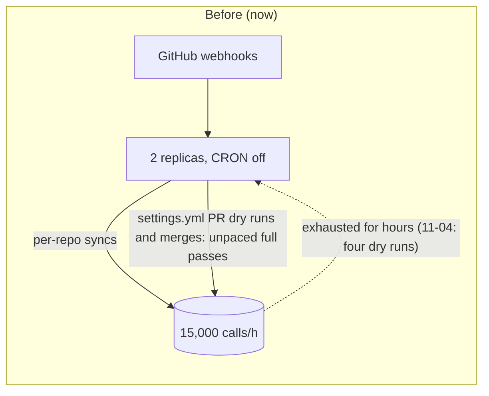
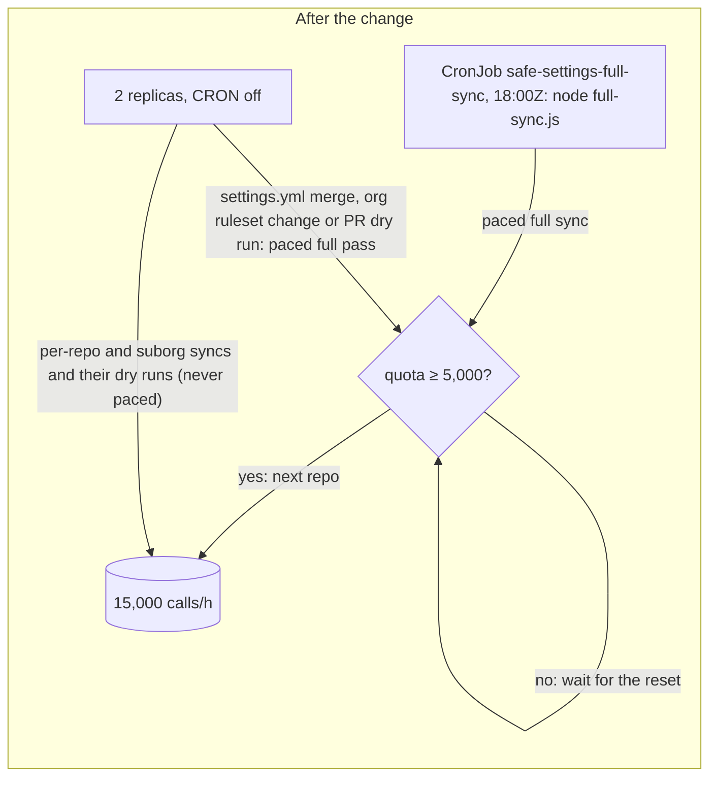
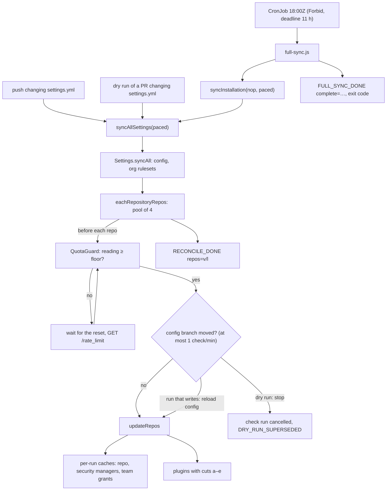
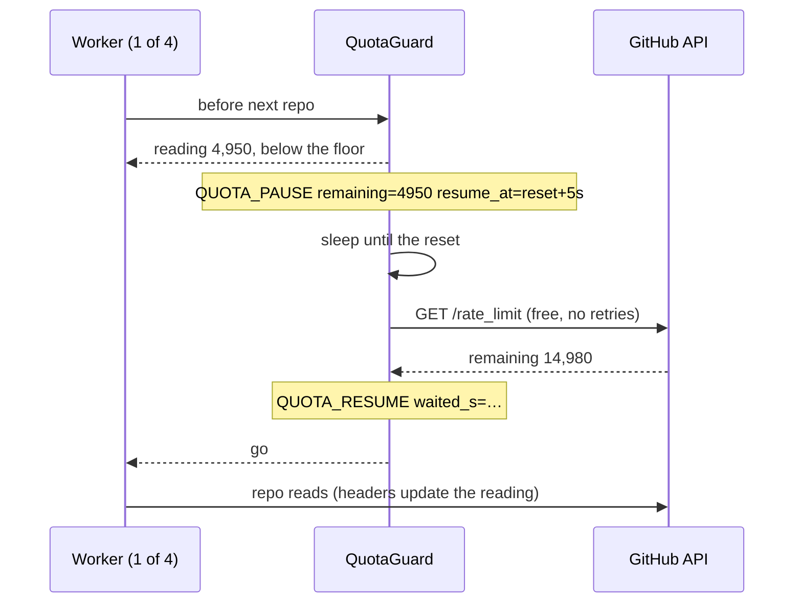

# Change Design: Nightly full sync in prod within the GitHub API quota

**Date:** 2026-11-23
**Artifact:** change-design
**Status:** Draft
**Template version:** default/0.3.2
**References:** prod values `apps/safe-settings-prod/values.yaml` in tomtom-internal/safe-settings-deployment (`CRON: ""` and the estimate behind it) · [tomtom-forks/safe-settings#26](https://github.com/tomtom-forks/safe-settings/pull/26) (rc.9: archived repos skipped) · cost model and its inputs in [`analysis/`](analysis/)

**Plugin version:** 0.7.11
**Agent Sessions:** claude-code: 0f4136a5-6f9b-4ab8-a1c3-4f012a27f673
**Self-review:** CAP_REACHED — round-2 findings fixed, not re-reviewed. Round-2 findings, as reported: (1) "'webhook-driven syncs are never paced' (Key facts, 'The rule to keep'). This contradicts G4-AC8, CD-D-5 and Architecture §2." (2) "In NOP mode, Diffable.sync (diffable.js:72–81) runs compareDeep on the raw team list. Before any remove() runs, it pushes a 'Changes found' row with the org-role team under `deletions`." (3) "For NOP runs, 'config load succeeded' has no definition." … "`errors=` is also undefined in NOP mode" (4) "Nothing says what NOP mode reports for this mode." … "A permission change on a pending invitation is a PATCH /invitations/{id} … which archived repos also refuse." (5) "'The org's security managers are read once per run into the same instance.' There is no rule for a failed read." … "'uses its own read from moments earlier' (Error handling) is false for the per-run grant and security-manager caches" (6) "With a stub Settings, the guard in eachRepositoryRepos never runs, so nothing can wait." … "no unit test uses nock today" (7) "'overshoot is bounded by the 4 repos in flight' … This bound is unsupported." (8) "Nothing says what happens for any other answer, such as a 403 for a missing permission or a 5xx" (G1-AC3) (9) "G4-AC1–AC3 and AC5 never mention that header" (`x-ratelimit-resource: core`) (10) "Accessing `.Values.fullSync.enabled` on a missing key makes `helm template` fail with a nil-pointer error" (11) "'`tickmodel.py` with the prod inputs gives at most 40,000 charged calls for one nightly prod run' (G6-AC3). This clause cannot fail." (12) "'A `settings.yml` merge rolls out over ~3.6–5.5 h instead of exhausting the quota.' That holds for one merge only." (13) "NopCommand keeps only the URL (nopcommand.js:6)." … "The existing disable rows (repository.js:267, :305) pass constructor arguments in the wrong order" (14) "'after a PATCH they see the PATCH response' (G2-AC3). The only repo field a later plugin reads is `default_branch`" … "G2-AC1's 'exactly N `GET /repos/{o}/{r}` calls' holds only when each repo's config makes some plugin read the repo" (15) "'nothing has to be cut first' (Verdict)." … "It is unclear whether the cuts are a prerequisite for enabling the CronJob." (16) "'If the plan phase finds a repo where the list and the per-repo check disagree, full runs switch to the per-repo check' (CD-D-6). This is an open design branch with no trigger and no criteria."
**Self-review (2026-11-24, after the CronJob docs and the dry-run pacing):** CAP_REACHED — round-2 findings fixed, not re-reviewed. Round-2 findings, as reported: (1) "A failed suborg directory read is silent today" … "`loadConfigMap` catches every `getContent` error, logs it at debug, and returns `[]` (lib/settings.js:655–661)" (2) "`errors=` cannot count failing repos as defined" … "So N repos that fail in `updateRepos` … count as `errors=1`." (3) "The scheduled NOP run is in neither config-branch category" (4) "G8 promises more than its criteria guarantee" … "A stale write from the long run can land after that and then stays" (5) "G4-AC8's verify checks an internal option" … "so an entry point wired wrongly would still pass" (6) "One paced run keeps the problem CD-D-10 fixes" (the org-level `repository_ruleset` full sync) (7) "'Only a kill without SIGTERM (out of memory) leaves no line.' is too strong" … "`index.js` calls `info()` without awaiting it or catching errors" (8) "The NOP-night exception list is incomplete" … "`PATCH https://api.github.com/repos/`" … "`POST https://api.github.commain`" (9) "Scope (item 4). The change has nine goals across two repos" … "Each group can ship and be tested on its own, which is a lot for one implementation plan." (10) "The Summary disagrees with the body" (11) "Two dates disagree" (12) "The prod chart template is not needed yet"

---

<!-- hint: Keep the `**Artifact:** change-design` line — /plan and /implement use it to recognize this as a change-design artifact (requirements + design in one file) and skip the prd.md requirement. -->

> *Section audience —* 🔍 reviewer (understand the change without implementing it) · 🛠 author (implement the change). Sections without an icon serve both.

## Summary 🔍

Prod runs webhook-only because a full sync was estimated at 100–200k API calls against the App's 15,000/hour budget. Extrapolated from a measured dev run and prod logs, one full sync of prod on rc.9 costs ~83,100 calls, and ~34,000 of them are writes that change nothing: branch protection rewritten on every run, Dependabot alerts re-enabled, DELETEs of teams whose access comes from an organization role, and collaborator additions that archived repos refuse. Two replicas each running it would double that.

This design runs one full sync per night from a Kubernetes CronJob and paces it: at its start and before each repo it checks the quota, and below 5,000 calls left in the hour it waits for the reset, so webhooks keep a third of the budget (their night peak is 2,461 calls/h). Five cuts remove the waste: one read per repo, flattened protection flags, read-before-write for Dependabot alerts, grant checks before team DELETEs, and no collaborator writes on archived repos. A run then costs ~37,300 calls and ~600 writes and needs ~3.8 of the 11 hours it may take; without the cuts it would barely fit, so they ship first. The same pacing covers the other runs that read the whole org: the full syncs that `settings.yml` merges and org-level ruleset changes start, and the dry run of a PR that changes `settings.yml`, the kind of run that exhausted the quota on 11-04. Such a PR's check then takes up to ~6 hours in the daytime, and a newer push to the PR stops the dry run still running, so a PR pushed four times costs about one pass, not four. A writing run that walks the org reloads its config when the admin repo's default branch moves, so it does not undo a merge that lands while it runs, and a failed read of the suborg directory stops a run instead of applying the org config to every suborg repo. Exit codes and end-of-run lines report truthfully whether a run covered every repo, and a check run goes on the commit that started its run, or is not posted when no commit did. The CronJob is named `safe-settings-full-sync`; the comment next to `CRON` in the values, the deployment's operations guide and the fork's TOMTOM.md say that it, not `CRON`, runs the full sync, and how to check, start and pause it. Prod is not changed in this phase; turning it on is a later, NOP-first rollout.

## Background & problem 🔍

Prod (org `tomtom-internal`) runs webhook-only. Its values set `CRON: ""` with this estimate: a full tick costs ~100–200k API calls against the App's 15,000/hour budget, so ~10 hours at full throttle, during which webhook handlers are throttled too. Without a periodic full sync, nothing re-applies the config to a repo until a webhook touches it. Drift made in the GitHub UI stays. A lost push delivery or a run killed mid-way stays unrepaired; both happened in October (a lost admin merge push on 2026-10-13, a run killed by a rollout on 2026-10-14).

The estimate predates rc.9 (#26, running in prod since the afternoon of 2026-11-03). rc.9 skips archived repos before any API call; they took 74% of prod calls. It also lists the repos once per run, 100 per page. This design measures what a full sync costs now, removes the calls that are pure waste, and turns on one nightly full sync that cannot starve the webhooks.

### What the numbers say

All counts are **charged calls**: requests that count against the App installation's primary quota, which is every request except `304 Not Modified`. Log counts come from the app's `GitHub request: <METHOD> <URL> - <status>` debug lines in Loki (one line per logical request, 304s included), queried the way the safe-settings section of the team's Loki guide prescribes.

**1. Limits (checked 2026-11-23)**

| Limit | Value | Source |
|---|---|---|
| Primary, per App installation | 15,000/h on prod and dev | `x-ratelimit-limit: 15000` in 78 of 78 rate-limit samples from prod error lines (2026-11-04); GitHub docs for Enterprise Cloud installations |
| Conditional requests | a 304 is free | Live, dev admin repo: three 304s left `x-ratelimit-used` at 8, the next 200 moved it to 9 |
| ETag support | every per-repo GET the plugins use answers 304 to `If-None-Match`, except `vulnerability-alerts` (204, no ETag) | Live probe of 14 endpoints on the dev admin repo |
| Secondary limits (documented) | 100 concurrent requests; 900 points/min for REST (read 1, write 5); 80 content-creating requests/min and 500/h | GitHub docs |
| Secondary limits (seen) | none: 0 `Secondary quota detected` lines on prod in 30 days and on dev in 7 days. The 11-04 full syncs peaked at 2,250 charged requests/min (93 minutes at ≥ 900) without one | Loki |
| `GET /rate_limit` | free on the primary limit | GitHub docs |

On 11-04 the response headers showed two `core` windows open at once, with different reset times, and the sum of their `used` matched the logged non-304 count within ~1%. GitHub documents one counter per installation, so the budget below is the documented single 15,000/h.

**2. Webhook-only baseline (prod, both pods, charged calls per clock hour)**

| Period | p50 | p95 | p99 | max | Hours with quota exhaustion |
|---|---|---|---|---|---|
| 30 days (10-24 → 11-23) | 16 | 15,105 | 20,079 | 28,480 | 42 |
| Before rc.9 | 13 | 17,808 | 22,614 | 28,480 | 34 |
| After rc.9 (from 11-03 17:00Z) | 25 | 2,834 | 16,154 | 21,583 | 8, all on 11-04 |
| Steady state (11-05 → 11-23) | 14 | 1,829 | 4,783 | 8,332 | 0 |
| Steady, weekdays 07–17Z | 621 | 3,529 | 5,934 | 8,332 | 0 |
| Steady, nights 18–06Z | 0 | 244 | 837 | 2,461 | 0 |

Source: Loki `count_over_time` of `GitHub request:` lines without ` - 304`, in 5-minute bins summed per clock hour. An exhaustion hour is one with a `Request quota exhausted` line. A clock hour can exceed 15,000 because a rate-limit window resets mid-hour. 304s were 44% of all requests over 30 days and 65% after rc.9.

The only exhaustion after rc.9 is the burst this design must not repeat. On 11-04 one admin PR that changes `settings.yml` (opened 10:37Z, pushed again at 10:43Z, 11:03Z and 11:39Z, still open) started four PR dry runs (index.js:584), one per pushed commit, each an unpaced full read pass of the org. Together they spent 15.5–21.6k calls an hour for about 8 hours, and other webhook runs waited 30–50 minutes every hour. Three of their four check runs still showed *in progress* on 11-23. No merge changed `settings.yml` that day; only two did between 10-01 and 11-23, both on 10-23. The push handler's full sync (index.js:262) logs the same `Changes in '.github/settings.yml' detected` line as a dry run, and dry runs never log `RECONCILE_DONE`, so only the admin repo's history tells the two apart.

About half of the per-repo syncs on prod are PR dry runs, which read everything and write nothing. Over 11-14 → 11-23 prod made 2,244 branch-protection PUTs for 4,336 protection GETs (0.52), while a real run PUTs every protected branch it reads (dev: 160 of 160; prod: all 834 protection diffs logged in 24 hours came from the four flags of cut (a) below). Rates measured on prod are corrected for this where it matters.

**3. Cost of one full sync on rc.9, measured on dev**

Dev (`tomtomsptesting`) has 209 repos: 160 active, 48 archived, 1 restricted. Each of its two pods runs an hourly in-process cron. One pod's tick on 2026-11-23 at 12:00Z: 1,402 request lines in 7 min 15 s, that is 975 reads (19 of them free 304s for config files) and 427 writes, so 1,383 charged (2 of them App-JWT calls, which count against the App's own limit). It ended `RECONCILE_DONE errors=12 archived_skipped=48`. The tick is write-bound: the throttle allows 1 write per second.

| Calls | Endpoint | Why |
|---|---|---|
| 486 GET | `/repos/{o}/{r}` | 3 per active repo (archive check, repository plugin, branches plugin) + 1 per repo with labels |
| 160 GET, 160 PUT | `/repos/{o}/{r}/branches/{b}/protection` | Every protected branch is rewritten. GitHub returns `allow_force_pushes`, `allow_fork_syncing`, `block_creations` and `lock_branch` as `{enabled: …}` objects, and `reformatAndReturnBranchProtection` (lib/plugins/branches.js:126) flattens five other flags but not these four, so the comparison always differs |
| 160 PUT | `/repos/{o}/{r}/vulnerability-alerts` | Written on every run when `enableVulnerabilityAlerts` is set (lib/plugins/repository.js:249), without reading the state first |
| 125 GET | `/repos/{o}/{r}/teams` | 1 per teams sync, plus 25 follow-up pages |
| 100 GET | `/orgs/{o}/security-managers` | Read once per repo with teams, though it is one org-wide list (lib/plugins/teams.js:40) |
| 88 DELETE | `/orgs/{o}/teams/{t}/repos/{o}/{r}` | A team that holds access through an organization role: GitHub lists it on every repo, but it has no repo-level grant there, so the DELETE returns 204 and changes nothing (see §4) |
| 12 GET, 12 PUT | one team grant | Two dev configs disagree about it (dev only) |
| 92 GET, 5 writes | listing, config (19 of them 304), org rulesets, autolinks, topics, labels, rulesets, environments, collaborators, the check run's commit lookup, and 1 App-JWT installation lookup | As configured; the 5 writes are ruleset 4xx |
| 1 POST | `/repos/{o}/admin/check-runs` | End-of-run check |
| 1 POST | `/app/installations/{id}/access_tokens` | Installation token, on the App's own limit |

**4. Extrapolation to prod**

One full run costs

> C = ⌈N/100⌉ + (4 + S + F) + (1 + K) + Σₚ nₚ·rₚ + W

- ⌈N/100⌉ — the repo listing, N repos in the installation.
- 4 + S + F — `settings.yml`, two directory reads and the repo-file tree, plus one read per suborg file (S) and repo file (F). These S + F reads are free 304s in a long-running pod whose file cache is warm; a CronJob process starts cold.
- 1 + K — the org rulesets list plus one read per org ruleset (K).
- Σₚ nₚ·rₚ — per plugin p: the repos or entries that run it (nₚ) × its reads per repo (rₚ).
- W — writes.

The reads per repo (rₚ) come from the code paths. With dev's inputs the model reproduces the dev tick exactly: 975 reads including the 19 free ones, and 427 writes. Where a call depends on GitHub's state (how often a read leads to a write), the rate comes from prod logs. [`analysis/tickmodel.py`](analysis/tickmodel.py) is the model; [`analysis/inputs/`](analysis/inputs/) holds its inputs.

Prod inputs: [`analysis/coverage.js`](analysis/coverage.js) resolves every repo's effective config with safe-settings' own `Settings` code, over the prod admin config (commit 92b62692) and the 2026-11-23 repo listing: 15,787 repos, of which 9,222 archived, 1 restricted and 6,564 active; 181 suborg files and 1,709 repo files. The 11-04 full syncs read 7 org rulesets.

| Term | Prod basis | Today | After the cuts | Cut |
|---|---|---|---|---|
| Repo listing | 15,787 repos | 158 | 158 | |
| Config reads, cold | 4 + 181 + 1,709 | 1,894 | 1,894 | |
| Org rulesets | 7 | 8 | 8 | |
| `GET /repos/{o}/{r}` | 6,564 active, 864 with labels | 20,556 | 6,564 | (e) |
| GET protection | 7,160 protected branches | 7,160 | 7,160 | |
| PUT protection | ≈ 1 per protected branch today | 7,160 | ≈ 0 | (a) |
| Dependabot alerts | 6,564 active repos | 6,564 PUT | 6,564 GET, ≈ 0 PUT | (b) |
| GET teams, + 0.207 follow-up pages | 4,445 teams syncs (2,835 active + 1,610 archived repos) | 5,365 | 5,365 | |
| GET security managers | | 4,445 | 1 | (e) |
| Team DELETEs that change nothing | 4 org-role teams on every teams-synced repo that does not grant them | 17,561 + ~8 real | 0, plus 34 grant-list reads and ~8 real DELETEs | (c) |
| Team PUT + GET by name | 112 a day, one-off changes | 224 | 224 | |
| Autolinks, topics, labels | 1,981 / 1,077 / 864 repos | 3,922 | 3,922 | |
| Collaborators on active repos | 658 repos, 303 distinct users | 1,619 | 1,619 | |
| Collaborators on archived repos | 542 repos, 2,710 entries; 13 users on no active repo, one membership read each | 1,097 GET + 2,710 PUT (all 403) | 1,097 GET, 0 PUT | (d) |
| Rulesets | 708 repos, 1,120 rulesets; 0.355 writes per sync | 1,828 + 251 | 1,828 + 251 | |
| Environments | 19 repos, 120 environments | 379 | 379 | |
| Drift writes (repo PATCH, labels, topics, autolinks) | 211 a day, one-off | 211 | 211 | |
| Check run | | 2 | 0 | |
| **Charged calls** | | **83,122**, of which 34,578 writes | **37,287**, of which 582 writes | |

Sources for the rates (prod Loki 11-14 → 11-23 unless noted):

- **Follow-up team pages:** 874 for 4,215 team lists.
- **Protection PUTs:** ≈ 1 per protected branch in a real run (see the dry-run note in §2).
- **Team DELETEs that change nothing:** four teams hold access through organization roles. GitHub lists them on every repo (4 of 4 randomly sampled active repos, live GET on 2026-11-23), but their repo-level grants cover only 2,296, 54, 22 and 21 repos (`GET /orgs/{org}/teams/{slug}/repos`). For an ungranted repo the grant check answers 404 and the DELETE answers 204 and changes nothing, so it repeats on every run. 99% of the team DELETE pairs on prod are these four teams (3 days, 568 pairs). Per full run they come to Σ over the four teams of (teams-synced repos − repos whose config grants the team) = 17,561 (coverage.js); the same formula gives dev's measured 88.
- **Team PUTs and drift writes:** 1,008 team PUTs and 1,902 other writes in 9 days; only 7 of 139 PUT pairs and 36 of 473 PATCHed repos recurred within 3 days, so these are real one-off changes, counted at their daily rate.
- **Ruleset writes:** 147 for 798 ruleset lists, divided by the 0.52 real-run share.
- **Archived collaborators:** 1,267 PUTs in 10 days, all `403 Repository was archived so is read-only`, 1,238 distinct (repo, user) pairs on 201 archived repos. Config holds 2,710 such entries, the upper bound per full run.

**5. Verdict**

The budget is 15,000 per window. A floor of 5,000 (33%) kept free for webhooks lets a paced run spend up to 10,000 per window, minus what the webhooks use in it. A run may take 11 hours (CD-D-12).

| Run | Charged calls | Writes, and their minimum time at 1/s | Hours at night under the floor (10,000 − p95 244 per h) | Fits in 11 hours? |
|---|---|---|---|---|
| Today, in-process `CRON` on both replicas | 166,244 | 2 × 34,578 | 17.0 | No |
| Today, one run | 83,122 | 34,578, 9.6 h | 8.5 | Barely: the writes alone take 9.6 h |
| After the five cuts, one CronJob run | 37,287 | 582, 10 min | 3.8 (4.9 if every hour were the worst night hour, 2,461) | Yes, 2.2–2.9× margin |
| After the cuts, a paced `settings.yml` merge in the daytime (warm config, check run) | ~35,400 | ~580 | 5.5 at the weekday p95 (3,529/h) | n/a |
| After the cuts, a paced `settings.yml` PR dry run in the daytime (config read cold) | ~36,700 | 0 | 5.7 at the weekday p95 (3.8 at night) | n/a |

Two replicas each running today's tick reproduce the original 100–200k estimate. A single paced run of today's code would only barely fit: its 34,578 writes alone take 9.6 of the 11 hours at 1 write per second. After the cuts it needs about 3.8 hours, with ~600 writes. So the budget allows a nightly run, but only with the cuts: they ship first, and the CronJob is enabled after them (CD-D-20). They also stop a nightly rewrite of settings that never change.

The starting point of keeping ≥ 30% free for webhooks holds. 5,000 is 33% of the budget, twice the worst night hour (2,461) and 1.4× the weekday p95 (3,529). It does not cover the weekday p99 (5,934). That matters only for the paced runs in the daytime (merges and PR dry runs), which today drain the quota completely.

The run behind the 11-04 burst is paced too (CD-D-5). The dry run of a `settings.yml` PR is a full read pass of ~36,700 reads after the cuts (today ~48,500), about 2.4 hourly budgets, on every push to such a PR. Paced, it takes ~5.7 hours in the daytime and ~3.8 at night, and the next push to the PR stops it within a minute (CD-D-24): on 11-04 the first three runs would have stopped at the next push, and only the last would have read the whole org. Merges that change `settings.yml` are rare (two in October and November), and each now starts a paced full sync. Several in a row would each run their own: four need ~141,600 calls together, 15–22 hours of budget above the floor. Webhooks keep their reserve, but those runs finish late, and a CronJob run that starts meanwhile shares the budget with them and may hit its deadline.

## Goals and non-goals

### Goals

**G1: A sync writes nothing to a repo that already matches its config (cuts a, b, c)**
- [ ] G1-AC1 — A protected branch whose live protection matches the config, with `allow_force_pushes`, `allow_fork_syncing`, `block_creations` and `lock_branch` returned as `{enabled: <bool>}` objects, gets no PUT. · `verify: nock test; GET protection returns the object form of the configured booleans; any PUT fails the test`
- [ ] G1-AC2 — A real difference in one of those four flags still gets exactly one PUT, carrying the configured value. · `verify: nock test; config allow_force_pushes: true, live {enabled: false}`
- [ ] G1-AC3 — With `enableVulnerabilityAlerts: true`, a 204 from `GET /repos/{o}/{r}/vulnerability-alerts` leads to no PUT and a 404 to exactly one PUT. With `false`, a 404 leads to no DELETE and a 204 to exactly one DELETE. Any other answer (a 403, or a 5xx after the client's retries) leads to the PUT or DELETE being sent, as today. · `verify: nock test, four cases plus a 403`
- [ ] G1-AC4 — A team that the repo's team list shows but that has no repo-level grant on the repo is not deleted. A team that has a repo-level grant and is not in the config is deleted once. Both hold in a full sync and in a single-repo sync. · `verify: nock tests; full sync: the repo is absent from / present in GET /orgs/{org}/teams/{slug}/repos; single-repo sync: GET /orgs/{org}/teams/{slug}/repos/{o}/{r} answers 404 / 204`
- [ ] G1-AC5 — In a run that walks the installation listing (a full or suborg sync), a team's grant list is read at most once, and only for a team about to lose a grant. A single-repo sync instead checks each such team with one `GET /orgs/{org}/teams/{slug}/repos/{o}/{r}` and reads no grant list. · `verify: nock tests; three repos that all list the same org-role team → one paginated grant listing; one single-repo sync → one per-repo check per team`
- [ ] G1-AC6 — If a team's grant list cannot be read, that run checks the team per repo instead. If a per-repo check fails (any answer other than 204 or 404), the DELETE goes ahead as today. · `verify: nock tests; the grant listing answers 403 → per-repo checks are made; a per-repo check answers 403 → the DELETE is sent`
- [ ] G1-AC7 — In a full sync, an unchanged active repo whose config has branch protection, teams and Dependabot alerts costs exactly: 1 `GET /repos/{o}/{r}`, 1 GET protection per protected branch, 1 GET vulnerability-alerts, 1 GET teams (plus follow-up pages), and no write. The run adds 1 GET security managers and the grant listings of G1-AC5. · `verify: nock test with nock.disableNetConnect(); the test lists every expected interceptor with its count and fails on any unmatched or missing request`
- [ ] G1-AC8 — In NOP mode cuts (a)–(c) make the same reads, and a repo that matches its config shows no intended protection PUT, alert change or team DELETE in the run's output: no `NOP_CHANGE` line in a scheduled NOP run, and no row for it in a PR dry run's check-run summary. A repo with a real difference shows exactly that change. · `verify: nock tests in NOP mode; assert the logged NOP_CHANGE lines and the body of the check-run update`

**G2: Each repo, and the org's security managers, are read once per run (cut e)**
- [ ] G2-AC1 — A full sync makes at most one `GET /repos/{o}/{r}` per repo: exactly one for a repo whose config has repository settings, branches or labels, and none for a repo whose config has only teams. · `verify: nock test with three repos (labels, branches, teams only): two repo GETs in total`
- [ ] G2-AC2 — `GET /orgs/{org}/security-managers` is called once per run when it succeeds, however many repos sync teams. A 404 or 410 (the endpoint is past its announced sunset) means an empty list and is also kept for the run. Any other failure is not kept: the next repo's teams sync reads again, and the repo whose read failed is handled as today, with its team list unfiltered. · `verify: nock tests; three repos with teams → one read; 404 and 410 → one read each; the first read answers 403, then 200 → two reads, and the first repo's DELETE candidates still pass the grant check of G1-AC4`
- [ ] G2-AC3 — After the repository plugin changes the default branch in a run, by rename or by PATCH, the branches plugin of the same run protects the new name. · `verify: nock tests, both ways; main → trunk; GET and PUT protection go to trunk`

**G3: No collaborator writes on archived repos (cut d)**
- [ ] G3-AC1 — On an archived repo whose config adds a collaborator, changes one's permission or changes a pending invitation's permission, a full sync sends no PUT to `/repos/{o}/{r}/collaborators/{u}` and no PATCH to `/repos/{o}/{r}/invitations/{id}`. In NOP mode it reports none of them: no `NOP_CHANGE` line, and no addition or permission change for the repo in a PR dry run's check-run summary. · `verify: nock tests in apply and NOP mode; assert the NOP_CHANGE lines and the body of the check-run update`
- [ ] G3-AC2 — On an archived repo, a collaborator or pending invitation that the config does not list is still removed (one DELETE), as today. · `verify: nock test`
- [ ] G3-AC3 — Active repos sync collaborators as before. · `verify: the existing collaborators unit tests pass unchanged`

**G4: Paced full syncs leave a quota reserve for webhooks**
- [ ] G4-AC1 — In a paced run, when the quota reading is below the floor (default 5,000, `SS_QUOTA_FLOOR`), no new repo starts until the reading's reset time. Repos already started finish. · `verify: nock test with fake timers; responses carry x-ratelimit-remaining 4999, x-ratelimit-reset 60 s ahead and x-ratelimit-resource core; the next repo's first request comes only after the clock passes the reset`
- [ ] G4-AC2 — After the reset the run reads `GET /rate_limit` and continues only at or above the floor; below it, it waits for the next reset. · `verify: nock test; /rate_limit answers 3,000 and then 14,000; the run resumes after the second`
- [ ] G4-AC3 — With a live reading at or above the floor, the guard makes no API call of its own. The start check of G4-AC9 has no reading yet, so it reads `GET /rate_limit` once. · `verify: nock test; remaining 9,000 on every response; exactly one /rate_limit request, before the first config read`
- [ ] G4-AC4 — With two `core` windows open (different reset times), the guard uses the lower `remaining`. · `verify: nock test; responses alternate remaining 12,000 (reset +50 min) and 4,000 (reset +10 min); the run pauses until the earlier reset`
- [ ] G4-AC5 — A reading whose reset time has passed is not used; the guard reads `GET /rate_limit` instead. · `verify: nock test; a stale low reading does not cause a pause when /rate_limit answers 14,000`
- [ ] G4-AC6 — Without a usable reading (no rate-limit headers seen and `GET /rate_limit` failing), a paced run starts no repo; it logs `QUOTA_UNKNOWN` and retries the reading every 60 s. The guard's own `GET /rate_limit` is sent without automatic retries, so one failure shows at once. · `verify: nock test with fake timers; /rate_limit answers 500 once, then 200 after 60 s; QUOTA_UNKNOWN is logged and no repo request comes before the 200`
- [ ] G4-AC7 — A paced run logs `QUOTA_GUARD floor=<f> remaining=<n> reset=<iso>` before its first repo, from a real reading. Each pause logs `QUOTA_PAUSE remaining=<n> floor=<f> resume_at=<iso>` and then `QUOTA_RESUME waited_s=<s> remaining=<n>`. · `verify: log assertions in the nock tests; the dev run of G6-AC2`
- [ ] G4-AC8 — Paced: the CronJob run, an in-process `CRON` tick, the full sync started by a push that changes `settings.yml` or by an org-level `repository_ruleset` event, and the dry run of a PR that changes `settings.yml`. Never paced: per-repo webhook syncs, suborg and repo-file syncs, and the dry runs of PRs that change only suborg or repo files. · `verify: one nock test per entry point with fake timers, loading index.js with the real Settings, the PR dry run once with settings.yml among the PR's files and once with only a suborg file; every response and /rate_limit report remaining 4,999 with a reset 60 s ahead; a paced entry point sends no repo request before the reset, an unpaced one sends its first repo request at once`
- [ ] G4-AC9 — A paced run also asks the guard once before it loads its config, so its start phase (config, listing, org rulesets) begins only at or above the floor. · `verify: nock test; /rate_limit answers 4,000 with a reset 60 s ahead; no config read before the reset`
- [ ] G4-AC10 — A response without `x-ratelimit-resource` counts as `core`. A response for another resource (such as `search`) and a response to an App-JWT request (a path under `/app/`, such as the installation-token request a long run makes about hourly) do not change the reading. · `verify: nock tests; a low remaining on a search response, and on a POST /app/installations/{id}/access_tokens response, causes no pause`
- [ ] G4-AC11 — From before its first repo until it ends, the check run of a paced PR dry run says that the run is paced to keep quota for webhooks and can take several hours. · `verify: nock test; the check-run update sent before the first repo request carries that text`

**G5: A nightly CronJob run that reports its outcome truthfully**
- [ ] G5-AC1 — With `fullSync.enabled: true`, the chart renders one CronJob: schedule `0 18 * * *` in `Etc/UTC`, `concurrencyPolicy: Forbid`, `backoffLimit: 0`, `startingDeadlineSeconds: 3600`, `activeDeadlineSeconds: 39600`, command `node full-sync.js`; the Deployment's image, credentials secret and env config map; the deployment-config file (`DEPLOYMENT_CONFIG_FILE` and its ConfigMap volume) as the Deployment mounts it; container env that overrides the shared map with `CRON: ""`, `SS_QUOTA_FLOOR` from `fullSync.quotaFloor` and `FULL_SYNC_NOP` from `fullSync.nop`; pod annotation `karpenter.sh/do-not-disrupt: "true"`; requests 500m / 1Gi, limits 2 CPU / 6Gi, and `NODE_OPTIONS=--max-old-space-size=5120`. Without `fullSync.enabled: true` it renders no CronJob. · `verify: helm template of the dev chart with fullSync.enabled true and false`
- [ ] G5-AC2 — The image contains `full-sync.js`. · `verify: docker build, then node -e "require.resolve('/opt/safe-settings/full-sync.js')" in the image`
- [ ] G5-AC3 — A run is complete when the installation lookup, the config load (settings.yml, suborg files and repo files without an error; in NOP mode, no ERROR row from those loads) and the repo listing succeeded, and every listed repo was visited; a repo that logged an error still counts as visited. `full-sync.js` always exits explicitly, 0 when complete and 1 otherwise, also when `CRON` is set in its environment. · `verify: unit tests; listing answers 404 → exit 1; the settings.yml read answers 403 → exit 1, in apply and in NOP mode; one repo's PUT answers 422 → exit 0 with errors=1; CRON="* * * * *" set → the process still exits`
- [ ] G5-AC4 — Every `full-sync.js` run, NOP or not, ends with one `FULL_SYNC_DONE nop=<bool> complete=<bool> repos=<visited>/<listed> errors=<n> paused_s=<s> duration_s=<s>` line: when it completes, when it fails, and when the process gets SIGTERM (the Job deadline, a node shutdown) or an unhandled error (such as a failed GitHub call at startup), which it answers with `complete=false` and the counts so far, then exits 1. Only a kill without SIGTERM (out of memory) leaves no line. `errors=` counts the distinct pairs of repo and plugin that logged an error or, in NOP mode, produced an ERROR row, so a failure reported both ways counts once; a repo whose sync fails outside its plugins counts under its own name, not the admin repo's. The `RECONCILE_DONE` line of a full sync gains `repos=<visited>/<listed>`; other runs' `RECONCILE_DONE` is unchanged. · `verify: log assertions for a complete run, a failed listing (complete=false repos=0/0), a run where syncInstallation throws, a SIGTERM mid-run (complete=false, exit 1), a rejected App lookup at startup (complete=false, exit 1), three repos whose sync throws outside their plugins, in apply and in NOP mode (errors=3), and a NOP run where one plugin fails on one repo and both logs the error and returns an ERROR row (errors=1)`
- [ ] G5-AC5 — A scheduled run, and the full sync that an org-level `repository_ruleset` event starts, post no check run on the admin repo. · `verify: nock tests; syncInstallation and the repository_ruleset handler make no POST check-runs and no GET commits`
- [ ] G5-AC6 — A push-triggered run posts its check run on the pushed commit (`after` in the push payload), not on the admin repo's newest commit when the run ends. · `verify: nock test; push with after = sha1; head_sha is sha1 and no commits listing is requested`
- [ ] G5-AC7 — Every other run posts its check run as today, on the admin repo's newest commit. · `verify: nock test; a repository.edited sync lists commits and posts the check run on the newest one`
- [ ] G5-AC8 — A scheduled NOP run (`FULL_SYNC_NOP=true`) touches no check run or PR comment. Before results are deduplicated, it logs one `NOP_CHANGE plugin=
 repo=<r> method=<M> endpoint=<url>` line per intended API call (each result row that names an endpoint); rows without an endpoint (summaries, errors, and the environments plugin's rows) produce none. The rows that disable Dependabot alerts and security updates, archive or unarchive a repo, or rename its default branch name their repo and endpoint like the others. · `verify: nock test; any check-run or comment request fails the test; a repo with two intended calls of one plugin logs two lines; a config that disables alerts logs one line with method DELETE; an archive row names PATCH /repos/{o}/{r} and a rename row POST /repos/{o}/{r}/branches/{b}/rename`
- [ ] G5-AC9 — A read of the suborg directory that fails with anything other than a 404 fails the config load, in every sync that loads suborg files: a run that writes starts no repo (a long run that is reloading waits, G8-AC3), and a NOP run gets an ERROR row and is not complete. A 404 still means there are no suborg files. · `verify: nock tests; the suborg directory answers 500 → no repo request in apply mode, an ERROR row and FULL_SYNC_DONE complete=false in NOP mode; it answers 404 → the run goes on without suborg config`

**G6: The cost claims hold on dev before prod is touched**
- [ ] G6-AC1 — On dev's hourly in-process cron, one pod's tick drops from 1,381 charged calls on the installation (2026-11-23 12:00Z) to at most 750, and from 426 writes to at most 30. The model predicts 708 and 17 for dev (`tickmodel.py … --warm-config --scheduled`). · `verify: Loki count of one tick's GitHub request: lines on one pod, before and after the dev rollout`
- [ ] G6-AC2 — A dev CronJob run with `fullSync.quotaFloor` above dev's remaining quota (e.g. 14,500) logs at least one `QUOTA_PAUSE`, then `QUOTA_RESUME` after the reset, and ends with `FULL_SYNC_DONE nop=false complete=true repos=<n>/<n>`, n being the number of repos the listing returned; the Job completes. · `verify: dev Job status and pod logs`
- [ ] G6-AC3 — The dev tick measured for G6-AC1 matches the model's dev prediction (`analysis/tickmodel.py analysis/inputs/coverage-dev.json analysis/inputs/rates-dev.json --warm-config --scheduled`: 708 charged, 17 writes) within 5% overall. Each model row is also compared per endpoint, and a row off by more than 5% or 2 calls, whichever is larger, has its per-repo count in `tickmodel.py` corrected to the measurement. The AC passes when the overall comparison holds and the corrected model with the prod inputs (`--scheduled`) stays at or below 40,000 charged calls for one nightly prod run (at most 4.1 hours under the floor at the night p95). · `verify: per-endpoint counts of the G6-AC1 tick against the model's rows; the corrected model's prod output`

**G7: Someone who has not read this design can find, check, start and pause the nightly sync**
- [ ] G7-AC1 — The CronJob is named `safe-settings-full-sync`. With `fullSync.suspend: true` it renders with `spec.suspend: true`; without the key, `spec.suspend` is `false`. · `verify: helm template with fullSync.enabled: true, with and without fullSync.suspend`
- [ ] G7-AC2 — In the dev values file, the comment above `CRON` says that an in-process schedule runs in every replica and that the full sync runs once as the `safe-settings-full-sync` CronJob, set by the `fullSync` block. That block follows the env config map, and its comments say what each key does, that `suspend: true` pauses the CronJob, and that `enabled: false` removes it only on a Sync with PRUNE ticked. · `verify: review of the values diff against this list`
- [ ] G7-AC3 — The deployment repo's operations guide lists the CronJob next to `CRON` in its overview table, and has a "Nightly full sync" section with copy-paste commands for: the last run's outcome (CronJob and Job status, and the Loki query for `FULL_SYNC_DONE`), starting a run by hand, switching NOP mode and pausing it. The section says what an incomplete run looks like and that nothing reruns it before the next night. The guide's cost of a full-org sync (≈ 100–200k calls, ~10 h) is replaced with the measured cost and the pacing. The repo's README names the section in its pointer to the guide. · `verify: the G6-AC2 dev run is started with the guide's manual-run command, and its outcome is read with the guide's commands`
- [ ] G7-AC4 — The fork's TOMTOM.md lists the change in its patch set, `SS_QUOTA_FLOOR` among the configuration knobs, and the `QUOTA_*`, `CONFIG_RELOAD*`, `DRY_RUN_SUPERSEDED`, `FULL_SYNC_DONE` and `NOP_CHANGE` markers and the `repos=` field of `RECONCILE_DONE` among the log markers. It also says that `CRON` schedules a sync in every replica, so a deployment with several replicas runs `full-sync.js` once from a scheduler instead; the header comment of `full-sync.js` says the same. · `verify: review of the diff against this list`

**G8: A long run picks up a config merge that lands while it runs**
- [ ] G8-AC1 — When the admin repo's default branch moves during a run that walks the installation listing and is not in NOP mode, every repo the run starts more than 60 s after the move is synced with the config of the new head, and the run logs `CONFIG_RELOAD from=<sha> to=<sha>`. Repos already started finish with the old config. · `verify: nock test with fake timers; the branch head answers sha1, then sha2 after the second repo; a repo started after the next check follows sha2's suborg file`
- [ ] G8-AC2 — While the head does not move, each check is a conditional request (`If-None-Match`), at most one a minute, and the run reads no config file again. · `verify: nock test; the head check carries If-None-Match and answers 304; no config read after the start`
- [ ] G8-AC3 — A failed head check lets the run go on with its config. A head that moved with a reload that fails stops the run from starting repos until a reload succeeds, retried every 60 s, with a `CONFIG_RELOAD_FAILED` line per attempt. · `verify: nock tests; the head check answers 500 → the next repo starts; the head moves and the suborg directory read answers 500, then 200 → no repo starts before the 200`
- [ ] G8-AC4 — Runs in NOP mode never reload their config: a PR dry run checks its PR's branch instead (G9), and a scheduled NOP run makes no head check. Single-repo syncs make no head check either. · `verify: nock tests; a PR dry run makes no request to the admin default branch's ref; a scheduled NOP run and a repository.edited sync make no ref request`

**G9: A PR dry run stops when its PR gets a newer push**
- [ ] G9-AC1 — During a PR dry run that walks the installation listing (the PR changes `settings.yml` or a suborg file), a push to the PR's branch stops the run: no repo starts more than 60 s after the push. The run completes its check run with conclusion `cancelled` and a summary naming the newer commit, posts no PR comment, and logs `DRY_RUN_SUPERSEDED pr=<n> sha=<sha> head=<sha> repos=<visited>/<listed>`. The newer commit's own dry run is not affected. · `verify: nock test with fake timers; the branch head answers the check run's head_sha, then sha2 after the second repo; no repo request after the next check; one check-run update with conclusion cancelled; no comment request. On dev: an admin PR that changes settings.yml gets a second push 2 minutes after it opens; the first commit's check run ends cancelled and the second's completes`
- [ ] G9-AC2 — While the branch stays at the check run's commit, each check is a conditional request (`If-None-Match`), at most one a minute. · `verify: nock test; the head check carries If-None-Match and answers 304; one check per minute of fake time`
- [ ] G9-AC3 — A head branch that is gone (404, as when a merge deletes it) also stops the run; the line says `head=deleted` and the check run's summary says the branch is gone. Any other failure of the check lets the run go on. · `verify: nock tests; the head check answers 404 → the run stops; 500 → the next repo starts`

### Non-goals

- Enabling the CronJob in prod or changing anything there (chart, values, App settings). That is a later step (see Testing & verification).
- Pacing the dry runs of PRs that change only suborg or repo files, suborg and repo-file syncs, or per-repo webhook syncs (CD-D-5).
- Stopping a dry run when its PR is closed but its branch stays (CD-D-24).
- Superseding or merging overlapping merge-triggered full syncs. Several merges in a row start several paced runs (see Error handling).
- A cache of ETags kept across runs. The CronJob starts cold every night; its 1,894 config reads stay.
- Leader election, or running `CRON` in the replicas; prod keeps `CRON: ""` (CD-D-2, CD-D-21). No overlap guard for in-process ticks.
- A second GitHub App for the scheduled run.
- Reading Dependabot alert state for many repos at once through GraphQL (would save ~6,500 REST calls per run).
- Spreading one run over several nights, or resuming a run that was killed.
- Fixing dev's conflicting team config (12 PUTs per tick) or the ruleset writes that fail on every run.

## Architecture

The change has six parts: where the run happens, how it is paced, how a long run follows the branch its config came from, what it stops wasting, how it reports, and how people find it.

**1. One run per night, out of band.** A Kubernetes CronJob, `safe-settings-full-sync`, in the safe-settings namespace starts `node full-sync.js` at 18:00Z. It uses the Deployment's image, credentials secret, env config map and deployment-config file, so it applies the same restricted repos and override validators as the webhook runs. Its container env sets `CRON: ""`, because a set `CRON` would schedule in-process ticks inside the Job (dev's shared map has one), and it sets the floor and NOP mode from `fullSync.*` values, so they never reach the replicas. The Dockerfile copies `full-sync.js` into the image. The template renders nothing unless `fullSync.enabled` is true; it goes into dev's chart now and into prod's with the enablement change (CD-D-26). `fullSync.suspend` pauses the CronJob without removing it (CD-D-22). `full-sync.js` calls `syncInstallation(nop, { paced: true })` and always ends the process itself. The replicas keep `CRON: ""` and serve webhooks as before. `concurrencyPolicy: Forbid` keeps one run at a time, and the 11-hour deadline ends a run by 06:00Z even when the Job starts an hour late.

**2. A quota guard in the repo loop.** A paced run asks its guard once at the start, in `syncAllSettings` (index.js:15) before `settings.yml` is read, and then `eachRepositoryRepos` (lib/settings.js:602) asks it before each repo. The guard is created per paced run and attaches hooks to that run's Octokit client:

- *Readings.* Every response and error response (304s included) with `x-ratelimit-resource: core`, or with no such header, updates a reading `{remaining, reset}` for its window. Responses to App-JWT requests (paths under `/app/`, such as the installation-token request a long run makes about hourly) describe the App's own limit and are ignored. The effective reading is the lowest `remaining` among windows whose reset is still ahead, which also covers the two concurrent windows seen in prod headers.
- *Decision.* At or above the floor, the guard returns at once. Below it, it logs `QUOTA_PAUSE`, sleeps until the reset plus 5 s, reads `GET /rate_limit`, and repeats until the reading is at or above the floor; then it logs `QUOTA_RESUME`. With no live reading it reads `GET /rate_limit` first; if that fails it logs `QUOTA_UNKNOWN` and retries every 60 s. Its own `GET /rate_limit` is sent with automatic retries turned off.
- *Overshoot.* All workers of the pool (4 by default) wait on the same guard, so what crosses the floor is the work already in flight: up to 4 repos per paced run, each a few calls, or ~35 when one of them fills a team's grant list. The start phase begins only at or above the floor but is not checked inside: ~2,060 calls for a cold start (config, listing, org rulesets; the CronJob, and at most a PR dry run), ~170 with a warm config cache. At night that still leaves ~2,940 of the reserve, above the worst night hour (2,461). Paced runs at the same time (the nightly run, merges, PR dry runs) each stop at the same floor and each add their own work in flight.
- *Callers.* `syncAllSettings` (index.js:15) takes a `paced` option. `syncInstallation` (CronJob and in-process `CRON`), the push handler's full sync (index.js:262), the org-level `repository_ruleset` handler (index.js:339) and the dry run of a PR that changes `settings.yml` (index.js:584) pass `paced: true`. Every per-repo or selected sync does not, including the dry run of a PR that changes only suborg or repo files (index.js:591). A paced dry run says in its check run that it is paced and can take hours.

**3. A long run follows the branch its config came from.** A run loads `settings.yml`, the suborg files and the repo files once, at its start, and then walks repos for hours: ~3.8 h at night, 3.6–5.5 h after a `settings.yml` merge, up to ~5.7 h for the dry run of a `settings.yml` PR, ~50 min for a large suborg. So every run that walks the installation listing, except a scheduled NOP run, checks the head of that branch before it starts a repo, at most once a minute, with a conditional request that answers 304 and costs nothing while the head stays put. Before a repo the quota guard comes first and the head check second, so a run that waited for a reset checks a fresh head. What a moved head means depends on the run:

- *A run that writes* follows the admin repo's default branch. A suborg or repo-file merge during the run is applied at once by its own push sync. Without the check, the long run would reach the same repos later and apply the old config, and because the App ignores webhooks caused by its own writes (bot senders, index.js:304, :356, :369), the old config would stay until the next run. So when the head has moved, the run re-reads `settings.yml`, the suborg files and the repo files (unchanged files answer 304) before its next repo and logs `CONFIG_RELOAD`; repos already started finish with the old config. A failed head check changes nothing. A failed reload after a move stops new repos until a reload succeeds, retried every minute, because going on would apply a config known to be stale. Org-level settings are not re-applied mid-run; a `settings.yml` merge starts its own full sync for those. A repo the run starts in the minute before it sees the move, or has in flight, can still get the old config after the merge's own push sync, and keeps it until the next run or a webhook for that repo.
- *A scheduled NOP run* writes nothing, so it cannot undo a merge: it makes no head check, and its `NOP_CHANGE` lines follow the config it started with.
- *A dry run* follows its PR's head branch, and every new commit there starts its own dry run. So when the branch has moved past the check run's commit, or is gone (404, as when a merge deletes it), the dry run starts no more repos: it completes its check run as `cancelled`, with a summary naming the newer commit or the deleted branch, posts no PR comment and logs `DRY_RUN_SUPERSEDED`. Any other failure of the check changes nothing. The branch lives in the admin repo, where the dry run already reads its config by branch name (index.js:584).

**4. The five cuts.**

- **(a) Branch protection.** `reformatAndReturnBranchProtection` (lib/plugins/branches.js:126) also flattens `allow_force_pushes`, `allow_fork_syncing`, `block_creations` and `lock_branch` from `{enabled: x}` to `x`, so an unchanged branch compares equal.
- **(b) Dependabot alerts.** `updateSecurity` (lib/plugins/repository.js:248) reads `GET /repos/{o}/{r}/vulnerability-alerts` (204 enabled, 404 disabled) and writes only on a difference. Any other answer leads to the write, as today.
- **(c) Grant check before a team DELETE.** In `find()` (lib/plugins/teams.js:7), before the plugin compares the repo's team list with the config, it drops every listed team that is not in the config and has no repo-level grant on the repo. Such a team never becomes a DELETE candidate, and a NOP run shows no deletion for it. A run that walks the installation listing (full or suborg sync) decides from a per-run cache of that team's repo-level grants, filled once per team on first need from `GET /orgs/{org}/teams/{slug}/repos` (paginated, 100 per page). A single-repo sync asks `GET /orgs/{org}/teams/{slug}/repos/{o}/{r}` instead (204 granted, 404 not), so a webhook sync costs what it costs today minus the write. The plugin logs at debug that the access comes from outside the repo. If the grant list fails, the run checks that team per repo; if a per-repo check fails, the team stays in the list and the DELETE goes ahead as today.
- **(d) No collaborator writes on archived repos.** `ARCHIVED_REPO_SECTIONS` (lib/settings.js:16) keeps both sections, and `syncArchivedRepo` runs the collaborators plugin in a mode whose only changes are removals, because GitHub refuses the other writes there (`403 Repository was archived so is read-only`). Before the compare, the mode keeps from the config only the users who already hold access or a pending invitation on the repo, at their current permission. The compare then finds no addition and no permission change, so there is no PUT, no invitation PATCH, and in NOP mode no row or summary entry for one. It still reads collaborators and invitations, and still removes the ones the config does not list (non-members too, as today). Team grants keep working on archived repos (3 days of prod: 144 team DELETEs and 20 team PUTs there, all 204).
- **(e) One repo read, one security-manager read.** The `Settings` instance of a run holds a repo cache: the first `GET /repos/{o}/{r}` of a repo fills it, and the archive check, the repository plugin, the branches plugin and the labels plugin read from it. When the repository plugin PATCHes the repo, the PATCH response replaces the cached repo; when it renames the default branch, the cached `default_branch` takes the new name. The org's security managers are read once per run into the same instance. A 404 or 410 counts as an empty list and is kept, as `checkSecurityManager` already treats a 404 (lib/plugins/teams.js:46); the endpoint is past its announced sunset, so it can go away. Any other failure is not kept: the next teams sync reads again, and the repo whose read failed is handled as today, its unfiltered security-manager teams still passing through the grant check of (c).
- **NOP mode.** The cuts make some write decisions depend on a read. In NOP mode the repository plugin (lib/plugins/repository.js:115) and `Diffable` (lib/plugins/diffable.js:140) return before their pending calls finish, so they wait for those calls before returning their results; otherwise an intended change found after a read is lost, because `appendToResults` copies the array (lib/settings.js:1024). `NopCommand` (lib/nopcommand.js) also keeps the HTTP method of its endpoint, so a `NOP_CHANGE` line says what kind of call it stands for, and the two rows that disable Dependabot alerts and security updates (lib/plugins/repository.js:267 and :305) get their arguments in the right order, so they name their repo and endpoint; so do the rows that archive or unarchive a repo (lib/plugins/archive.js:35) and rename its default branch (lib/plugins/repository.js:203), which today build a broken URL.

**5. Reporting the outcome.**

- A full sync counts the repos it listed and visited, and remembers whether the installation lookup, the config load and the listing succeeded. In NOP mode the config loaders turn failures into ERROR rows instead of throwing, so an ERROR row from loading settings.yml, a suborg file or a repo file also marks the config load as failed. A failed read of the suborg directory now fails the config load too (CD-D-25); today `loadConfigMap` takes it for an org without suborg files (lib/settings.js:655–661). A repo counts as visited once its step ends, whether it was synced, skipped as restricted or archived, or failed with a logged error. The run is complete when all three steps succeeded and every listed repo was visited.
- `RECONCILE_DONE` of a full sync gains `repos=<visited>/<listed>`. `full-sync.js` logs `FULL_SYNC_DONE` with `complete=` in both modes, also when `syncInstallation` throws or returns no run (`repos=0/0`), and when the process gets SIGTERM or an unhandled error, such as a failed GitHub call while the app starts (`complete=false`, the counts so far); it exits 0 only for a complete run. Its `errors=` counts the distinct pairs of repo and plugin with a logged error or, in NOP mode, an ERROR row. The per-repo failures that `Settings` itself catches (lib/settings.js:631, :432, :476) name the failing repo instead of the admin repo, so they count per repo.
- Check runs: a scheduled run and the full sync of an org-level ruleset event post none; a push-triggered run posts on the pushed commit (`after`); a dry run stopped by a newer push completes its own check run as `cancelled` (part 3); every other run reports as today, a dry run on its PR's check run and any other run on the admin repo's newest commit (lib/settings.js:135).
- In NOP mode a run without a check run skips the check-run update and PR comment in `handleResults` (lib/settings.js:191), which today read `payload.check_run` and `payload.repository` and would fail (lib/settings.js:297–318). Before deduplicating its results, it logs one `NOP_CHANGE` line, with method and endpoint, per result row that names an endpoint.

**6. Making it findable.** People look first at `CRON`, which stays empty in prod, so the explanation goes where they look:

- *Values.* The comment above `CRON` says that an in-process schedule runs in every replica and points to the `fullSync` block, which follows the env config map and documents its keys, including the pause switch. Dev's values get this in this change, prod's in its enablement change.
- *Operations guide* (deployment repo, `docs/OPERATIONS.md`). The overview table lists the CronJob next to `CRON`. A "Nightly full sync" section covers status, logs, a manual run, NOP mode and pausing, and the guide's full-org sync cost is updated. The README names the section.
- *Fork.* TOMTOM.md documents the new knob and markers and why a deployment with several replicas runs `full-sync.js` from a scheduler rather than `CRON`; `full-sync.js` says so in its header.

## Components

In tomtom-forks/safe-settings:

- **`lib/quotaGuard.js`** (new) — readings from response headers, the floor decision, `GET /rate_limit` without retries, the `QUOTA_*` log lines.
- **`lib/settings.js`** — the guard call before each repo, the head check of the config's branch between repos with the reload (runs that write) or the stop and cancelled check run (dry runs), and the listed/visited counts and completion flag, in `eachRepositoryRepos` and `syncAll`; `repos=` in a full sync's `RECONCILE_DONE`; per-run caches for repos, security managers and team grants; the no-PUT mode for collaborators in `syncArchivedRepo`; check-run placement, the NOP path without a check run and the `NOP_CHANGE` lines in `handleResults`; `loadConfigMap` returns an empty list only for a 404 and throws otherwise; the per-repo failure records (the catch in `eachRepositoryRepos`, the NOP ERROR rows of `updateRepos` and `syncArchivedRepo`) name the failing repo.
- **`lib/plugins/branches.js`** — flatten the four flags; read the repo from the cache.
- **`lib/plugins/repository.js`** — read alert state before writing it; read the repo from the cache and update the cache after a PATCH or rename; in NOP mode, wait for pending calls; fix the argument order of the two NOP disable rows and the endpoint of the rename row.
- **`lib/nopcommand.js`** — keep the endpoint's HTTP method.
- **`lib/plugins/teams.js`** — grant check in `find()`, before the compare (grant list or per-repo check, with the fallbacks); security managers from the per-run cache.
- **`lib/plugins/collaborators.js`** — the mode used on archived repos: the config is cut down to existing access before the compare, so only removals remain, in apply and NOP mode.
- **`lib/plugins/diffable.js`** — in NOP mode, wait for pending changes before returning results.
- **`lib/plugins/archive.js`** — read the repo from the cache; the NOP row names the repo's PATCH endpoint.
- **`lib/plugins/labels.js`** — read the repo from the cache.
- **`index.js`** — `paced` option on `syncAllSettings`, set by the scheduled, push and org-ruleset full syncs and by the dry run of a `settings.yml` PR, and the paced run's start check before `settings.yml` is read; the paced dry run's check-run summary; a loader the run can call again to reload `settings.yml`; the pushed commit passed on for the check run; the scheduled marker that suppresses the check run.
- **`full-sync.js`** — completion from the run's flags and counts; `FULL_SYNC_DONE`; explicit exit in every case, with handlers for SIGTERM and unhandled errors, installed before the app loads, that log the end line first; a header comment on why it runs from a scheduler, not `CRON`.
- **`Dockerfile`** — copy `full-sync.js` into the image.
- **`lib/env.js`** — `SS_QUOTA_FLOOR` (default 5000).
- **`TOMTOM.md`** — the patch-set row, `SS_QUOTA_FLOOR` among the knobs, the new log markers and `repos=`, and the note on `CRON` with several replicas (G7-AC4).
- **`test/unit/…`** — nock tests for G1–G5, G8 and G9. CI runs only `test:unit:ci`, and the integration harness in `test/integration/common.js` fails at startup on Probot 13 (`appId option is required`), so new tests go under `test/unit`. They intercept HTTP with `nock` (already a dev dependency, not yet used by unit tests) or with the fetch stub of `test/unit/lib/settings-archived-transport.test.js`. Entry-point tests load `index.js` with a fake robot (it records `robot.on` handlers) whose `auth()` and event contexts return Octokit clients pointed at nock, and with the real `Settings`, so each test runs through the client its entry point really uses.
- **`docs/sdlc/changes/2026-11-23-cron-sync-quota/analysis/`** — the cost model, `coverage.js` and the aggregate inputs used above.

In tomtom-internal/safe-settings-deployment:

- **`apps/safe-settings-dev/templates/cronjob.yaml`** (new) — the CronJob `safe-settings-full-sync` of G5-AC1 and G7-AC1, including `fullSync.suspend`.
- **`apps/safe-settings-dev/values.yaml`** — the `fullSync` block, enabled on dev for G6, and the rewritten comment above `CRON` (G7-AC2).
- **`docs/OPERATIONS.md`, `README.md`** — the overview row, the "Nightly full sync" section, the updated full-org sync cost and the README pointer (G7-AC3).

## Data flow

How one paced run spends the quota and gives it back:

## Error handling

| Failure | What happens | What shows it |
|---|---|---|
| The run reaches its 11-hour deadline | Kubernetes stops the pod (`DeadlineExceeded`); the next night starts again from the top of the listing, so repos late in the listing wait a day longer | Job `Failed`; `FULL_SYNC_DONE complete=false`, logged on SIGTERM |
| The pod is killed (forced node expiry, OOM) | Same as above; `do-not-disrupt` stops only voluntary moves | Job `Failed`; after a forced node expiry `FULL_SYNC_DONE complete=false` (SIGTERM); after OOM no end line, and the container's reason says `OOMKilled` |
| A config merge lands during a long run | The run reloads its config within a minute and applies it to the repos it has not started; the merge's own push sync covers the repos it already did. A repo it started in that minute or had in flight can get the old config after the push sync and keeps it until the next run | `CONFIG_RELOAD` line |
| The suborg directory read fails | The config load fails (CD-D-25): a run that writes starts no repo, a reload waits and retries (G8-AC3), a NOP run records an ERROR row. Today the run would go on as if the org had no suborg files | `complete=false`; the error line |
| A `settings.yml` PR gets several pushes | Each push starts a paced dry run of its commit; the running one stops within a minute of the next push, so only the last push's run reads the whole org (~5.7 h in the daytime) | `DRY_RUN_SUPERSEDED` lines; a cancelled check run on each older commit |
| A PR is merged or closed while its dry run runs | If its branch is deleted, the run stops at its next check. Otherwise it goes on to the end, paced, next to the merge's own paced full sync | `DRY_RUN_SUPERSEDED head=deleted`, or the check run completing as today |
| Webhooks spend the reserve anyway | Unchanged: the throttling plugin waits for the reset, as today | `Request quota exhausted` lines |
| Paced runs overlap (the nightly run, a merge sync, a PR dry run) | All stop at the floor and share what is above it; each takes longer | Several runs' `QUOTA_PAUSE` lines |
| A repo fails | Logged per repo as today; counts as visited; the run goes on | `errors=` in both end lines; exit code stays 0 |
| Several `settings.yml` merges in a row | Each starts a paced full sync; four in an hour need ~141,600 calls, 15–22 h of budget above the floor. Webhooks keep their reserve; the runs finish late, and a CronJob run that starts meanwhile may hit its deadline | `QUOTA_PAUSE` lines of several runs; Job `Failed` |
| A team's grants or the security managers change during a run | The per-run caches can be hours old by the end of a run. A repo-level grant added meanwhile to a team outside the config is removed one run later | The next run, or a webhook sync of the repo, which checks per repo |
| Someone turns the CronJob off with `fullSync.enabled: false` | A Sync without PRUNE leaves the CronJob in the cluster, and it keeps running every night | Argo shows the CronJob as needing a prune; the values comment and the guide point to `fullSync.suspend` instead (CD-D-22) |

## Testing & verification

The per-goal `verify:` hints are the test plan; all new tests go under `test/unit` (see Components). The plan can cut the change into three slices that ship in this order: the cuts (G1–G3), then the pacing with the config reload and the dry-run stop (G4, G8, G9), then the CronJob with its reporting and docs (G5, G7). G6 measures the first slice on dev's in-process cron and the last with a dev CronJob run. Two checks cut across goals.

**Dev, before vs after (G6).** Dev keeps its hourly in-process cron. Before: one pod's tick on 2026-11-23 12:00Z made 1,402 request lines (1,381 charged on the installation, 426 writes). After the dev rollout, count one tick on one pod the same way and compare it, per endpoint, with the model's dev prediction (G6-AC3). Then start one dev CronJob run with the operations guide's manual-run command and a high `fullSync.quotaFloor` (G6-AC2), and read its outcome with the guide's commands (G7-AC3). On the dev admin repo, a PR that changes `settings.yml` and gets a second push two minutes after it opens checks the stop of a superseded dry run (G9-AC1).

**Prod enablement (a later step, not part of this change).** Each step is a separate change in safe-settings-deployment:

1. Ship the fork release to prod; the prod chart has no CronJob yet. The replicas get cuts (a)–(e), the pacing of merge-triggered syncs and `settings.yml` PR dry runs, the stop of superseded dry runs, the config reload and the check-run placement.
2. Enable the CronJob for one night with `fullSync.nop: true`. The same change adds the CronJob template to the prod chart (CD-D-26), and the `fullSync` block and the rewritten `CRON` comment to the prod values (G7-AC2). A NOP run makes all the reads and no writes, so it measures the real nightly cost, duration and peak memory. Its `NOP_CHANGE` lines list the API calls the first real night will make, except two kinds whose NOP rows carry no endpoint or are dropped: environment changes (19 repos; lib/plugins/environments.js:43) and the DELETE half of an autolink update (lib/plugins/autolinks.js:30).
3. Review the NOP night: charged calls (expected ≤ 40,000), `QUOTA_PAUSE` count, `FULL_SYNC_DONE complete=true repos=<n>/<n>`, and the size and kind of the intended changes.
4. Switch to apply. Watch the first night's writes against the NOP list, and the webhook p95 the next day.

## Decisions 🔍

| ID | Title | Context | Options | Choice | Rationale | Source | Goal impact | Consequences |
|----|-------|---------|---------|--------|-----------|--------|-------------|--------------|
| CD-D-1 | How often, and when | A full sync repairs drift; its cost competes with webhooks | Hourly (as on dev); every 6 h (legacy); nightly; weekly | Nightly, starting 18:00Z | One paced run needs ~3.8 h at night; nights 18–06Z have a webhook p95 of 244 calls/h, weekdays 3,529 | `user` (once a night); start time `auto (prod baseline §2)` | G5-AC1 | Drift is repaired within a day; webhooks stay the fast path |
| CD-D-2 | Where the run executes | Prod has 2 replicas and no leader election, so in-process `CRON` runs once per replica | In-process `CRON` on both replicas; leader election; a CronJob under the existing App; a CronJob under a second App with its own 15,000/h | One CronJob running `full-sync.js` under the existing App | One run per night, not one per replica; a run that stalls or runs out of memory cannot take a webhook pod down with it (prod's liveness probe already allows for event-loop stalls of several minutes during a full-org sync); a Job status as the signal; the prod values comment and upstream's `full-sync.js` already prescribe an out-of-band run; with the cuts the existing budget suffices | `user` (kept after the question whether in-process `CRON` is easier to maintain, CD-D-21) | G5-AC1 | A cron-only App later needs the CronJob to take `APP_ID` and `PRIVATE_KEY` from its own values and secret (`APP_ID` sits in the shared env map today): a chart change, no code change |
| CD-D-3 | How the run is paced | The throttling plugin waits only at 0 remaining, which starved webhooks on 11-04 | A fixed slice of repos per tick; spreading over N hours; rely on the throttling plugin; a dynamic floor | At the start and before each repo, wait for the reset while the reading is below 5,000 | Adapts to the real webhook load; 5,000 is twice the worst night hour and 1.4× the weekday p95 | `user` | G4-AC1–AC7, G4-AC9 | Run time depends on the webhook load; what crosses the floor is the work in flight (up to 4 repos per run) and the start phase (~2,060 calls when cold) |
| CD-D-4 | Which calls to cut | Today's run is ~83,100 calls and 34,578 writes (≥ 9.6 h at 1 write/s) | None; write fixes only (a, b, d); all five (a–e); also an ETag cache kept across runs | All five | ~37,300 calls and 582 writes; an ETag cache would need storage that outlives the CronJob's process | `user` | G1, G2, G3 | Webhook syncs get the same cuts; for (d) see CD-D-18 |
| CD-D-5 | Which runs the floor paces | The 11-04 exhaustion came from four dry runs of one open `settings.yml` PR, one per pushed commit. The design first put it down to merges; the admin history disproves that (no `settings.yml` merge that day, two in 10-01 → 11-23) | Scheduled runs only; also full syncs triggered by `settings.yml` merges; also the dry runs of `settings.yml` PRs | Scheduled runs, push-triggered full syncs (and the org-level ruleset event, which also starts one), and the dry run of a PR that changes `settings.yml` | Paces every run that reads the whole org, including the kind that drained the quota on 11-04; a newer push stops a running dry run (CD-D-24), so a PR with several pushes costs about one pass | `user` (2026-11-23, asked again after the burst was traced to dry runs) | G4-AC8, G4-AC11 | A `settings.yml` PR's check takes ~5.7 h in the daytime (~3.8 h at night). A `settings.yml` merge rolls out over ~3.6–5.5 h instead of exhausting the quota; several in a row finish late (four: 15–22 h of budget above the floor). Dry runs of PRs that change only suborg or repo files stay unpaced |
| CD-D-6 | How cut (c) checks a grant | The four org-role teams appear on every repo; the approved cut checks the grant before a DELETE | Per-repo check `GET /orgs/{org}/teams/{slug}/repos/{o}/{r}` in every run; one paginated grant list per team in every run; the list in runs that walk the listing and the per-repo check in single-repo syncs | The list in runs that walk the listing and the per-repo check in single-repo syncs, both applied in `find()` before the compare | In a full sync the per-repo check would add 17,561 reads (~1.8 h under the floor), while the four lists are 23 + 1 + 1 + 1 pages; in a webhook sync of one repo the lists would cost 26 reads against 4 per-repo checks. On 2026-11-23 the grant list and the per-repo check agreed on all 209 dev repos and on 306 sampled prod repos (for each of the four teams, up to 50 listed active repos and 50 unlisted ones). Filtering before the compare keeps NOP output free of deletions that would not happen | `auto (live GETs on prod and dev, 2026-11-23; blind review)` | G1-AC4–AC6, G1-AC8 | A grant made during a run is seen one run later (Error handling) |
| CD-D-7 | Where and when the guard reads the quota | `GET /rate_limit` is free but adds latency; headers come with every response; the run's start phase makes ~2,060 calls before the first repo | `GET /rate_limit` before every repo; headers only; headers, plus `GET /rate_limit` when no reading is live or after a wait | Headers (a response without `x-ratelimit-resource` counts as core), plus `GET /rate_limit` without retries when needed; the lowest remaining among windows still open; checked at the start of a run and before each repo | No extra call above the floor; two concurrent windows were seen on 11-04, and the minimum is the safe reading; the start check keeps the start phase from beginning below the floor | `auto (11-04 headers; GitHub docs; blind review)` | G4-AC1–AC6, G4-AC9, G4-AC10 | A reading can be up to one repo old; the floor absorbs that |
| CD-D-8 | Guard without a reading | Headers can be missing and `GET /rate_limit` can fail | Proceed (fail open); wait and retry (fail closed) | Fail closed: log `QUOTA_UNKNOWN`, retry every 60 s | A blind run is the 11-04 failure; a stuck run is visible (deadline, Job `Failed`, `QUOTA_UNKNOWN` lines) | `auto (11-04)` | G4-AC6 | A GitHub outage stalls paced runs until the reading comes back |
| CD-D-9 | What the exit code and end lines mean | `full-sync.js` exits 1 on any per-repo error, and dev logs `errors=12` every tick; `syncAll` catches fatal errors, including a failed listing, and still logs `RECONCILE_DONE` (lib/settings.js:22–34); in NOP mode the config loaders turn failures into ERROR rows and `syncAllSettings` swallows a failed settings.yml load (index.js:28–40); NOP runs never log `RECONCILE_DONE` | Keep; derive success from `RECONCILE_DONE`; listed vs visited alone; listed vs visited plus the success of the lookup, config load and listing | Complete = lookup, config load (no error, and in NOP mode no ERROR row from it) and listing succeeded and every listed repo was visited; `complete=` in `FULL_SYNC_DONE`, which is also logged on SIGTERM and on an unhandled error; `errors=` counts distinct repo and plugin pairs, with the failures `Settings` catches itself named by their repo; exit 0 only when complete | A Job that is always `Failed` is no signal; a run that listed nothing (`0/0`), lost its config or died early must not look complete | `auto (code; blind review)` | G5-AC3, G5-AC4 | Per-repo errors are read from `errors=`, not from the Job status |
| CD-D-10 | Where check runs go | `createCheckRun` (lib/settings.js:135) puts the check on the admin repo's newest commit when any non-NOP run ends | Keep; a nightly check with its own name on the newest commit; none for scheduled runs and push runs on their pushed commit, others as today | No check run for scheduled runs or the full sync of an org-level ruleset event; push runs check their pushed commit; every other run as today | A merge already showed another run's green check (2026-10-14); a paced 4-hour run makes that likely, and the ruleset event, also paced, has no commit of its own; a nightly check would put a red mark (prod runs always log some errors) on the day's last merge | `auto (prod logs 2026-10-14; code)` | G5-AC5–AC7 | The admin repo shows nothing about nightly runs; the Job status and the end lines do |
| CD-D-11 | A scheduled NOP run must end cleanly and count its changes | `handleResults` in NOP mode reads `payload.check_run` (lib/settings.js:297–318), which a scheduled run lacks; results are deduplicated per (type, repo, plugin); `NopCommand` keeps only the URL, two disable rows pass their arguments in the wrong order (lib/plugins/repository.js:267, :305), and the archive and rename rows build a broken URL (lib/plugins/archive.js:35, lib/plugins/repository.js:203) | Leave it; skip the summary; log the intended calls | Skip the check-run update; log one `NOP_CHANGE` line with method and endpoint per result row that names an endpoint, before the dedupe; keep the method in `NopCommand`; fix those four rows | The prod NOP night (enablement step 2) must count the first night's calls and tell their kinds apart | `auto (code; blind review)` | G1-AC8, G5-AC8 | A first night with a lot of drift logs many lines, which Loki handles |
| CD-D-12 | Job settings | A stuck run must not spill into the working day, and a failed run must not restart in daytime | No deadline; retries; a deadline without retries | `activeDeadlineSeconds: 39600` (11 h), `backoffLimit: 0`, `Forbid`, `startingDeadlineSeconds: 3600`, `Etc/UTC` | 3.8 h expected; a start up to an hour late still ends by 06:00Z; the daytime reserve covers the p95 only | `auto (prod baseline §2; blind review)` | G5-AC1 | A killed run leaves the end of the listing to the next night |
| CD-D-13 | CronJob resources | The tenant quota is 24 GiB and 8 CPU; the replicas' limits are 2 × 8 GiB; `maxSurge: 0` was set to stay off the cap | Copy the replicas' 8Gi (24 GiB, exactly the cap); 6Gi | Requests 500m / 1Gi, limits 2 CPU / 6Gi, heap 5 GiB | 2 × 8 + 6 = 22 GiB leaves room; one run per pod, where the replicas held up to four on 11-04 | `auto (prod values comments)` | G5-AC1 | Peak memory of a prod full sync is not measured yet; the NOP night measures it |
| CD-D-14 | Keeping the repo cache right | The branches plugin reads `default_branch` (lib/plugins/branches.js:26) after the repository plugin may have changed it; a rename returns a branch, not a repo | Cache GET responses only; re-read after any write; update the entry from the write's response | Replace the cached repo with a PATCH response; after a rename, set the cached `default_branch` to the new name | One read per repo without stale data inside a run | `auto (code; blind review)` | G2-AC3 | Changes by others during a run are seen as late as today |
| CD-D-15 | What can be tuned, and where | Dev must be able to force a pause without pacing its replicas | Constants; the shared env map; CronJob-only values | `SS_QUOTA_FLOOR` (default 5000); on the CronJob, `fullSync.quotaFloor` and `fullSync.nop` set its container env only | A floor of 14,500 in dev's shared map would pace dev's hourly ticks too, and they would pile up (CD-D-16) | `auto (blind review)` | G4-AC1, G5-AC1, G6-AC2 | The replicas' merge-triggered syncs use the default unless the shared map sets the variable |
| CD-D-16 | In-process `CRON` | The guard sits in the shared loop | Pace it; leave it unpaced; remove the option | Paced, kept; no overlap guard; prod keeps `CRON: ""` | Dev's hourly ticks (~700 calls after the cuts) never reach the floor; prod does not use it | `auto` | G4-AC8 | A tick that waits past the hour overlaps the next one; documented, not guarded |
| CD-D-17 | Order of the prod rollout | Turning it on in prod is a later step | Apply from the first night; NOP first | Dev, then a prod NOP night, then apply | The NOP night measures cost, time and memory and lists the first night's calls with zero writes | `auto (prod changes are a later step)` | none | One extra night before drift repair starts |
| CD-D-18 | What cut (d) skips on archived repos | All 1,267 collaborator failures on archived repos were PUTs; no removal was attempted in 10 days, so whether GitHub accepts one there is unknown; with `COLLABORATORS_MEMBERS_ONLY` the plugin also removes non-members' access; invitation updates are PATCHes, which archived repos refuse too | Stop the collaborators plugin on archived repos (the approved wording); skip only its writes other than removals | Skip additions, permission changes and invitation updates (PUT and PATCH), in apply and NOP mode; keep reads and removals | Stopping the plugin could leave access in place that a removal would have taken away; keeping the reads costs 1,097 calls per run (3%) | `auto (prod logs; blind review)` | G3-AC1–AC3 | A removal GitHub refuses on an archived repo logs an error, as today |
| CD-D-19 | The CronJob's environment | `full-sync.js` loads `index.js`, which schedules `CRON` when set; the Deployment mounts a deployment-config file that the shared env map does not carry | Inherit everything from the Deployment; override per CronJob | Same image, secret, env map and deployment-config file as the Deployment, plus container env `CRON: ""` and the `fullSync.*` settings; `full-sync.js` always exits | Without the config file the run would apply repo-file overrides that webhook runs reject; with dev's `CRON` the Job would never end | `auto (chart; code; blind review)` | G5-AC1–AC3 | none |
| CD-D-20 | Cuts before the CronJob | A paced run of today's code fits the 11 hours only barely: its 34,578 writes take 9.6 h at 1 write/s | Enable the CronJob first and cut later; cut first | Ship the cuts first; enable the CronJob only on a release that has them | ~3.8 h instead of ≥ 9.6 h; the paced daytime runs shrink too (at the weekday p95: a merge ~12.6 h → ~5.5 h, a PR dry run ~7.5 h → ~5.7 h) | `auto (§5)` | G5-AC1, G6-AC3 | Prod enablement step 1 is the release with the cuts |
| CD-D-21 | Making the CronJob findable | A separate CronJob is one more object, and people who do not know this design look first at `CRON`; prod's comment above `CRON: ""` mentions a CronJob only as an option | Switch to in-process `CRON`, which needs leader election or a single-replica Deployment to run once; keep the CronJob, documented only in the chart; keep it, named and explained where people look first | Keep the CronJob as `safe-settings-full-sync`, explained next to `CRON` in the values, in the deployment's operations guide and in the fork's TOMTOM.md | In-process `CRON` runs once per replica; making it run once adds code or an object that is harder to explain than a documented CronJob | `user` (2026-11-23) | G7 | The values comments and the guide must change with the chart; the G6-AC2 dev run tries the guide's commands |
| CD-D-22 | How to pause the CronJob | Argo CD auto-sync is off and the operations guide says to leave PRUNE unticked, so a CronJob dropped from the rendered chart (`fullSync.enabled: false`) keeps running until a pruning Sync | `enabled: false` with a pruning Sync; `fullSync.suspend`, rendered as `spec.suspend` | `fullSync.suspend` (default `false`) pauses it; `enabled: false` with PRUNE ticked removes it | A pause that takes effect on an ordinary Sync and keeps the Job history | `auto (deployment operations guide §1)` | G7-AC1, G7-AC2 | none |
| CD-D-23 | A long run and config merges | A run loads its config once and then walks repos for hours. Between 2026-09-23 and 11-23, 6 suborg or repo-file merges landed at 18–21Z, none at 23–03Z, and daytime merges are frequent. The App ignores webhooks its own writes cause, so a long run that applies old config leaves it in place until the next run | Start the nightly run at 22–23Z, when merges are rarest; stop a run when the admin head moves; reload the config when it moves | Reload when the admin repo's default branch moves, checked at most once a minute with a conditional request, in every run that walks the listing and writes (a PR dry run stops instead, CD-D-24; a scheduled NOP run does neither); keep 18:00Z | A start time only makes a revert less likely and does nothing for merge-triggered or suborg runs in the daytime; stopping would end most daytime runs early; the check is free while nothing changes (304, dev probe 2026-11-23) | `auto (blind review; admin merge history)` | G8 | Up to a minute can pass between a merge and the reload, and a repo started in that minute or in flight can keep the old config until the next run; a run whose reload keeps failing stops starting repos and may hit its deadline |
| CD-D-24 | When a dry run stops | Every push to an admin PR starts a dry run of its commit (11-04: four for one PR), and a paced one takes hours; three of the four 11-04 check runs still showed *in progress* on 11-23 | Let every dry run finish; stop when the PR's branch moves; also stop when the PR is closed | A dry run that walks the listing checks its PR's head branch at most once a minute with a conditional request and stops when the branch has moved past the check run's commit or is gone (404); it completes its check run as `cancelled`, posts no PR comment and logs `DRY_RUN_SUPERSEDED`. While a paced dry run runs, its check run says that it is paced | The newer commit has its own dry run; on 11-04 the first three runs would have stopped at the next push. The branch check is free while the branch stays put, and it is the same check as the config reload (CD-D-23). Noticing a close would mean reading the PR, which changes far more often than its branch. A check that says nothing for hours looks broken | `user` (stop on a newer push, 2026-11-23); details `auto` | G9, G4-AC11 | A PR closed without deleting its branch leaves its dry run going to the end, paced; each superseded commit keeps a cancelled check run |
| CD-D-25 | A failed read of the suborg directory | `loadConfigMap` turns every failure into an empty list (lib/settings.js:655–661), so a 500 on the suborg directory looks like an org without suborg files, and a run that writes would apply the org config, without suborg overrides, to every suborg repo; the nightly run and each reload add chances for it | Keep; retry the read; fail the config load on anything but a 404 | Fail the config load on anything but a 404 (no suborg directory), in apply and NOP mode | Applying the org config to suborg repos can remove the teams and settings their suborgs grant; a failed load stops the run, and the next run or a reload retry repairs it | `auto (code; blind review)` | G5-AC9, G8-AC3 | A transient failure ends a run, or pauses a reload, instead of writing a wrong config; a webhook sync that hits it fails and logs an error |
| CD-D-26 | When prod's chart gets the CronJob template | Prod is not changed in this phase | Now, rendering nothing until enabled; with the enablement change | With the enablement change (step 2), together with the `fullSync` block | Shipping it now changes prod's chart for no effect and needs a template that tolerates values without the block | `auto (blind review)` | G5-AC1 | Step 2 copies dev's template, by then tried on dev |

## Key facts & assumptions

- **The rule to keep:** a paced run never starts a repo while its quota reading is below the floor. Paced are scheduled runs, the full syncs started by a `settings.yml` push or an org-level ruleset event, and the dry run of a PR that changes `settings.yml`; per-repo webhook syncs, suborg and repo-file syncs, and the dry runs of PRs that change only suborg or repo files never are.
- The budget is GitHub's documented 15,000 calls/h per installation, shared by the replicas and the CronJob. If GitHub in fact counts per token, as the two windows seen on 11-04 might suggest, the guard reads its own token's window and stays on the safe side.
- Night webhook load stays near the steady state of 11-05 → 11-23 (p95 244/h, worst hour 2,461).
- A `settings.yml` PR's dry run is a full read pass (~36,700 calls after the cuts, ~48,500 today) on every push to the PR; four of them, one per pushed commit, caused the 11-04 exhaustion.
- An admin PR's head branch lives in the admin repo: the dry run already reads its config from there by branch name (index.js:584), so the stop check of G9 reads the same repo.
- *Unconfirmed, not blocking:* whether GitHub accepts collaborator removals on archived repos (no removal was attempted in 10 days; additions all failed). The design keeps trying them, as today.
- *Unconfirmed, not blocking:* the peak memory of a prod full sync in one process; the NOP night measures it before the first real night.
- *Unconfirmed, not blocking:* whether the tenant's Kubernetes role may create Jobs (`kubectl create job --from=cronjob/safe-settings-full-sync`). If it may not, the guide's manual run becomes a temporary schedule change in the values; the G6-AC2 dev run finds out.
- The first real night also writes the drift accumulated since the last complete full sync. It is a one-off, sized by the NOP night.
- This repository is public. The design carries aggregate numbers only; the Loki helper scripts and repo lists behind them stay in private tooling.
