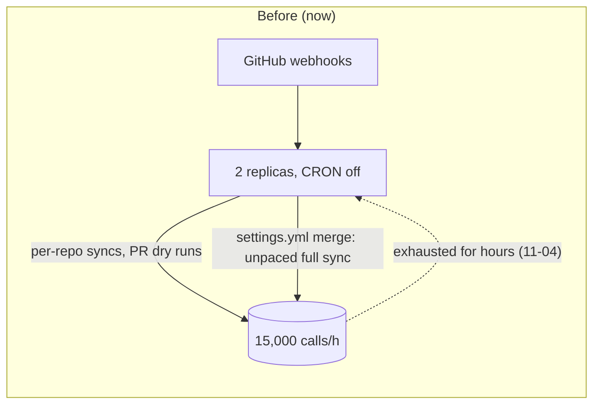
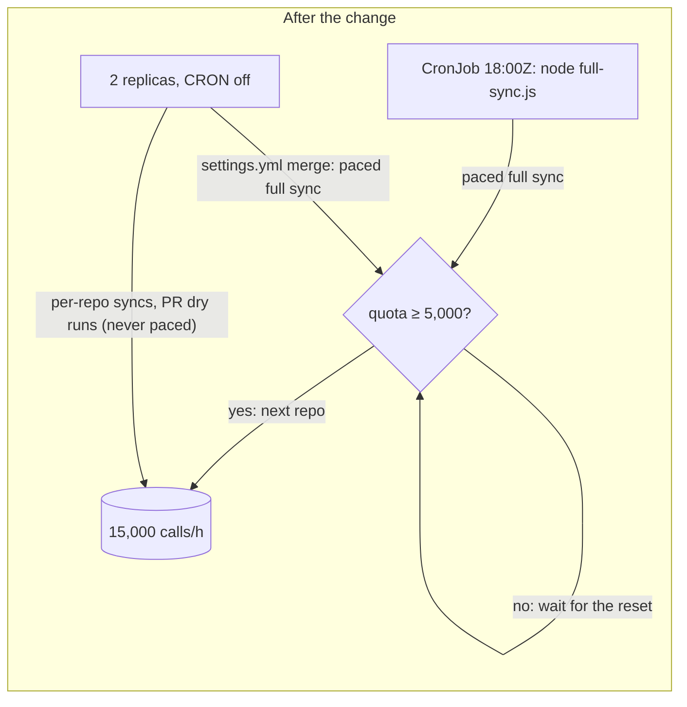
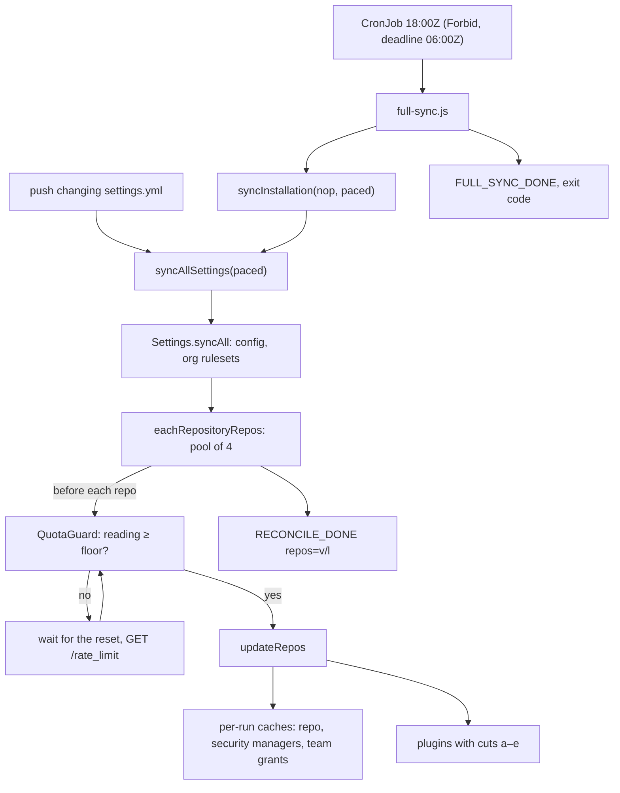
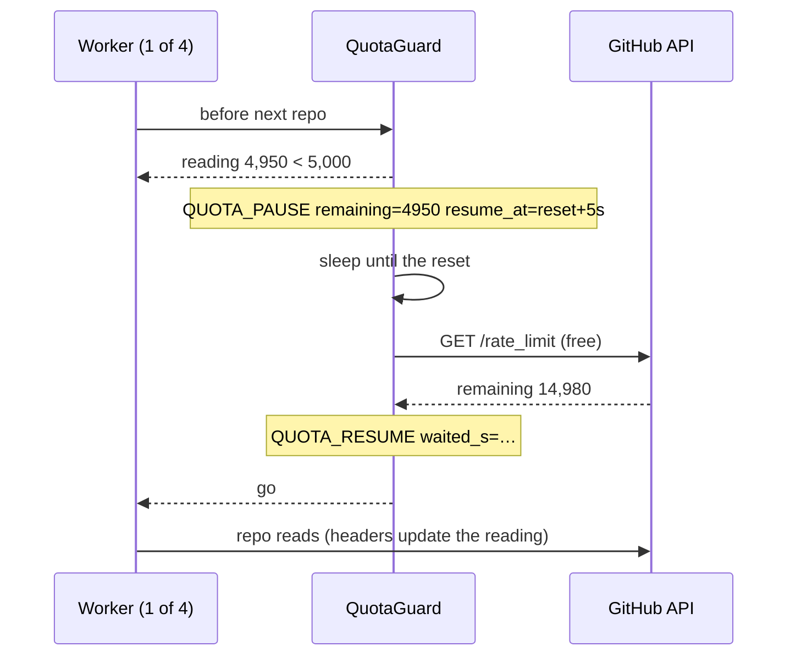

# Change Design: Nightly full sync in prod within the GitHub API quota

**Date:** 2026-11-23
**Artifact:** change-design
**Status:** Draft
**Template version:** default/0.3.2
**References:** prod values `apps/safe-settings-prod/values.yaml` in tomtom-internal/safe-settings-deployment (`CRON: ""` and the estimate behind it) · [tomtom-forks/safe-settings#26](https://github.com/tomtom-forks/safe-settings/pull/26) (rc.9: archived repos skipped) · cost model and its inputs in [`analysis/`](analysis/)

**Plugin version:** 0.7.11
**Agent Sessions:** claude-code: 0f4136a5-6f9b-4ab8-a1c3-4f012a27f673

---

<!-- hint: Keep the `**Artifact:** change-design` line — /plan and /implement use it to recognize this as a change-design artifact (requirements + design in one file) and skip the prd.md requirement. -->

> *Section audience —* 🔍 reviewer (understand the change without implementing it) · 🛠 author (implement the change). Sections without an icon serve both.

## Summary 🔍

Prod runs webhook-only because a full sync was estimated at 100–200k API calls against the App's 15,000/hour budget. Measured on rc.9, one full sync of prod costs 83,109 calls, and 34,578 of them are writes that change nothing: branch protection rewritten on every run, Dependabot alerts re-enabled, DELETEs of teams whose access comes from an organization role, and collaborator additions that archived repos refuse. Two replicas each running it would double that.

This design runs one full sync per night from a Kubernetes CronJob and paces it: before each repo it checks the quota, and below 5,000 calls left in the hour it waits for the reset, so webhooks keep a third of the budget (their night peak is 2,461 calls/h). Five cuts remove the waste: one read per repo, flattened protection flags, read-before-write for Dependabot alerts, one grant list per org-role team, and no collaborator sync on archived repos. A run then costs ~36,200 calls and ~600 writes and needs ~3.7 of the 12 night hours. The same pacing covers the full syncs that `settings.yml` merges start, which exhausted the quota for 8 hours on 11-04. Exit codes, end-of-run lines and check runs report truthfully whether a run covered every repo. Prod is not changed in this phase; turning it on is a later, NOP-first rollout.

## Background & problem 🔍

Prod (org `tomtom-internal`) runs webhook-only. Its values set `CRON: ""` with this estimate: a full tick costs ~100–200k API calls against the App's 15,000/hour budget, so ~10 hours at full throttle, during which webhook handlers are throttled too. Without a periodic full sync, nothing re-applies the config to a repo until a webhook touches it. Drift made in the GitHub UI stays. A lost push delivery or a run killed mid-way stays unrepaired; both happened in October (a lost admin merge push on 2026-10-13, a run killed by a rollout on 2026-10-14).

The estimate predates rc.9 (#26, prod since 2026-11-02). rc.9 skips archived repos before any API call; they took 74% of prod calls. It also lists the repos once per run, 100 per page. This design measures what a full sync costs now, removes the calls that are pure waste, and turns on one nightly full sync that cannot starve the webhooks.

### What the numbers say

All counts are **charged calls**: requests that count against the App installation's primary quota, which is every request except `304 Not Modified`. Log counts come from the app's `GitHub request: <METHOD> <URL> - <status>` debug lines in Loki (one line per logical request, 304s included), queried the way the safe-settings section of the team's Loki guide prescribes.

**1. Limits (checked 2026-11-23)**

| Limit | Value | Source |
|---|---|---|
| Primary, per App installation | 15,000/h on prod and dev | `x-ratelimit-limit: 15000` in 78 of 78 rate-limit samples from prod error lines (2026-11-04); GitHub docs for Enterprise Cloud installations |
| Conditional requests | a 304 is free | Live, dev admin repo: three 304s left `x-ratelimit-used` at 8, the next 200 moved it to 9 |
| ETag support | every per-repo GET the plugins use answers 304 to `If-None-Match`, except `vulnerability-alerts` (204, no ETag) | Live probe of 14 endpoints on the dev admin repo |
| Secondary limits (documented) | 100 concurrent requests; 900 points/min for REST (read 1, write 5); 80 content-creating requests/min and 500/h | GitHub docs |
| Secondary limits (seen) | none: 0 `Secondary quota detected` lines on prod in 30 days and on dev in 7 days. The 11-04 full syncs peaked at 2,250 charged requests/min (93 minutes at ≥ 900) without one | Loki |
| `GET /rate_limit` | free on the primary limit | GitHub docs |

On 11-04 the response headers showed two `core` windows open at once, with different reset times, and the sum of their `used` matched the logged non-304 count within ~1%. GitHub documents one counter per installation, so the budget below is the documented single 15,000/h.

**2. Webhook-only baseline (prod, both pods, charged calls per clock hour)**

| Period | p50 | p95 | p99 | max | Hours with quota exhaustion |
|---|---|---|---|---|---|
| 30 days (10-24 → 11-23) | 16 | 15,105 | 20,079 | 28,480 | 42 |
| Before rc.9 | 13 | 17,808 | 22,614 | 28,480 | 34 |
| After rc.9 (from 11-03 17:00Z) | 25 | 2,834 | 16,154 | 21,583 | 8, all on 11-04 |
| Steady state (11-05 → 11-23) | 14 | 1,829 | 4,783 | 8,332 | 0 |
| Steady, weekdays 07–17Z | 621 | 3,529 | 5,934 | 8,332 | 0 |
| Steady, nights 18–06Z | 0 | 244 | 837 | 2,461 | 0 |

Source: Loki `count_over_time` of `GitHub request:` lines without ` - 304`, in 5-minute bins summed per clock hour. An exhaustion hour is one with a `Request quota exhausted` line. A clock hour can exceed 15,000 because a rate-limit window resets mid-hour. 304s were 44% of all requests over 30 days and 65% after rc.9.

The only exhaustion after rc.9 is the burst this design must not repeat. On 11-04 four `settings.yml` merges (10:37–11:39Z) each started an unpaced full sync from the push handler (index.js:262), next to the PR dry runs of the same PRs. Together they spent 15.5–21.6k calls an hour for about 8 hours. Other webhook runs waited 30–50 minutes every hour, and none of the four runs logged `RECONCILE_DONE`.

About half of the per-repo syncs on prod are PR dry runs, which read everything and write nothing. Over 11-14 → 11-23 prod made 2,244 branch-protection PUTs for 4,336 protection GETs (0.52), while a real run PUTs every protected branch it reads (dev: 160 of 160; prod: all 834 protection diffs logged in 24 hours came from the four flags of cut (a) below). Rates measured on prod are corrected for this where it matters.

**3. Cost of one full sync on rc.9, measured on dev**

Dev (`tomtomsptesting`) has 209 repos: 160 active, 48 archived, 1 restricted. Each of its two pods runs an hourly in-process cron. One pod's tick on 2026-11-23 at 12:00Z: 1,402 request lines in 7 min 15 s, that is 975 reads (19 of them free 304s for config files) and 427 writes, so 1,383 charged (2 of them App-JWT calls, which count against the App's own limit). It ended `RECONCILE_DONE errors=12 archived_skipped=48`. The tick is write-bound: the throttle allows 1 write per second.

| Calls | Endpoint | Why |
|---|---|---|
| 486 GET | `/repos/{o}/{r}` | 3 per active repo (archive check, repository plugin, branches plugin) + 1 per repo with labels |
| 160 GET, 160 PUT | `/repos/{o}/{r}/branches/{b}/protection` | Every protected branch is rewritten. GitHub returns `allow_force_pushes`, `allow_fork_syncing`, `block_creations` and `lock_branch` as `{enabled: …}` objects, and `reformatAndReturnBranchProtection` (lib/plugins/branches.js:126) flattens five other flags but not these four, so the comparison always differs |
| 160 PUT | `/repos/{o}/{r}/vulnerability-alerts` | Written on every run when `enableVulnerabilityAlerts` is set (lib/plugins/repository.js:249), without reading the state first |
| 125 GET | `/repos/{o}/{r}/teams` | 1 per teams sync, plus 25 follow-up pages |
| 100 GET | `/orgs/{o}/security-managers` | Read once per repo with teams, though it is one org-wide list (lib/plugins/teams.js:40) |
| 88 DELETE | `/orgs/{o}/teams/{t}/repos/{o}/{r}` | A team that holds access through an organization role: GitHub lists it on every repo, but it has no repo-level grant there, so the DELETE returns 204 and changes nothing (see §4) |
| 12 GET, 12 PUT | one team grant | Two dev configs disagree about it (dev only) |
| 92 GET, 5 writes | listing, config, org rulesets, autolinks, topics, labels, rulesets, environments, collaborators, check run | As configured; the 5 writes are ruleset 4xx |
| 1 POST | `/repos/{o}/admin/check-runs` | End-of-run check |

**4. Extrapolation to prod**

One full run costs

> C = ⌈N/100⌉ + (4 + S + F) + (1 + K) + Σₚ nₚ·rₚ + W

- ⌈N/100⌉ — the repo listing, N repos in the installation.
- 4 + S + F — `settings.yml`, two directory reads and the repo-file tree, plus one read per suborg file (S) and repo file (F). These S + F reads are free 304s in a long-running pod whose file cache is warm; a CronJob process starts cold.
- 1 + K — the org rulesets list plus one read per org ruleset (K).
- Σₚ nₚ·rₚ — per plugin p: the repos or entries that run it (nₚ) × its reads per repo (rₚ).
- W — writes.

The reads per repo (rₚ) come from the code paths. With dev's inputs the model reproduces the dev tick exactly: 975 reads including the 19 free ones, and 427 writes. Where a call depends on GitHub's state (how often a read leads to a write), the rate comes from prod logs. [`analysis/tickmodel.py`](analysis/tickmodel.py) is the model; [`analysis/inputs/`](analysis/inputs/) holds its inputs.

Prod inputs: [`analysis/coverage.js`](analysis/coverage.js) resolves every repo's effective config with safe-settings' own `Settings` code, over the prod admin config (commit 92b62692) and the 2026-11-23 repo listing: 15,787 repos, of which 9,222 archived, 1 restricted and 6,564 active; 181 suborg files and 1,709 repo files. The 11-04 full syncs read 7 org rulesets.

| Term | Prod basis | Today | After the cuts | Cut |
|---|---|---|---|---|
| Repo listing | 15,787 repos | 158 | 158 | |
| Config reads, cold | 4 + 181 + 1,709 | 1,894 | 1,894 | |
| Org rulesets | 7 | 8 | 8 | |
| `GET /repos/{o}/{r}` | 6,564 active, 864 with labels | 20,556 | 6,564 | (e) |
| GET protection | 7,160 protected branches | 7,160 | 7,160 | |
| PUT protection | ≈ 1 per protected branch today | 7,160 | ≈ 0 | (a) |
| Dependabot alerts | 6,564 active repos | 6,564 PUT | 6,564 GET, ≈ 0 PUT | (b) |
| GET teams, + 0.207 follow-up pages | 4,445 teams syncs (2,835 active + 1,610 archived repos) | 5,365 | 5,365 | |
| GET security managers | | 4,445 | 1 | (e) |
| Team DELETEs that change nothing | 4 org-role teams on every teams-synced repo that does not grant them | 17,561 + ~8 real | 0, plus 34 grant-list reads and ~8 real DELETEs | (c) |
| Team PUT + GET by name | 112 a day, one-off changes | 224 | 224 | |
| Autolinks, topics, labels | 1,981 / 1,077 / 864 repos | 3,922 | 3,922 | |
| Collaborators on active repos | 658 repos, 303 distinct users | 1,619 | 1,619 | |
| Collaborators on archived repos | 542 repos, 2,710 entries | 1,084 GET + 2,710 PUT (all 403) | 0 | (d) |
| Rulesets | 708 repos, 1,120 rulesets; 0.355 writes per sync | 1,828 + 251 | 1,828 + 251 | |
| Environments | 19 repos, 120 environments | 379 | 379 | |
| Drift writes (repo PATCH, labels, topics, autolinks) | 211 a day, one-off | 211 | 211 | |
| Check run | | 2 | 0 | |
| **Charged calls** | | **83,109**, of which 34,578 writes | **36,190**, of which 582 writes | |

Sources for the rates (prod Loki 11-14 → 11-23 unless noted):

- **Follow-up team pages:** 874 for 4,215 team lists.
- **Protection PUTs:** ≈ 1 per protected branch in a real run (see the dry-run note in §2).
- **Team DELETEs that change nothing:** four teams hold access through organization roles. GitHub lists them on every repo (4 of 4 randomly sampled active repos, live GET on 2026-11-23), but their repo-level grants cover only 2,296, 54, 22 and 21 repos (`GET /orgs/{org}/teams/{slug}/repos`). For an ungranted repo the grant check answers 404 and the DELETE answers 204 and changes nothing, so it repeats on every run. 99% of the team DELETE pairs on prod are these four teams (3 days, 568 pairs). Per full run they come to Σ over the four teams of (teams-synced repos − repos whose config grants the team) = 17,561 (coverage.js); the same formula gives dev's measured 88.
- **Team PUTs and drift writes:** 1,008 team PUTs and 1,902 other writes in 9 days; only 7 of 139 PUT pairs and 36 of 473 PATCHed repos recurred within 3 days, so these are real one-off changes, counted at their daily rate.
- **Ruleset writes:** 147 for 798 ruleset lists, divided by the 0.52 real-run share.
- **Archived collaborators:** 1,267 PUTs in 10 days, all `403 Repository was archived so is read-only`, 1,238 distinct (repo, user) pairs on 201 archived repos. Config holds 2,710 such entries, the upper bound per full run.

**5. Verdict**

The budget is 15,000 per window. A floor of 5,000 (33%) kept free for webhooks lets a paced run spend up to 10,000 per window, minus what the webhooks use in it.

| Run | Charged calls | Writes, and their minimum time at 1/s | Hours at night under the floor (10,000 − p95 244 per h) | Fits 18:00–06:00Z? |
|---|---|---|---|---|
| Today, in-process `CRON` on both replicas | 166,218 | 2 × 34,578 | 17.0 | No |
| Today, one run | 83,109 | 34,578, 9.6 h | 8.5 | Barely: the writes alone take 9.6 h |
| After the five cuts, one CronJob run | 36,190 | 582, 10 min | 3.7 (4.8 if every hour were the worst night hour, 2,461) | Yes, 2.5–3.2× margin |
| After the cuts, a paced `settings.yml` merge in the daytime (warm config, check run) | ~34,300 | ~580 | 5.3 at the weekday p95 (3,529/h) | n/a |

Two replicas each running today's tick reproduce the original 100–200k estimate. One paced run after the cuts needs about 3.7 of the 12 night hours, so there is no gap left to close: option (a) of the brief applies once the run is paced and runs once instead of once per replica. The cuts are what make it comfortable. They take the run from 83,109 to ~36k calls and from 34,578 to ~600 writes, and stop a nightly rewrite of settings that never change.

The starting point of keeping ≥ 30% free for webhooks holds. 5,000 is 33% of the budget, twice the worst night hour (2,461) and 1.4× the weekday p95 (3,529). It does not cover the weekday p99 (5,934). That matters only for the paced merge-triggered runs, which today drain the quota completely.

## Goals and non-goals

### Goals

**G1: A full sync writes nothing to a repo that already matches its config (cuts a, b, c)**
- [ ] G1-AC1 — A protected branch whose live protection matches the config, with `allow_force_pushes`, `allow_fork_syncing`, `block_creations` and `lock_branch` returned as `{enabled: <bool>}` objects, gets no PUT. · `verify: nock test; GET protection returns the object form of the configured booleans; any PUT fails the test`
- [ ] G1-AC2 — A real difference in one of those four flags still gets exactly one PUT, carrying the configured value. · `verify: nock test; config allow_force_pushes: true, live {enabled: false}`
- [ ] G1-AC3 — With `enableVulnerabilityAlerts: true`, a 204 from `GET /repos/{o}/{r}/vulnerability-alerts` leads to no PUT and a 404 to exactly one PUT. With `false`, a 404 leads to no DELETE and a 204 to exactly one DELETE. · `verify: nock test, four cases`
- [ ] G1-AC4 — A team that the repo's team list shows but that has no repo-level grant (the repo is absent from `GET /orgs/{org}/teams/{slug}/repos`) is not deleted. A team that has a repo-level grant and is not in the config is deleted once. · `verify: nock test, both cases`
- [ ] G1-AC5 — A team's grant list is read at most once per run, and only for a team about to lose a grant. · `verify: nock test; three repos that all list the same org-role team; one paginated grant listing in total`
- [ ] G1-AC6 — In a full sync, an unchanged active repo whose config has branch protection, teams and Dependabot alerts costs exactly: 1 `GET /repos/{o}/{r}`, 1 GET protection per protected branch, 1 GET vulnerability-alerts, 1 GET teams (plus follow-up pages), and no write. The run adds 1 GET security managers and the grant listings of G1-AC5. · `verify: nock test with nock.disableNetConnect(); the test lists every expected interceptor with its count and fails on any unmatched or missing request`

**G2: Each repo, and the org's security managers, are read once per run (cut e)**
- [ ] G2-AC1 — A full sync over N active repos makes exactly N `GET /repos/{o}/{r}` calls, also when some of them have labels. · `verify: nock test, three repos, one with labels`
- [ ] G2-AC2 — `GET /orgs/{org}/security-managers` is called once per run, however many repos sync teams. · `verify: nock test, three repos with teams`
- [ ] G2-AC3 — After the repository plugin changes a repo in a run (a PATCH or a default-branch rename), the plugins after it in the same run see the changed repo: the branches plugin protects the new default branch name. · `verify: nock test; rename main → trunk; GET and PUT protection go to trunk`

**G3: Archived repos sync teams only (cut d)**
- [ ] G3-AC1 — A full sync of an archived repo whose config has teams and collaborators calls team endpoints only, and no `/collaborators` or `/invitations` endpoint. · `verify: nock test`
- [ ] G3-AC2 — Active repos still sync collaborators as before. · `verify: the existing collaborators tests pass unchanged`

**G4: Paced full syncs leave a quota reserve for webhooks**
- [ ] G4-AC1 — In a paced run, when the quota reading is below the floor (default 5,000, `SS_QUOTA_FLOOR`), no new repo starts until the reading's reset time. Repos already started finish. · `verify: nock test with fake timers; responses carry x-ratelimit-remaining 4999 and a reset 60 s ahead; the next repo's first request comes only after the clock passes the reset`
- [ ] G4-AC2 — After the reset the run reads `GET /rate_limit` and continues only at or above the floor; below it, it waits for the next reset. · `verify: nock test; /rate_limit answers 3,000 and then 14,000; the run resumes after the second`
- [ ] G4-AC3 — At or above the floor the guard makes no API call of its own. · `verify: nock test; remaining 9,000 on every response; no /rate_limit request`
- [ ] G4-AC4 — A paced run logs `QUOTA_GUARD floor=<f> remaining=<n> reset=<iso>` before its first repo, from a real reading. Each pause logs `QUOTA_PAUSE remaining=<n> floor=<f> resume_at=<iso>` and then `QUOTA_RESUME waited_s=<s> remaining=<n>`. · `verify: log assertions in the nock tests; the dev run of G6-AC2`
- [ ] G4-AC5 — Without a usable reading (no rate-limit headers seen and `GET /rate_limit` failing), a paced run starts no repo; it logs `QUOTA_UNKNOWN` and retries the reading every 60 s. · `verify: nock test; /rate_limit answers 500 twice, then 200; no repo request before the 200`
- [ ] G4-AC6 — A reading whose reset time has passed is not used; the guard reads `GET /rate_limit` instead. · `verify: nock test; a stale low reading does not cause a pause when /rate_limit answers 14,000`
- [ ] G4-AC7 — Paced: the CronJob run, an in-process `CRON` tick, and the full sync started by a push that changes `settings.yml` or by an org-level `repository_ruleset` event. Never paced: per-repo webhook syncs, suborg and repo-file syncs, and PR dry runs. · `verify: one test per entry point; with a reading below the floor only the paced ones wait`

**G5: A nightly CronJob run that reports its outcome truthfully**
- [ ] G5-AC1 — With `fullSync.enabled: true`, the chart renders one CronJob: schedule `0 18 * * *` in `Etc/UTC`, `concurrencyPolicy: Forbid`, `backoffLimit: 0`, `activeDeadlineSeconds: 43200`, `startingDeadlineSeconds: 3600`, command `node full-sync.js`, the Deployment's image, env config map and credentials secret (overridable by `fullSync.secretName`), pod annotation `karpenter.sh/do-not-disrupt: "true"`, requests 500m / 1Gi, limits 2 CPU / 6Gi, and `NODE_OPTIONS=--max-old-space-size=5120`. With default values it renders no CronJob. · `verify: helm template with and without fullSync.enabled`
- [ ] G5-AC2 — `full-sync.js` exits 0 when the run visited every listed repo, even if some repos logged errors. It exits 1 when the installation lookup, the config load or the listing failed, or when a listed repo was not visited. · `verify: tests; listing answers 500 → exit 1; one repo's PUT answers 422 → exit 0 and errors=1`
- [ ] G5-AC3 — Every `full-sync.js` run, NOP or not, ends with one `FULL_SYNC_DONE nop=<bool> repos=<visited>/<listed> errors=<n> paused_s=<s> duration_s=<s>` line, and `RECONCILE_DONE` gains `repos=<visited>/<listed>`. · `verify: log assertions; the dev run of G6-AC2`
- [ ] G5-AC4 — A scheduled run posts no check run on the admin repo. · `verify: nock test; syncInstallation makes no POST check-runs and no GET commits`
- [ ] G5-AC5 — A push-triggered run posts its check run on the pushed commit (`after` in the push payload), not on the admin repo's newest commit when the run ends. · `verify: nock test; push with after = sha1; head_sha is sha1 and no commits listing is requested`
- [ ] G5-AC6 — A scheduled NOP run (`FULL_SYNC_NOP=true`) ends without touching a check run or PR comment and logs each intended change as one `NOP_CHANGE plugin=
 repo=<r> action=
` line. · `verify: nock test; any check-run or comment request fails the test`

**G6: The cost claims hold on dev before prod is touched**
- [ ] G6-AC1 — On dev's hourly in-process cron, one pod's tick drops from 1,381 charged calls on the installation (2026-11-23 12:00Z) to at most 750 (model: 708), and from 426 writes to at most 30 (model: 17). · `verify: Loki count of one tick's GitHub request: lines on one pod, before and after the dev rollout`
- [ ] G6-AC2 — A dev CronJob run with `SS_QUOTA_FLOOR` above dev's remaining quota (e.g. 14,500) logs at least one `QUOTA_PAUSE`, then `QUOTA_RESUME` after the reset, and ends with `FULL_SYNC_DONE nop=false repos=209/209`; the Job completes. · `verify: dev Job status and pod logs`
- [ ] G6-AC3 — Re-running the model with dev's measured after-change counts per repo and prod's coverage gives at most 40,000 charged calls for one nightly prod run, which is at most 4.1 hours under the floor at the night p95. · `verify: analysis/tickmodel.py output`

### Non-goals

- Enabling the CronJob in prod or changing anything there (values, App settings). That is a later step (see Testing & verification).
- A cache of ETags kept across runs. The CronJob starts cold every night; its 1,894 config reads stay.
- Pacing PR dry runs, suborg and repo-file syncs, or per-repo webhook syncs.
- Leader election, or running `CRON` in the replicas; prod keeps `CRON: ""`. No overlap guard for in-process ticks.
- A second GitHub App for the scheduled run. The CronJob takes its credentials from a secret named in values, so this stays a values change.
- Reading Dependabot alert state for many repos at once through GraphQL (would save ~6,500 REST calls per run).
- Spreading one run over several nights, or resuming a run that was killed.
- Fixing dev's conflicting team config (12 PUTs per tick) or the ruleset writes that fail on every run.

## Architecture

The change has four parts: where the run happens, how it is paced, what it stops wasting, and how it reports.

**1. One run per night, out of band.** A Kubernetes CronJob in the safe-settings namespace starts `node full-sync.js` at 18:00Z with the Deployment's image, env config map and credentials. `full-sync.js` calls `syncInstallation(nop, { paced: true })`. The replicas keep `CRON: ""` and serve webhooks as before. `concurrencyPolicy: Forbid` keeps one run at a time, and the 12-hour deadline ends a run by 06:00Z.

**2. A quota guard in the repo loop.** `eachRepositoryRepos` (lib/settings.js:602) asks the run's guard before each repo when the run is paced. The guard is created per paced run and attaches hooks to that run's Octokit client:

- *Readings.* Every response and error response (304s included) with `x-ratelimit-resource: core` updates a reading `{remaining, reset}` for its window. The effective reading is the lowest `remaining` among windows whose reset is still ahead, which also covers the two concurrent windows seen in prod headers.
- *Decision.* At or above the floor, the guard returns at once. Below it, it logs `QUOTA_PAUSE`, sleeps until the reset plus 5 s, reads `GET /rate_limit`, and repeats until the reading is at or above the floor; then it logs `QUOTA_RESUME`. With no live reading it reads `GET /rate_limit` first; if that fails it logs `QUOTA_UNKNOWN` and retries every 60 s.
- *Scope.* All workers of the pool (4 by default) wait on the same guard, so at most 4 repos in flight overshoot the floor, by a few calls each. Two paced runs at once (the nightly run and a merge) both stop at the same floor.
- *Callers.* `syncAllSettings` (index.js:15) takes a `paced` option. `syncInstallation` (CronJob and in-process `CRON`), the push handler's full sync (index.js:262) and the org-level `repository_ruleset` handler (index.js:339) pass `paced: true`. The PR dry run (index.js:584) and every per-repo or selected sync do not.

**3. The five cuts.**

- **(a) Branch protection.** `reformatAndReturnBranchProtection` (lib/plugins/branches.js:126) also flattens `allow_force_pushes`, `allow_fork_syncing`, `block_creations` and `lock_branch` from `{enabled: x}` to `x`, so an unchanged branch compares equal.
- **(b) Dependabot alerts.** `updateSecurity` (lib/plugins/repository.js:248) reads `GET /repos/{o}/{r}/vulnerability-alerts` (204 enabled, 404 disabled) and writes only on a difference.
- **(c) Teams with org-role access.** Before `remove` (lib/plugins/teams.js:121) deletes a team's grant, the plugin asks a per-run cache of that team's repo-level grants. The cache is filled once per run per team, on first need, from `GET /orgs/{org}/teams/{slug}/repos` (paginated, 100 per page). A repo that is not in the list gets no DELETE; the plugin logs at debug that the access comes from outside the repo.
- **(d) Archived repos.** `ARCHIVED_REPO_SECTIONS` (lib/settings.js:16) becomes `['teams']`. GitHub refuses collaborator writes on archived repos, and team grants still work there (3 days of prod: 144 team DELETEs and 20 team PUTs on archived repos, all 204).
- **(e) One repo read, one security-manager read.** The `Settings` instance of a run holds a repo cache: the first `GET /repos/{o}/{r}` of a repo fills it, and the archive check, the repository plugin, the branches plugin and the labels plugin read from it. The repository plugin replaces the cached repo with its PATCH or rename response, so later plugins see the change. The org's security managers are read once per run into the same instance.

**4. Reporting the outcome.**

- `eachRepositoryRepos` counts listed and visited repos. A repo counts as visited once its step ends, whether it was synced, skipped as restricted or archived, or failed with a logged error.
- `RECONCILE_DONE` gains `repos=<visited>/<listed>`. `full-sync.js` logs `FULL_SYNC_DONE` in both modes and exits 0 only when every listed repo was visited.
- `handleResults` (lib/settings.js:191) puts a check run only on the commit that triggered the run, which is the push's `after`. A run without a triggering commit posts none. In NOP mode, a run without a check run logs its intended changes as `NOP_CHANGE` lines instead of updating a check run. Today it would read `payload.check_run` and fail (lib/settings.js:297–318).

## Components

In tomtom-forks/safe-settings:

- **`lib/quotaGuard.js`** (new) — readings from response headers, the floor decision, `GET /rate_limit`, the `QUOTA_*` log lines.
- **`lib/settings.js`** — guard call and listed/visited counts in `eachRepositoryRepos`; `repos=` in `RECONCILE_DONE`; per-run caches for repos, security managers and team grants; `ARCHIVED_REPO_SECTIONS = ['teams']`; check-run placement and the NOP path without a check run in `handleResults`.
- **`lib/plugins/branches.js`** — flatten the four flags; read the repo from the cache.
- **`lib/plugins/repository.js`** — read alert state before writing it; read the repo from the cache and refresh the cache after a PATCH or rename.
- **`lib/plugins/teams.js`** — grant check before `remove`; security managers from the per-run cache.
- **`lib/plugins/archive.js`, `lib/plugins/labels.js`** — read the repo from the cache.
- **`index.js`** — `paced` option on `syncAllSettings`, set by the scheduled, push and org-ruleset full syncs; the pushed commit passed on for the check run.
- **`full-sync.js`** — exit code from listed/visited; `FULL_SYNC_DONE`.
- **`lib/env.js`** — `SS_QUOTA_FLOOR` (default 5000).
- **`test/unit/lib/…`, `test/integration/…`** — nock tests for G1–G5, in the style of `test/integration/common.js` (`nock.disableNetConnect()`, `isDone()` at teardown) and `test/unit/lib/settings-archived-transport.test.js`.
- **`docs/sdlc/changes/2026-11-23-cron-sync-quota/analysis/`** — the cost model, `coverage.js` and the aggregate inputs used above.

In tomtom-internal/safe-settings-deployment:

- **`apps/safe-settings-dev/templates/cronjob.yaml`** (new) and dev values — the CronJob of G5-AC1, enabled on dev for G6.
- **`apps/safe-settings-prod/templates/cronjob.yaml`** (new) — the same template, rendering nothing until values enable it. The prod values file is not changed in this phase.

## Data flow

How one paced run spends the quota and gives it back:

## Error handling

| Failure | What happens | What shows it |
|---|---|---|
| The run is still going at 06:00Z | Kubernetes stops the pod (`DeadlineExceeded`); the next night starts again from the top of the listing, so repos late in the listing wait a day longer | Job `Failed`, no `FULL_SYNC_DONE` |
| The pod is killed (forced node expiry, OOM) | Same as above; `do-not-disrupt` stops only voluntary moves | Job `Failed`; for OOM the container's reason |
| Webhooks spend the reserve anyway | Unchanged: the throttling plugin waits for the reset, as today | `Request quota exhausted` lines |
| A paced merge sync and the nightly run overlap | Both stop at the floor and share what is above it; each takes longer | Two runs' `QUOTA_PAUSE` lines |
| A repo fails | Logged per repo as today; counts as visited; the run goes on | `errors=` in both end lines; exit code stays 0 |
| A webhook sync changes a repo during the night | The nightly run uses its own read from moments earlier, as any run does today | none needed |

## Testing & verification

The per-goal `verify:` hints are the test plan. Two checks cut across goals.

**Dev, before vs after (G6).** Dev keeps its hourly in-process cron. Before: one pod's tick on 2026-11-23 12:00Z made 1,402 request lines (1,381 charged on the installation, 426 writes). After the dev rollout, count one tick on one pod the same way. Then run the dev CronJob once with a high `SS_QUOTA_FLOOR` (G6-AC2), and feed the measured per-repo counts back into the model for G6-AC3.

**Prod enablement (a later step, not part of this change).** Each step is a separate change in safe-settings-deployment:

1. Ship the fork release to prod with the CronJob template disabled. The replicas get cuts (a)–(e), the pacing of merge-triggered syncs and the check-run placement.
2. Enable the CronJob for one night with `FULL_SYNC_NOP=true`. A NOP run makes all the reads and no writes, so it measures the real nightly cost, duration and peak memory. Its `NOP_CHANGE` lines count the drift the first real night will write.
3. Review the NOP night: charged calls (expected ≤ 40,000), `QUOTA_PAUSE` count, `FULL_SYNC_DONE repos=15787/15787`, and the size and kind of the intended changes.
4. Switch to apply. Watch the first night's writes against the NOP list, and the webhook p95 the next day.

## Decisions 🔍

| ID | Title | Context | Options | Choice | Rationale | Source | Goal impact | Consequences |
|----|-------|---------|---------|--------|-----------|--------|-------------|--------------|
| CD-D-1 | How often, and when | A full sync repairs drift; its cost competes with webhooks | Hourly (as on dev); every 6 h (legacy); nightly; weekly | Nightly, starting 18:00Z | One paced run needs ~3.7 h at night; nights 18–06Z have a webhook p95 of 244 calls/h, weekdays 3,529 | `user` (once a night); start time `auto (prod baseline §2)` | G5-AC1 | Drift is repaired within a day; webhooks stay the fast path |
| CD-D-2 | Where the run executes | Prod has 2 replicas and no leader election, so in-process `CRON` runs once per replica | In-process `CRON` on both replicas; leader election; a CronJob under the existing App; a CronJob under a second App with its own 15,000/h | One CronJob running `full-sync.js` under the existing App, credentials from a secret named in values | One run per night, its own memory, a Job status as the signal; with the cuts the existing budget suffices | `user` | G5-AC1 | A cron-only App later means creating the App and pointing `fullSync.secretName` at its secret; no code change |
| CD-D-3 | How the run is paced | The throttling plugin waits only at 0 remaining, which starved webhooks on 11-04 | A fixed slice of repos per tick; spreading over N hours; rely on the throttling plugin; a dynamic floor | Before each repo, wait for the reset while the reading is below 5,000 | Adapts to the real webhook load; 5,000 is twice the worst night hour and 1.4× the weekday p95 | `user` | G4-AC1–AC6 | Run time depends on the webhook load; overshoot is bounded by the 4 repos in flight |
| CD-D-4 | Which calls to cut | Today's run is 83,109 calls and 34,578 writes (≥ 9.6 h at 1 write/s) | None; write fixes only (a, b, d); all five (a–e); also an ETag cache kept across runs | All five | 36,190 calls and 582 writes; an ETag cache would need storage that outlives the CronJob's process | `user` | G1, G2, G3 | (d) also stops collaborator removals on archived repos, which GitHub was never seen to accept (§4) |
| CD-D-5 | Which runs the floor paces | The 11-04 exhaustion came from four merge-triggered full syncs | Scheduled runs only; also full syncs triggered by `settings.yml` merges; also the PR dry runs | Scheduled runs and push-triggered full syncs (and the org-level ruleset event, which also starts one) | Removes the only failure mode the post-rc.9 data shows; pacing dry runs would make PR checks take hours | `user` | G4-AC7 | A `settings.yml` merge rolls out over ~3.5–5.5 h instead of exhausting the quota; a `settings.yml` PR's dry run is still an unpaced full read pass |
| CD-D-6 | How cut (c) checks a grant | The four org-role teams appear on every repo; the approved cut checks the grant before a DELETE | Per-repo check `GET /orgs/{org}/teams/{slug}/repos/{o}/{r}` before each DELETE; one paginated grant list per team per run | Grant list per team, read on first need, cached for the run | The per-repo check would add 17,561 reads per run (~1.8 h under the floor); the four lists are 23 + 1 + 1 + 1 pages; on 2026-11-23 a listed repo answered 204 and an unlisted one 404 to the per-repo check | `auto (live GETs on prod, 2026-11-23)` | G1-AC4, G1-AC5 | A team with grants on many repos costs ⌈grants/100⌉ reads once per run. If the plan phase finds a repo where the list and the per-repo check disagree, switch to the per-repo check |
| CD-D-7 | Where the guard's reading comes from | `GET /rate_limit` is free but adds latency; headers come with every response | `GET /rate_limit` before every repo; headers only; headers, plus `GET /rate_limit` when no reading is live or after a wait | Headers, plus `GET /rate_limit` when needed; the lowest remaining among windows still open | No extra call above the floor; two concurrent windows were seen on 11-04, and the minimum is the safe reading | `auto (11-04 headers; GitHub docs)` | G4-AC1–AC3, G4-AC6 | A reading can be up to one repo old; the floor absorbs that |
| CD-D-8 | Guard without a reading | Headers can be missing and `GET /rate_limit` can fail | Proceed (fail open); wait and retry (fail closed) | Fail closed: log `QUOTA_UNKNOWN`, retry every 60 s | A blind run is the 11-04 failure; a stuck run is visible (deadline, Job `Failed`, `QUOTA_UNKNOWN` lines) | `auto (11-04)` | G4-AC5 | A GitHub outage stalls paced runs until the reading comes back |
| CD-D-9 | What the exit code and end lines mean | `full-sync.js` exits 1 on any per-repo error, and dev logs `errors=12` every tick; `syncAll` catches fatal errors and still logs `RECONCILE_DONE` (lib/settings.js:22–34); NOP runs never log it | Keep; derive success from `RECONCILE_DONE`; count listed vs visited | Exit 0 only when every listed repo was visited; `FULL_SYNC_DONE` in both modes; `repos=` in `RECONCILE_DONE` | A Job that is always `Failed` is no signal; a run that died early must not look complete | `auto (code)` | G5-AC2, G5-AC3 | Per-repo errors are read from `errors=`, not from the Job status |
| CD-D-10 | Where check runs go | `createCheckRun` (lib/settings.js:135) puts the check on the admin repo's newest commit when a run ends | Keep; a nightly check with its own name on the newest commit; none for scheduled runs, and push runs on their pushed commit | No check run for scheduled runs; push runs check their pushed commit | A merge already showed another run's green check (2026-10-14); a paced 4-hour run makes that likely; a nightly check would put a red mark (prod runs always log some errors) on the day's last merge | `auto (prod logs 2026-10-14; code)` | G5-AC4, G5-AC5 | The admin repo shows nothing about nightly runs; the Job status and the end lines do |
| CD-D-11 | A scheduled NOP run must end cleanly | `handleResults` in NOP mode reads `payload.check_run` (lib/settings.js:297–318); a scheduled run has none | Leave it; skip the summary; log the intended changes | Log one `NOP_CHANGE` line per intended change | The prod NOP night (enablement step 2) must count the first night's writes | `auto (code)` | G5-AC6 | A first night with a lot of drift logs many lines, which Loki handles |
| CD-D-12 | Job settings | A stuck run must not spill into the day, and a failed run must not restart in the day | No deadline; retries; a 12-hour deadline without retries | `activeDeadlineSeconds: 43200`, `backoffLimit: 0`, `Forbid`, `startingDeadlineSeconds: 3600`, `Etc/UTC` | 3.7 h expected vs 12 h available; the daytime reserve covers the p95 only | `auto (prod baseline §2)` | G5-AC1 | A killed run leaves the end of the listing to the next night |
| CD-D-13 | CronJob resources | The tenant quota is 24 GiB and 8 CPU; the replicas' limits are 2 × 8 GiB; `maxSurge: 0` was set to stay off the cap | Copy the replicas' 8Gi (24 GiB, exactly the cap); 6Gi | Requests 500m / 1Gi, limits 2 CPU / 6Gi, heap 5 GiB | 2 × 8 + 6 = 22 GiB leaves room; one run per pod, where the replicas held up to four on 11-04 | `auto (prod values comments)` | G5-AC1 | Peak memory of a prod full sync is not measured yet; the NOP night measures it |
| CD-D-14 | Keeping the repo cache right | The branches plugin reads `default_branch` (lib/plugins/branches.js:26) after the repository plugin may have changed it | Cache GET responses only; re-read after any write; replace the entry with the write's response | Replace the cached repo with the PATCH or rename response | One read per repo without stale data inside a run | `auto (code)` | G2-AC3 | Changes by others during a run are seen as late as today |
| CD-D-15 | What can be tuned | Dev must be able to force a pause; prod may need a different floor | Constants; env and values | `SS_QUOTA_FLOOR` (default 5000) and `fullSync.*` values | G6-AC2 needs a floor above dev's remaining quota | `auto` | G4-AC1, G6-AC2 | none |
| CD-D-16 | In-process `CRON` | The guard sits in the shared loop | Pace it; leave it unpaced; remove the option | Paced, kept; no overlap guard; prod keeps `CRON: ""` | Dev's hourly ticks (~700 calls after the cuts) never reach the floor; prod does not use it | `auto` | G4-AC7 | A tick that waits past the hour overlaps the next one; documented, not guarded |
| CD-D-17 | Order of the prod rollout | Turning it on in prod is a later step | Apply from the first night; NOP first | Dev, then a prod NOP night, then apply | The NOP night measures cost, time and memory and lists the first night's drift with zero writes | `auto (brief: prod is a later step)` | none | One extra night before drift repair starts |

## Key facts & assumptions

- **The rule to keep:** a paced run never starts a repo while its quota reading is below the floor; webhook-driven syncs are never paced.
- The budget is GitHub's documented 15,000 calls/h per installation, shared by the replicas and the CronJob. If GitHub in fact counts per token, as the two windows seen on 11-04 might suggest, the guard reads its own token's window and stays on the safe side.
- Night webhook load stays near the steady state of 11-05 → 11-23 (p95 244/h, worst hour 2,461).
- *Unconfirmed, not blocking:* that GitHub refuses collaborator removals on archived repos as it refuses additions (1,267 additions, all `403 Repository was archived so is read-only`; no removal was attempted in 10 days).
- *Unconfirmed, not blocking:* the peak memory of a prod full sync in one process; the NOP night measures it before the first real night.
- The first real night also writes the drift accumulated since the last complete full sync. It is a one-off, sized by the NOP night.
- This repository is public. The design carries aggregate numbers only; the Loki helper scripts and repo lists behind them stay in private tooling.
