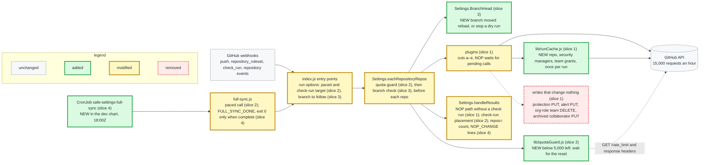
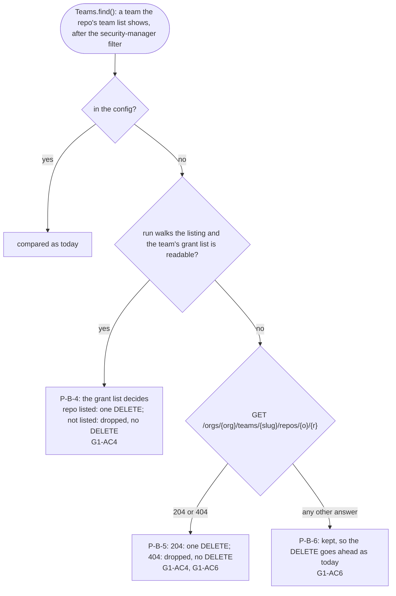
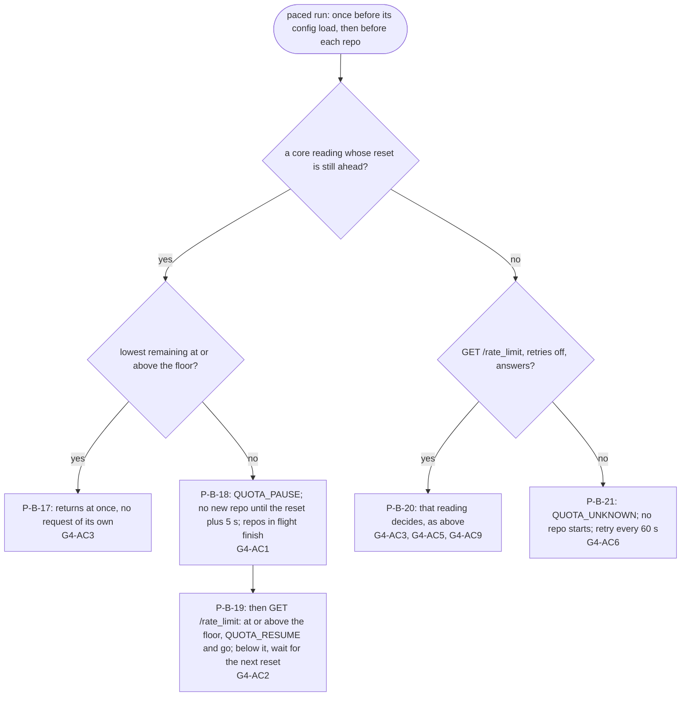
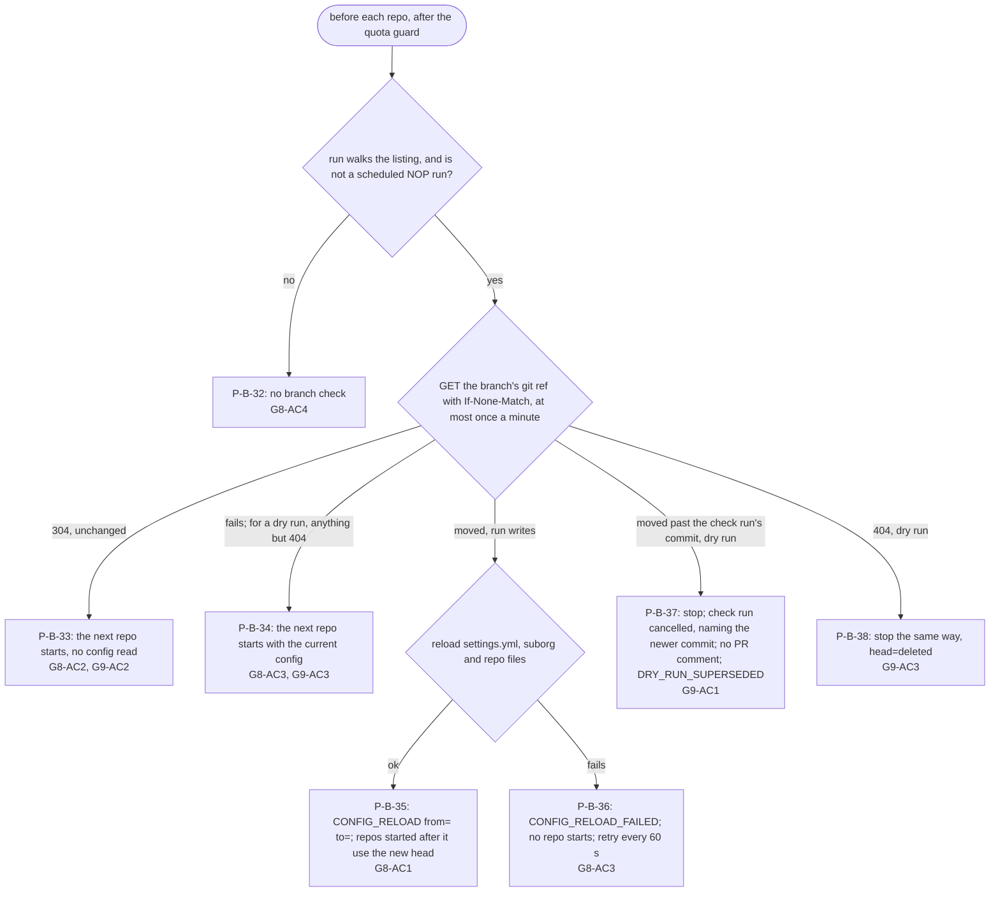

# Plan: Nightly full sync in prod within the GitHub API quota

> **For agentic workers:** REQUIRED PHASE COMMAND: Run `/tt-agentic-sdlc:implement` with this file's path to execute this plan. It runs one slice per session, and only a slice with tasks. The program design below is binding: build the call trees as drawn, and turn each behaviour into a failing test before you write the code.

**Date:** 2026-11-24
**Artifact:** plan
**Design:** [change-design.md](change-design.md)
**References:** [tomtom-forks/safe-settings#29](https://github.com/tomtom-forks/safe-settings/pull/29) (the design PR) · cost model in [`analysis/`](analysis/) · tomtom-internal/safe-settings-deployment (dev chart, values, operations guide)
**Strategy:** slices
**Test command:** `npm run test:unit`
**Status:** Draft
**Template version:** default/0.3.3

**Plugin version:** 0.7.11
**Agent Sessions:** claude-code: 8c373795-83b8-40b9-ac04-0d0f08d44165

---

## Program design

### R0 — Headline

A full sync was estimated at 100–200k GitHub requests against an allowance of 15,000 an hour, so prod runs none. This change cuts one to ~37,000 requests and paces every org-wide run so webhooks keep 5,000 an hour; a `settings.yml` pull request's check takes hours. Long runs follow config merges and newer pushes. A nightly dev job reports its outcome.

### R1 — The whole flow



Follow the loop node: every org-wide run now passes the quota guard and then the branch check before each repo, and the plugins read repos, security managers and team grants through the run cache. The dashed node is what the cuts stop sending.

### R2 — Seams — where the change attaches to existing code

```diff
  tomtom-forks/safe-settings
+ ├── index.js                       # run options: guard and check-run target (slice 2), branch and reload loader (slice 3); start check (slice 2) and branch baseline (slice 3) before settings.yml; paced note on a dry run's check run (slice 2)
+ ├── full-sync.js                   # paced syncInstallation call (slice 2); complete flag, FULL_SYNC_DONE, explicit exit, SIGTERM and error handlers, header note (slice 4)
+ ├── Dockerfile                     # slice 4: copies full-sync.js into the image
+ ├── TOMTOM.md                      # each slice's patch-set row and markers; SS_QUOTA_FLOOR (slice 2); the CRON note (slice 4)
  ├── lib/
+ │   ├── quotaGuard.js              # slice 2, NEW: readings from response headers, floor decision, GET /rate_limit without retries, QUOTA_* lines
+ │   ├── runCache.js                # slice 1, NEW: repo, security-manager and team-grant caches of one run, keyed on the run's Octokit client
+ │   ├── settings.js                # archived collaborators mode, listing mark, NOP path without a check run (slice 1); guard per repo, check-run placement (slice 2); BranchHead, branch check per repo, reload or stop, loadConfigMap (slice 3); listed/visited, lookup, config and listing flags, complete flag, repos=, NOP_CHANGE, per-repo error rows (slice 4)
+ │   ├── env.js                     # slice 2: SS_QUOTA_FLOOR, default 5000
+ │   ├── nopcommand.js              # slice 4: keeps the endpoint's HTTP method
  │   ├── configManager.js           # loadGlobalSettingsYaml(), called again by a reload
  │   └── plugins/
+ │       ├── diffable.js            # slice 1: NOP waits for pending changes before returning its rows
+ │       ├── branches.js            # slice 1: four more protection flags flattened; repo from the run cache
+ │       ├── repository.js          # alert state read before writing, repo from and into the run cache, NOP waits, disable rows fixed (slice 1); rename row fixed (slice 4)
+ │       ├── teams.js               # slice 1: grant check in find(); security managers from the run cache
+ │       ├── collaborators.js       # slice 1: removals-only mode for archived repos
+ │       ├── archive.js             # repo from the run cache (slice 1); NOP row names PATCH /repos/{o}/{r} (slice 4)
+ │       └── labels.js              # slice 1: repo from the run cache
  └── test/unit/
+     ├── helpers/github.js          # slice 1, NEW: Probot's ProbotOctokit on nock, throttle and retry off; a Settings run helper
+     ├── helpers/robot.js           # slice 2, NEW: fake robot that loads index.js with the real Settings
+     ├── lib/plugins/{branches,repository,teams}.test.js   # slice 1: plugin cases of the cuts
+     ├── lib/settings-cuts.test.js  # slice 1, NEW: request counts and NOP rows of whole runs; slice 3 adds the suborg-read case
+     ├── lib/quotaGuard.test.js     # slice 2, NEW: guard decisions and readings
+     ├── index-paced.test.js        # slice 2, NEW: which entry points are paced; where check runs go
+     ├── index-branch.test.js       # slice 3, NEW: branch check, reload, dry-run stop
+     └── full-sync.test.js          # slice 4, NEW: completion, exit code, FULL_SYNC_DONE, NOP_CHANGE

  tomtom-internal/safe-settings-deployment
  ├── apps/safe-settings-dev/
+ │   ├── templates/cronjob.yaml     # slice 4, NEW: CronJob safe-settings-full-sync, rendered only with fullSync.enabled; its pod mirrors the Deployment's security contexts, /tmp volume, service account, labels and extraEnv
+ │   └── values.yaml                # fullSync block, on for dev, and the comment above CRON (slice 4); image tag per rollout (each slice)
  ├── apps/safe-settings-prod/       # unchanged: prod gets the template with its enablement change
+ ├── docs/OPERATIONS.md             # CronJob row, "Nightly full sync" section, measured cost (slice 4); image-tag rows per rollout (each slice)
+ └── README.md                      # slice 4: names the new section
```

Which entry point starts which run. Everything left of the arrow exists today; what is new carries the slice that builds it, (s2) or (s3).

```text
index.js
├── push to the admin default branch
│   ├── settings.yml changed       :264 → syncAllSettings(run: paced (s2), follow the default branch (s3), check run on payload.after (s2))
│   └── suborg or repo files       :277 → syncSelectedSettings(run: follow the default branch¹ (s3), check run on payload.after (s2))
├── repository_ruleset, org source :339 → syncAllSettings(run: paced (s2), follow the default branch (s3), no check run (s2))
├── check_run.created, admin PR
│   ├── settings.yml changed       :584 → checks.update: paced, can take hours (s2) → syncAllSettings(NOP, run: paced (s2), stop at a newer PR push (s3))
│   └── suborg or repo files       :591 → syncSelectedSettings(NOP, run: stop at a newer PR push¹ (s3))
├── CRON tick :655, full-sync.js   → syncInstallation(nop, { paced: true }) :219 (s2) → syncAllSettings(run: paced (s2), follow the default branch² (s3), no check run (s2))
└── per-repo events :283–:640      → syncSettings → Settings.sync: not paced, no branch check, check run on the newest commit, as today
¹ only while it walks the listing, that is when suborg files changed   ² not in a scheduled NOP run
```

An org-wide run, as a call-stack diff:

```diff
  syncAllSettings(nop, context, repo, ref, run)                    index.js:15
+ ├── run.guard.waitForRoom()                                      # slice 2, paced: the start check, before any config read
+ ├── run.branch.start()                                           # slice 3, follow mode: GET /repos/{o}/admin, then the git ref of its default branch
  ├── ConfigManager.loadGlobalSettingsYaml()                       configManager.js:53
  └── Settings.syncAll(nop, context, repo, config, ref, run)       settings.js:22
+     ├── new Settings(…) → RunCache.begin(github)                 # slice 1: a fresh cache for this run
      ├── loadConfigs() → loadConfigMap('.github/suborgs')         settings.js:321, :652
-     │   └── any read error → "no suborg files"
+     │   └── 404 → no suborg files; any other error fails the config load   # slice 3
      ├── updateOrg()                                              settings.js:326
      ├── updateAll() → eachRepositoryRepos()                      settings.js:485, :602
+     │   ├── marks the run cache as walking the listing (slice 1); listed = the listing's length (slice 4)
      │   └── 4 workers, one repo at a time
+     │       ├── run.guard.waitForRoom()                          # slice 2, paced runs
+     │       ├── checkConfigBranch() → run.branch.check()         # slice 3: at most once a minute; moved: stop a dry run, or reloadConfig()
+     │       │   └── reloadConfig() → run.reload(), loadConfigs()  # slice 3: settings.yml, suborg and repo files; org settings are not re-applied
      │       ├── checkAndProcessRepo() → updateRepos()            settings.js:639, :345
+     │       └── visited += 1 when the repo's step ends           # slice 4
      └── handleResults()                                          settings.js:191
+         ├── RECONCILE_DONE … repos=<visited>/<listed>             # slice 4, full sync only
+         ├── createCheckRun() on run.checkRunSha, or none         settings.js:135, slice 2
+         ├── superseded dry run → checks.update(cancelled), no PR comment, DRY_RUN_SUPERSEDED   # slice 3
+         ├── NOP → one NOP_CHANGE line per row that names an endpoint, before the dedupe   # slice 4
+         └── NOP without payload.check_run → no PR comment and no check-run update   # slice 1
```

One repo, as a call-stack diff. Slice 1 builds all of it:

```diff
  updateRepos(repo, archived)                                      settings.js:345
  ├── Archive.getState() → getRepo()                               archive.js:75, :12
- │   └── GET /repos/{o}/{r}
+ │   └── RunCache.repo() → GET /repos/{o}/{r}, once per repo per run
  ├── Repository.sync()                                            repository.js:61
- │   ├── GET /repos/{o}/{r}                                       repository.js:67
+ │   ├── RunCache.repo(); a PATCH response or a default-branch rename updates the entry
- │   ├── updateSecurity(): PUT or DELETE vulnerability-alerts on every run    repository.js:248
+ │   ├── updateSecurity(): GET vulnerability-alerts (204 on, 404 off), then write only on a difference
- │   └── NOP: returns before its pending calls finish             repository.js:115
+ │   └── NOP: waits for its pending calls, then returns its rows
  ├── child plugins, in parallel                                   settings.js:418
  │   ├── Branches.sync()                                          branches.js:24
- │   │   ├── GET /repos/{o}/{r}                                   branches.js:26
+ │   │   ├── RunCache.repo()
  │   │   └── GET protection → compare(reformatAndReturnBranchProtection()) → PUT on a difference   branches.js:57, :126
+ │   │       # also flattens allow_force_pushes, allow_fork_syncing, block_creations, lock_branch
  │   ├── Labels.find()                                            labels.js:35
- │   │   └── GET /repos/{o}/{r}, as an existence check            labels.js:38
+ │   │   └── RunCache.repo()
  │   └── Teams: Diffable.sync() → find()                          diffable.js:63, teams.js:7
  │       ├── GET /repos/{o}/{r}/teams, all pages
- │       ├── GET /orgs/{org}/security-managers, for every repo    teams.js:40
+ │       ├── RunCache.securityManagers(): once per run; 404 or 410 → []
+ │       ├── drop each listed team that is not in the config and has no repo-level grant
+ │       │   run that walks the listing: RunCache.teamGrants(slug) → GET /orgs/{org}/teams/{slug}/repos, once per team
+ │       │   any other run: GET /orgs/{org}/teams/{slug}/repos/{o}/{r}, 204 granted, 404 not
  │       └── compare → remove() → DELETE /orgs/{org}/teams/{slug}/repos/{o}/{r}   teams.js:121
- ├── Diffable NOP: returns before its pending changes finish      diffable.js:140
+ ├── Diffable NOP: waits for its pending changes, then returns its rows
  └── syncArchivedRepo() → Teams.sync(), Collaborators.sync()      settings.js:459
+     └── Collaborators in removals-only mode: the config is cut to existing access before the compare, so only DELETEs remain
```

The scheduled run, built by slice 4 except its paced call (slice 2):

```text
node full-sync.js                                                  # the CronJob, or by hand
├── SIGTERM or an unhandled error → FULL_SYNC_DONE complete=false with the counts so far → exit 1   # installed before index.js loads
├── appFn(createProbot(), {})                                      # the CronJob sets CRON="", so no in-process tick starts
├── app.syncInstallation(nop, { paced: true })                     index.js:219
│   └── syncAllSettings(…) → Settings.syncAll(…) → the run         # lookup, config and listing flags; listed, visited; errors; paused time
├── complete = all three steps succeeded and visited = listed
├── FULL_SYNC_DONE nop= complete= repos=<visited>/<listed> errors=<repo and plugin pairs> paused_s= duration_s=
└── process.exit(complete ? 0 : 1)
```

**Data the reader needs.** `run` is built by index.js and passed to `Settings.syncAll` and `Settings.syncSelectedRepos`: `guard` (a `QuotaGuard`, paced runs only), `branch` (a `Settings.BranchHead` in follow or stop mode, or none), `reload` (loads `settings.yml` again, as at the start) and `checkRunSha` (`null`: no check run; a sha: that commit; absent: the newest commit, as today). A stop-mode `BranchHead` follows `pull_request.head.ref` and starts from `payload.check_run.head_sha`. A quota reading is `{ remaining, reset }` per core window. `NopCommand` gains `method`. A run reports on its `Settings` instance: `listed`, `visited`, and whether the lookup, the config load and the listing succeeded.

**Facts behind the seams.** The branch check reads `GET /repos/{o}/admin/git/ref/heads/{branch}`. Probed on the dev admin repo on 2026-11-24, it answers 304 to `If-None-Match` without moving `x-ratelimit-used`, 404 for a missing branch, and works for branch names with `/`. A hook added to a client after Probot builds it wraps outside throttling and retry, so the guard sees each logical request once, 304s included as errors. `request: { retries: 0 }` turns retries off for one request. The run cache lives in its own module because the plugins read it and lib/settings.js requires the plugins; it is keyed on the run's client, as collaborators.js:9 keys its membership cache.

**Test seam.** `test/unit/helpers/github.js` builds Probot's `ProbotOctokit` with throttle and retry off; nock 14 intercepts its global `fetch`, and `octokit.hook.after` sees the rate-limit headers (probed on Node 24 only; CI runs Node 18 and 20). Timer tests use `jest.useFakeTimers({ doNotFake: ['nextTick', 'setImmediate'] })`, under which nock still intercepts. `test/unit/helpers/robot.js` loads index.js with the real `Settings`; its `robot.auth()` and event contexts hand out clients on nock, and it answers the `info()` call index.js makes at load.

Look twice at the NOP returns at diffable.js:140 and repository.js:115: once they wait, every dry run's rows arrive complete, and rejections that went unhandled now reach each plugin's own catch.

### R3 — Behaviour

**The cuts.** A sync stops writing what already matches and reads each repo once.

| P-B-ID | Situation | Result | Proves |
|---|---|---|---|
| <a id="p-b-1"></a>P-B-1 | A protected branch matches its config, and GitHub returns `allow_force_pushes`, `allow_fork_syncing`, `block_creations` and `lock_branch` as `{enabled: <bool>}` | No PUT | [G1-AC1](change-design.md#g1-ac1) |
| <a id="p-b-2"></a>P-B-2 | One of those four flags differs, e.g. config `allow_force_pushes: true`, live `{enabled: false}` | Exactly one PUT, with the configured value | [G1-AC2](change-design.md#g1-ac2) |
| <a id="p-b-3"></a>P-B-3 | `enableVulnerabilityAlerts` is set | `GET …/vulnerability-alerts` first. `true` with 204, or `false` with 404, writes nothing; `true` with 404 sends one PUT; `false` with 204 sends one DELETE; any other answer (a 403, a 5xx after retries) sends the write, as today | [G1-AC3](change-design.md#g1-ac3) |
| <a id="p-b-7"></a>P-B-7 | Three repos in a full or suborg sync list the same org-role team; a single-repo sync lists it too | The run reads that team's grant list once, paginated, and only when the team is about to lose a grant. The single-repo sync makes one per-repo check and reads no list | [G1-AC5](change-design.md#g1-ac5) |
| <a id="p-b-8"></a>P-B-8 | A full sync of one unchanged active repo with branch protection, teams and Dependabot alerts | Exactly 1 `GET /repos/{o}/{r}`, 1 GET protection per protected branch, 1 GET vulnerability-alerts, 1 GET teams plus follow-up pages, and no write. The run adds 1 security-manager read and the grant lists of [P-B-7](#p-b-7) | [G1-AC7](change-design.md#g1-ac7) |
| <a id="p-b-9"></a>P-B-9 | NOP mode, scheduled or a PR dry run | The cuts make the same reads. A matching repo gets no protection, alert or team-DELETE row, so the PR check run's summary has no row for it; a repo with a real difference gets exactly its row | [G1-AC8](change-design.md#g1-ac8), with [P-B-46](#p-b-46) for the `NOP_CHANGE` clause |
| <a id="p-b-10"></a>P-B-10 | A full sync of three repos whose configs have labels, branches, and only teams | Two `GET /repos/{o}/{r}` in all: one per repo with repository settings, branches or labels, none for the teams-only repo | [G2-AC1](change-design.md#g2-ac1) |
| <a id="p-b-11"></a>P-B-11 | Several repos sync teams in one run | `GET /orgs/{org}/security-managers` once when it succeeds. A 404 or 410 means an empty list, also kept. Any other failure is not kept: the next repo reads again, and the failing repo's team list goes unfiltered into the grant check | [G2-AC2](change-design.md#g2-ac2) |
| <a id="p-b-12"></a>P-B-12 | The repository plugin renames the default branch, or PATCHes it, `main` → `trunk` | The branches plugin of the same run reads and PUTs protection on `trunk` | [G2-AC3](change-design.md#g2-ac3) |
| <a id="p-b-13"></a>P-B-13 | An archived repo whose config adds a collaborator, or changes a collaborator's or a pending invitation's permission | No PUT `…/collaborators/{u}` and no PATCH `…/invitations/{id}`; in NOP mode no row and no summary entry for them | [G3-AC1](change-design.md#g3-ac1), with [P-B-46](#p-b-46) for the `NOP_CHANGE` clause |
| <a id="p-b-14"></a>P-B-14 | An archived repo with a collaborator or invitation the config does not list | One DELETE, as today | [G3-AC2](change-design.md#g3-ac2) |
| <a id="p-b-15"></a>P-B-15 | Collaborators on active repos | Synced as today: the existing collaborators tests pass unchanged | [G3-AC3](change-design.md#g3-ac3) |
| <a id="p-b-16"></a>P-B-16 | TOMTOM.md | Its patch set lists the cuts | [G7-AC4](change-design.md#g7-ac4), in part |

**Which listed teams a sync may delete.** The leaves are behaviours [P-B-4](#p-b-4) to [P-B-6](#p-b-6): <a id="p-b-4"></a><a id="p-b-5"></a><a id="p-b-6"></a>a listed team outside the config loses its grant only when it has one on the repo, and a check that fails leaves the DELETE as it is today. They prove [G1-AC4](change-design.md#g1-ac4) and [G1-AC6](change-design.md#g1-ac6).



**What the quota guard decides.** The leaves are behaviours [P-B-17](#p-b-17) to [P-B-21](#p-b-21): <a id="p-b-17"></a><a id="p-b-18"></a><a id="p-b-19"></a><a id="p-b-20"></a><a id="p-b-21"></a>a paced run starts nothing while its reading is below the floor, and starts nothing without a reading. They prove [G4-AC1](change-design.md#g4-ac1), [G4-AC2](change-design.md#g4-ac2), [G4-AC3](change-design.md#g4-ac3), [G4-AC5](change-design.md#g4-ac5), [G4-AC6](change-design.md#g4-ac6) and [G4-AC9](change-design.md#g4-ac9).



**Pacing and check runs.**

| P-B-ID | Situation | Result | Proves |
|---|---|---|---|
| <a id="p-b-22"></a>P-B-22 | Responses alternate `remaining` 12,000 (reset in 50 min) and 4,000 (reset in 10 min) | The guard uses 4,000 and pauses until the earlier reset | [G4-AC4](change-design.md#g4-ac4) |
| <a id="p-b-23"></a>P-B-23 | A response without `x-ratelimit-resource`; a `search` response; a response to a path under `/app/` | The first counts as core; the other two leave the reading alone | [G4-AC10](change-design.md#g4-ac10) |
| <a id="p-b-24"></a>P-B-24 | A paced run starts, pauses and resumes | `QUOTA_GUARD floor=<f> remaining=<n> reset=<iso>` before the first repo, from a real reading; `QUOTA_PAUSE remaining=<n> floor=<f> resume_at=<iso>`; `QUOTA_RESUME waited_s=<s> remaining=<n>` | [G4-AC7](change-design.md#g4-ac7) |
| <a id="p-b-25"></a>P-B-25 | Every response and `/rate_limit` report 4,999 with a reset 60 s ahead, and the run is a CRON tick, a `full-sync.js` run, a `settings.yml` push, an org-level `repository_ruleset` event or a `settings.yml` PR dry run | No repo request before the reset | [G4-AC8](change-design.md#g4-ac8) |
| <a id="p-b-26"></a>P-B-26 | The same readings, and the run is a per-repo webhook sync, a suborg or repo-file push, or the dry run of a PR that changes only a suborg file | The first repo request goes out at once | [G4-AC8](change-design.md#g4-ac8) |
| <a id="p-b-27"></a>P-B-27 | A paced PR dry run | Before its first repo request, its check run says that the run is paced to keep quota for webhooks and can take several hours | [G4-AC11](change-design.md#g4-ac11) |
| <a id="p-b-28"></a>P-B-28 | A scheduled run; the full sync of an org-level `repository_ruleset` event | No POST check-runs and no GET commits | [G5-AC5](change-design.md#g5-ac5) |
| <a id="p-b-29"></a>P-B-29 | A push-triggered run whose payload has `after` = sha1 | Its check run has `head_sha` sha1; no commits listing | [G5-AC6](change-design.md#g5-ac6) |
| <a id="p-b-30"></a>P-B-30 | Any other run, e.g. a `repository.edited` sync | Lists commits and posts on the newest one, as today | [G5-AC7](change-design.md#g5-ac7) |
| <a id="p-b-31"></a>P-B-31 | TOMTOM.md | `SS_QUOTA_FLOOR` among the knobs; `QUOTA_GUARD`, `QUOTA_PAUSE`, `QUOTA_RESUME` and `QUOTA_UNKNOWN` among the markers | [G7-AC4](change-design.md#g7-ac4), in part |

**What the branch check decides.** The leaves are behaviours [P-B-32](#p-b-32) to [P-B-38](#p-b-38): <a id="p-b-32"></a><a id="p-b-33"></a><a id="p-b-34"></a><a id="p-b-35"></a><a id="p-b-36"></a><a id="p-b-37"></a><a id="p-b-38"></a>a run that writes never applies a config it knows is stale, and a dry run stops once a newer push has its own. A dry run's branch is its PR's head branch, never the default branch. They prove [G8-AC1](change-design.md#g8-ac1)–[G8-AC4](change-design.md#g8-ac4) and [G9-AC1](change-design.md#g9-ac1)–[G9-AC3](change-design.md#g9-ac3).



| P-B-ID | Situation | Result | Proves |
|---|---|---|---|
| <a id="p-b-39"></a>P-B-39 | The suborg directory read fails with anything but 404, in any sync that loads suborg files | The config load fails: a run that writes starts no repo (a reloading run waits, [P-B-36](#p-b-36)), and a NOP run gets an ERROR row. A 404 still means no suborg files | [G5-AC9](change-design.md#g5-ac9), with [P-B-44](#p-b-44) for `complete=false` |
| <a id="p-b-40"></a>P-B-40 | TOMTOM.md | `CONFIG_RELOAD`, `CONFIG_RELOAD_FAILED` and `DRY_RUN_SUPERSEDED` among the markers | [G7-AC4](change-design.md#g7-ac4), in part |

**The nightly run and its report.**

| P-B-ID | Situation | Result | Proves |
|---|---|---|---|
| <a id="p-b-41"></a>P-B-41 | `helm template` of the dev chart with `fullSync.enabled: true`, and with it false | One CronJob with everything [G5-AC1](change-design.md#g5-ac1) lists: schedule and time zone, `Forbid`, the three deadlines and limits, `node full-sync.js`, the Deployment's image, secret, env map and deployment-config file, the env overrides, `do-not-disrupt`, resources and heap; also the Deployment's pod and container security contexts, `/tmp` volume, service account with its workload-identity label, labels and `extraEnv`. None when false | [G5-AC1](change-design.md#g5-ac1) |
| <a id="p-b-42"></a>P-B-42 | `fullSync.suspend: true`, and the key absent | Named `safe-settings-full-sync`; `spec.suspend` true, and false | [G7-AC1](change-design.md#g7-ac1) |
| <a id="p-b-43"></a>P-B-43 | The built image | `require.resolve('/opt/safe-settings/full-sync.js')` succeeds in it | [G5-AC2](change-design.md#g5-ac2) |
| <a id="p-b-44"></a>P-B-44 | A `full-sync.js` run whose listing answers 404; whose settings.yml read answers 403, in apply and NOP mode; where one repo's PUT answers 422; with `CRON="* * * * *"` set | Exit 1; exit 1; exit 0 with `errors=1`; the process still exits. Complete means the lookup, the config load (in NOP mode, no ERROR row from it) and the listing succeeded and every listed repo was visited | [G5-AC3](change-design.md#g5-ac3) |
| <a id="p-b-45"></a>P-B-45 | A `full-sync.js` run completes, fails, gets SIGTERM mid-run, or hits an unhandled error at startup | One `FULL_SYNC_DONE nop= complete= repos=<visited>/<listed> errors= paused_s= duration_s=` line, then exit 0 only when complete. `errors=` counts distinct repo and plugin pairs, and a failure outside the plugins counts under the failing repo's name. A full sync's `RECONCILE_DONE` gains `repos=` | [G5-AC4](change-design.md#g5-ac4) |
| <a id="p-b-46"></a>P-B-46 | A scheduled NOP run (`FULL_SYNC_NOP=true`) | No check-run or comment request. Before the dedupe, one `NOP_CHANGE plugin= repo= method= endpoint=` line per row that names an endpoint. The rows that disable alerts or security updates, archive or unarchive, or rename the default branch name their repo and endpoint | [G5-AC8](change-design.md#g5-ac8) |
| <a id="p-b-47"></a>P-B-47 | The dev values file | The comment above `CRON` and the `fullSync` block's comments say what [G7-AC2](change-design.md#g7-ac2) lists | [G7-AC2](change-design.md#g7-ac2) |
| <a id="p-b-48"></a>P-B-48 | The deployment repo's docs | OPERATIONS.md lists the CronJob next to `CRON`, has a "Nightly full sync" section (last outcome, manual run, NOP, pause, what an incomplete run looks like) and the measured full-sync cost; README names the section | [G7-AC3](change-design.md#g7-ac3) |
| <a id="p-b-49"></a>P-B-49 | TOMTOM.md and the header of `full-sync.js` | `FULL_SYNC_DONE`, `NOP_CHANGE` and `repos=` among the markers; both say that `CRON` runs in every replica, so several replicas run `full-sync.js` once from a scheduler | [G7-AC4](change-design.md#g7-ac4), in part |

**Checks on dev.** These need the user's access: a release, an Argo CD Sync, the team's Loki guide.

| P-B-ID | Situation | Result | Proves |
|---|---|---|---|
| <a id="p-b-50"></a>P-B-50 | One dev pod's hourly tick after the cuts reach dev | At most 750 charged requests and 30 writes (1,381 and 426 on 2026-11-23) | [G6-AC1](change-design.md#g6-ac1) |
| <a id="p-b-51"></a>P-B-51 | That tick per endpoint against `tickmodel.py` with the dev inputs, `--warm-config --scheduled` (708 and 17) | Within 5% overall; a row off by more than 5% or 2 calls gets its per-repo count corrected; the corrected model gives at most 40,000 for one prod night | [G6-AC3](change-design.md#g6-ac3) |
| <a id="p-b-52"></a>P-B-52 | On dev, an admin PR that changes `settings.yml` gets a second push two minutes after it opens | The first commit's check run ends `cancelled`; the second's completes | [G9-AC1](change-design.md#g9-ac1), its dev part |
| <a id="p-b-53"></a>P-B-53 | A dev CronJob run with `fullSync.quotaFloor` above dev's remaining quota, started with the guide's manual-run command | At least one `QUOTA_PAUSE`, then `QUOTA_RESUME`; `FULL_SYNC_DONE nop=false complete=true repos=<n>/<n>`; the Job completes; the guide's commands read the outcome | [G6-AC2](change-design.md#g6-ac2), [G7-AC3](change-design.md#g7-ac3) |

### Test strategy

| Level | What it proves | Behaviours |
|---|---|---|
| Unit, plugin: a real client on nock, one repo | A plugin's requests and rows for one repo | [P-B-1](#p-b-1)–[P-B-3](#p-b-3), [P-B-5](#p-b-5), [P-B-6](#p-b-6), [P-B-15](#p-b-15) |
| Unit, whole run: the real `Settings` on nock, `nock.disableNetConnect()` | Every request of a run, counted, and its NOP rows | [P-B-4](#p-b-4), [P-B-7](#p-b-7)–[P-B-14](#p-b-14), [P-B-39](#p-b-39) |
| Unit, guard: nock and fake timers | Pauses, resumes, readings, log lines | [P-B-17](#p-b-17)–[P-B-24](#p-b-24) |
| Unit, entry point: index.js on the fake robot, the real `Settings`, nock, fake timers | Which runs are paced, which branch they follow, where check runs go | [P-B-25](#p-b-25)–[P-B-30](#p-b-30), [P-B-32](#p-b-32)–[P-B-38](#p-b-38) |
| Unit, process: `full-sync.js` with an injected exit | Completion, exit code, end line, `NOP_CHANGE` lines | [P-B-44](#p-b-44)–[P-B-46](#p-b-46) |
| Static check: `helm template`, `docker build` | The CronJob as rendered; the image's contents | [P-B-41](#p-b-41)–[P-B-43](#p-b-43) |
| Review against the acceptance criterion's list | Docs and comments | [P-B-16](#p-b-16), [P-B-31](#p-b-31), [P-B-40](#p-b-40), [P-B-47](#p-b-47)–[P-B-49](#p-b-49) |
| Dev check, with the user's access | Real request counts, a drift put back, a real superseded dry run, a real CronJob run | [P-B-50](#p-b-50)–[P-B-53](#p-b-53); [P-B-2](#p-b-2) and [P-B-3](#p-b-3) once more, on a dev repo drifted by hand |

**Where:** `test/unit/lib/plugins/{branches,repository,teams}.test.js` (`collaborators.test.js` runs unchanged), `test/unit/lib/settings-cuts.test.js`, `test/unit/lib/quotaGuard.test.js`, `test/unit/index-paced.test.js`, `test/unit/index-branch.test.js`, `test/unit/full-sync.test.js`, with helpers in `test/unit/helpers/`. Each test's name starts with its behaviour ID (`P-B-3: …`), so `npx jest <file> -t 'P-B-3:'` selects it. CI runs `npm run test:unit:ci` on Node 18 and 20 and nothing else; whole-repo lint is already red on main (146 problems), so only new files are linted, with `npx standard <files>`.

**Test command:** `npm run test:unit`

## Slice Status

| Slice | Name | Delivers | Seams | Behaviours | Status |
|-------|------|----------|-------|------------|--------|
| 1 | Stop writes that change nothing | Syncs stop writes that change nothing and read each repo once; one dev tick drops to at most 750 requests ([G1](change-design.md#g1), [G2](change-design.md#g2), [G3](change-design.md#g3), [G6-AC1](change-design.md#g6-ac1), [G6-AC3](change-design.md#g6-ac3)) | `lib/runCache.js`; the plugins diffable, branches, repository, teams, collaborators, archive and labels; settings.js archived collaborators mode, listing mark and NOP path without a check run; `test/unit/helpers/github.js`; a TOMTOM.md row | [P-B-1](#p-b-1)–[P-B-16](#p-b-16), [P-B-50](#p-b-50), [P-B-51](#p-b-51) | todo |
| 2 | Paced org-wide runs | Org-wide runs wait at the 5,000 floor, so webhooks keep their share, and their check runs go on the commit that started them, or nowhere ([G4](change-design.md#g4), [G5-AC5](change-design.md#g5-ac5)–[G5-AC7](change-design.md#g5-ac7)) | `lib/quotaGuard.js`; env.js; index.js guard, start check, check-run target and paced note; full-sync.js's paced call; settings.js guard per repo and check-run placement; `test/unit/helpers/robot.js`; TOMTOM.md knob and markers | [P-B-17](#p-b-17)–[P-B-31](#p-b-31) | unplanned |
| 3 | Long runs follow their branch | A long run that writes picks up config merges, a superseded PR dry run stops, and a failed suborg directory read stops the run ([G8](change-design.md#g8), [G9](change-design.md#g9), [G5-AC9](change-design.md#g5-ac9)) | `Settings.BranchHead`; index.js branch baseline and reload loader; settings.js branch check, reload or stop, loadConfigMap; TOMTOM.md markers | [P-B-32](#p-b-32)–[P-B-40](#p-b-40), [P-B-52](#p-b-52) | unplanned |
| 4 | Nightly CronJob on dev | Dev runs one paced full sync a night as `safe-settings-full-sync`, which reports whether it reached every repo, and the docs say how to check, start and pause it ([G5-AC1](change-design.md#g5-ac1)–[G5-AC4](change-design.md#g5-ac4), [G5-AC8](change-design.md#g5-ac8), [G6-AC2](change-design.md#g6-ac2), [G7](change-design.md#g7)) | `full-sync.js` report and exit; Dockerfile; nopcommand.js; settings.js listed/visited, lookup, config and listing flags, complete flag, `repos=`, `NOP_CHANGE`, per-repo error rows; the archive and rename NOP rows; the dev chart's `cronjob.yaml` and values; OPERATIONS.md and README; TOMTOM.md markers and CRON note | [P-B-41](#p-b-41)–[P-B-49](#p-b-49), [P-B-53](#p-b-53) | unplanned |

Slice 1 is worth merging alone: every sync, webhook or scheduled, drops about half its requests and nearly all its needless writes, though an org-wide run can still use up the quota. Slice 2 keeps org-wide runs inside the quota; until slice 3 lands, a run that takes hours applies the config it started with, and a superseded dry run runs to its end. Slice 3 makes long runs follow their branch, with nothing scheduled yet. Slice 4 adds the nightly dev run and its report; prod stays as it is, since enabling the run there is a later change.

## Slice 1: Stop writes that change nothing

**Delivers:** every sync stops rewriting protection and Dependabot alerts that already match, stops team DELETEs that remove nothing and collaborator writes on archived repos, and reads each repo and the security managers once; one dev tick drops from 1,381 requests and 426 writes to at most 750 and 30.

1. Add `test/unit/helpers/github.js` with a passing seam test (nock answers ProbotOctokit, `hook.after` sees the rate-limit headers), push it to [tomtom-forks/safe-settings#29](https://github.com/tomtom-forks/safe-settings/pull/29) and see CI pass on Node 18 and 20, an early probe of the test seam (leaves the machine) · verify: `test -f test/unit/helpers/github.js && [ "$(gh pr view 29 -R tomtom-forks/safe-settings --json headRefOid --jq .headRefOid)" = "$(git rev-parse HEAD)" ] && gh pr checks 29 -R tomtom-forks/safe-settings`
2. Add failing plugin tests, covering [P-B-1](#p-b-1)–[P-B-3](#p-b-3), [P-B-5](#p-b-5), [P-B-6](#p-b-6) · verify: `[ "$(npx jest test/unit/lib/plugins -t 'P-B-[12356]:' --verbose 2>&1 | grep -oE '✕ P-B-[12356]:' | sort -u | grep -c .)" -eq 5 ]`
3. Add `test/unit/lib/settings-cuts.test.js` with failing whole-run tests, covering [P-B-4](#p-b-4), [P-B-7](#p-b-7)–[P-B-14](#p-b-14) · verify: `[ "$(npx jest test/unit/lib/settings-cuts.test.js -t 'P-B-([4789]|1[0-4]):' --verbose 2>&1 | grep -oE '✕ P-B-([4789]|1[0-4]):' | sort -u | grep -c .)" -eq 9 ]`
4. Flatten the four protection flags in `reformatAndReturnBranchProtection()`, covering [P-B-1](#p-b-1), [P-B-2](#p-b-2) · verify: `npx jest test/unit/lib/plugins/branches.test.js -t 'P-B-[12]:'`
5. Read the alert state before writing it, covering [P-B-3](#p-b-3) · verify: `npx jest test/unit/lib/plugins/repository.test.js -t 'P-B-3:'`
6. Add `lib/runCache.js` with the repo entry, read by the archive check and the repository, branches and labels plugins and updated after a PATCH or rename, covering [P-B-10](#p-b-10), [P-B-12](#p-b-12) · verify: `npx jest test/unit/lib/settings-cuts.test.js -t 'P-B-1[02]:'`
7. Add the security-manager and team-grant entries, the listing mark in `eachRepositoryRepos` and the grant check in `Teams.find()`, covering [P-B-4](#p-b-4)–[P-B-8](#p-b-8), [P-B-11](#p-b-11) · verify: `npx jest test/unit/lib/plugins/teams.test.js -t 'P-B-[56]:' && npx jest test/unit/lib/settings-cuts.test.js -t 'P-B-([478]|11):'`
8. Make the Diffable and Repository NOP paths wait for their pending calls, fix the two disable rows' arguments, and end a NOP run without `payload.check_run` before the PR comment and check-run update, covering [P-B-9](#p-b-9) · verify: `npx jest test/unit/lib/settings-cuts.test.js -t 'P-B-9:'`
9. Add the removals-only collaborators mode and use it in `syncArchivedRepo`, covering [P-B-13](#p-b-13)–[P-B-15](#p-b-15) · verify: `npx jest test/unit/lib/settings-cuts.test.js -t 'P-B-1[34]:' && npx jest test/unit/lib/plugins/collaborators.test.js && git diff --exit-code origin/main -- test/unit/lib/plugins/collaborators.test.js`
10. Add the cuts to TOMTOM.md's patch set, covering [P-B-16](#p-b-16) · verify: `grep -q 'runCache' TOMTOM.md`
11. Run the slice's local checks · verify: `npm run test:unit && npx standard lib/runCache.js test/unit/helpers/github.js test/unit/lib/settings-cuts.test.js`
12. Push the slice to [tomtom-forks/safe-settings#29](https://github.com/tomtom-forks/safe-settings/pull/29) and see CI pass on Node 18 and 20 (leaves the machine) · verify: `[ "$(gh pr view 29 -R tomtom-forks/safe-settings --json headRefOid --jq .headRefOid)" = "$(git rev-parse HEAD)" ] && gh pr checks 29 -R tomtom-forks/safe-settings`
13. Tag the PR head `2.1.18-tomtom-rc.10-pre.1`, a dev pre-release as `rc.9-pre.1` was, then build and lock its image with the deployment repo's OPERATIONS.md §3 and record the digest in plan.md (needs the user: signed tag, registry login) · verify: `git fetch -q origin --tags && git diff --quiet 2.1.18-tomtom-rc.10-pre.1 HEAD -- index.js lib && grep -qE 'rc\.10-pre\.1.*sha256:[0-9a-f]{12}' docs/sdlc/changes/2026-11-23-cron-sync-quota/plan.md`
14. Roll dev to that image: a deployment-repo PR with `image.tag` and the §4 row, merged, then Argo CD Refresh, an APP DIFF of only the image, and Sync (needs the user: merge, Argo CD, and the dev kubeconfig and namespace from the guide's verify block as `KUBECONFIG` and `NS`) · verify: `kubectl -n "$NS" rollout status deploy/safe-settings-deployment --timeout=5m && kubectl -n "$NS" get deploy/safe-settings-deployment -o jsonpath='{.spec.template.spec.containers[0].image}' | grep -q ':2.1.18-tomtom-rc.10-pre.1$'`
15. Count one dev pod's next hourly tick per endpoint with the team's Loki guide, and record `Dev tick after slice 1: charged=<n> writes=<n>` and its table in plan.md, covering [P-B-50](#p-b-50) (needs the user's Loki access) · verify: `grep -oE 'Dev tick after slice 1: charged=[0-9]+ writes=[0-9]+' docs/sdlc/changes/2026-11-23-cron-sync-quota/plan.md | awk -F'[= ]' '{ok = ($7 <= 750 && $9 <= 30)} END {exit !ok}'`
16. Compare that tick per endpoint with the model's dev rows (708 and 17, plus the check run's 2 calls until slice 2), correct each row off by more than 5% or 2 calls, and record `Dev tick vs model: measured <charged>/<writes>, model 708/17, <k> rows corrected, prod night <the corrected model's prod total, as printed>.` with the table in plan.md, covering [P-B-51](#p-b-51) · verify: `cd docs/sdlc/changes/2026-11-23-cron-sync-quota && P=$(python3 analysis/tickmodel.py analysis/inputs/coverage-prod.json analysis/inputs/rates-prod.json --scheduled | grep -oE 'charged [0-9,]+' | tail -1 | cut -d' ' -f2) && grep -qE "Dev tick vs model: measured [0-9]+/[0-9]+, .*prod night $P\." plan.md && [ "$(printf '%s' "$P" | tr -d ,)" -le 40000 ]`
17. Between two ticks, turn Dependabot alerts off and flip one of [P-B-1](#p-b-1)'s four flags by hand on a dev repo whose config sets both; the next tick puts both back with one write each per pod, recorded in plan.md as `Drift put back on <owner>/<repo>: alerts writes=<n>, protection writes=<n>`, covering [P-B-2](#p-b-2), [P-B-3](#p-b-3) (needs the user: two writes in the dev org) · verify: `R=$(grep -oE 'Drift put back on [A-Za-z0-9_.-]+/[A-Za-z0-9_.-]+' docs/sdlc/changes/2026-11-23-cron-sync-quota/plan.md | head -1 | awk '{print $NF}') && [ -n "$R" ] && gh api "repos/$R/vulnerability-alerts" --silent`
18. Merge [tomtom-forks/safe-settings#29](https://github.com/tomtom-forks/safe-settings/pull/29) once it is reviewed (needs the user and a reviewer) · verify: `gh pr view 29 -R tomtom-forks/safe-settings --json state --jq .state | grep -qx MERGED`

## Deviations from Design

Plans do not introduce new architectural decisions. If the plan must differ from the design artifact (`solution-design.md` or `change-design.md`), record it here. A new architectural decision goes back to the design phase: edit the design artifact and review it again.

Required even if empty: write "None." A `change` row needs an updated design artifact and a new approval before the plan is approved. A `gap` row is a mistake.

| ID | Type | Status | Design updated? | Note |
|----|------|--------|-----------------|------|
| Architecture (e) and Components: per-run caches on the `Settings` instance | change | pending | no | The repo, security-manager and team-grant caches live in a new `lib/runCache.js`, keyed on the run's Octokit client as collaborators.js:9 keys its membership cache; each `Settings` constructor begins a fresh one. The plugins read the caches, and `lib/settings.js` requires the plugins, so caches on the instance would need a require cycle or a new constructor argument on every plugin. Behaviour is unchanged. |
| G5-AC1 | change | pending | no | [P-B-41](#p-b-41) also has the CronJob's pod mirror the Deployment's pod and container security contexts, `/tmp` volume, service account with its workload-identity label, labels and `extraEnv`, which G5-AC1 does not list. Without them the Job's pod would run as root with a writable root filesystem, which the tenant's admission policy may reject. |

## Replan log

> *Inline guidance:* Empty after the first run. Each later `plan` run that plans the next slice adds one row for each thing that differs from what this plan assumed: a part built another way, a call path that changed, a behaviour that moved, a deviation row, a design edit, something the user learned from an earlier slice. `Plan change` names what the run changed in the program design, the slice list or the tasks, or "none". With **all at once**, delete this section.

| Slice | Assumed | Found | Plan change | Date |
|-------|---------|-------|-------------|------|
|       |         |       |             |      |

## Implementation deviations

> *Inline guidance:* Leave the table empty at plan time. `implement` adds one row for each place the code departs from this plan, and reads the rows of earlier slices before it starts the next one. A `change` row is a deliberate departure; a `gap` row is something the plan missed. `Status` starts `pending`. The user decides on each row at the end of the slice's run: `approved` as recorded, or `approved — plan §X / design §Y edited {date}`.

| # | Slice | Task | Type (change/gap) | Description | Status | Date |
|---|-------|------|-------------------|-------------|--------|------|
|   |       |      |                   |             |        |      |
